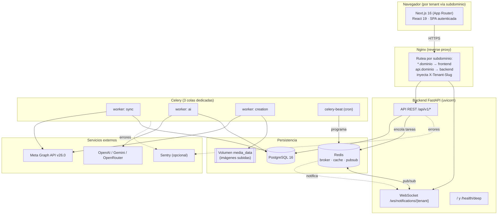
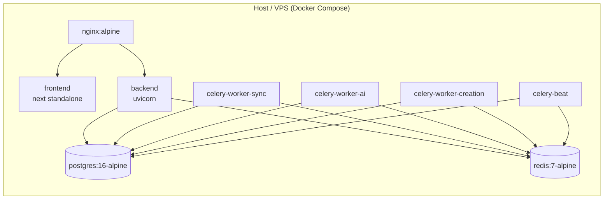
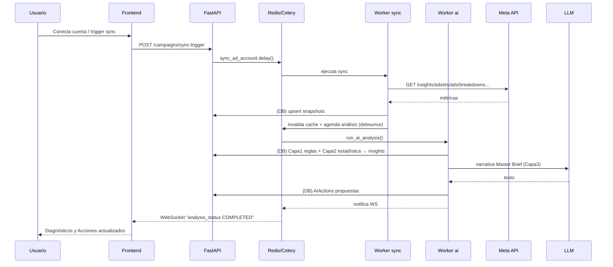

# 01 · Arquitectura General

## 1. Propósito del sistema

LejoVista es una plataforma **SaaS multi-tenant** que automatiza el ciclo de análisis y optimización de campañas de Meta Ads. El sistema:

1. **Conecta** cuentas publicitarias de Meta por organización (tenant).
2. **Sincroniza** métricas diarias (campañas, adsets, anuncios, breakdowns, inventario de creativos/audiencias/páginas, histórico mensual de gasto) desde la Graph API.
3. **Analiza** esos datos con un motor de IA en 3 capas (reglas deterministas → estadística → narrativa LLM).
4. **Propone acciones** de optimización con niveles de riesgo y las mantiene en un flujo `PROPOSED → APPROVED/REJECTED → EXECUTING → COMPLETED/FAILED`.
5. **Ejecuta** las acciones aprobadas contra Meta (con backups y rollback), o **crea campañas nuevas** mediante una Saga por pasos.
6. **Aprende** de los resultados reales de las campañas que la propia IA creó (outcome loop).
7. **Reporta**: Master Brief narrativo, reportes estructurados en pantalla y PDF, medición de consumo de tokens de IA.

## 2. Principios de diseño observados en el código

- **Human-in-the-loop por defecto.** Las escrituras reales a Meta están triple-gateadas: `MOCK_SERVICES`, `ENABLE_META_WRITEBACK` y `WRITEBACK_ACCOUNT_ALLOWLIST`. Las campañas se crean siempre `PAUSED`; la activación es manual. Ver [09-seguridad](09-seguridad.md).
- **La IA nunca inventa cifras (regla `AI-1`).** Todo número que se muestra o se usa para decidir sale de datos reales agregados en la base de datos. El LLM solo redacta texto (copy, narrativa) sobre cifras ya calculadas de forma determinista.
- **Determinismo antes que LLM.** El sugeridor de campañas, el clasificador (`classify_campaign`), el CPL objetivo (`compute_target_cpl`), el riesgo y las políticas son código puro; el LLM es una capa opcional con fallback local que nunca rompe el flujo.
- **Aislamiento estricto por tenant y por cuenta.** Cada consulta filtra por `organization_id` y, cuando aplica, por la cuenta activa resuelta en `get_active_ad_account_id`.
- **Resiliencia de la integración externa.** Rate limiting basado en cabeceras de Meta, paginación por cursor, reintentos con backoff, clasificación de errores transitorios vs permanentes, y degradación a modo mock.
- **Fail-open en los limitadores.** Redis (cooldowns, rate limits, cache de reportes, revocación de tokens, pubsub) degrada de forma segura: si no responde, la app sigue funcionando.

## 3. Componentes del sistema

### Rol de cada componente

| Componente | Responsabilidad | Referencia |
|-----------|-----------------|-----------|
| **Frontend (Next.js)** | SPA autenticada por tenant; consume la API REST y el WebSocket; selector de cuenta activa; formularios de creación de campañas y reportes | [04-frontend](04-frontend.md) |
| **Nginx** | Reverse proxy; enrutamiento multi-tenant por subdominio; inyecta `X-Tenant-Slug`; TLS en prod | [14-deployment](14-deployment.md) |
| **Backend FastAPI** | API REST síncrona/async, auth JWT, WebSocket, healthchecks; encola trabajo pesado en Celery | [03-backend](03-backend.md) |
| **Celery worker `sync`** | Sincronización con Meta (lecturas); concurrency 2 | [19-sincronizacion-meta](19-sincronizacion-meta.md) |
| **Celery worker `ai`** | Motor de análisis, ejecución de acciones aprobadas, outcome loop; concurrency 1 | [18-motor-ia](18-motor-ia.md) |
| **Celery worker `creation`** | Saga de creación de campañas (5 pasos) + cola `celery` (mantenimiento); concurrency 1 | [20-creacion-campanas](20-creacion-campanas.md) |
| **Celery Beat** | Cron: sync diario 06:00, análisis 07:00, outcomes 08:00, archivado semanal domingo 03:00 (hora Lima) | [12-flujos](12-flujos.md) |
| **PostgreSQL** | Fuente de verdad: tenants, cuentas, snapshots, insights, acciones, drafts, aprendizaje, tokens | [05-base-de-datos](05-base-de-datos.md) |
| **Redis** | Broker y backend de Celery, cache de reportes, cooldowns/rate-limits, blocklist de JWT, Pub/Sub para WebSocket | [11-servicios-externos](11-servicios-externos.md) |

## 4. Vista de despliegue

- **Una sola imagen de backend** se reutiliza para el API, los 3 workers y beat; solo cambia el `command`. Esto simplifica el build/deploy (ver [14-deployment](14-deployment.md)).
- El frontend usa `output: "standalone"` de Next.js → imagen mínima (~250 MB).
- Las variables `NEXT_PUBLIC_*` se **inlinean en build time** (importante al migrar de dominio).

## 5. Flujo de datos de extremo a extremo (resumen)

Detalle de cada flujo (sync, análisis, aprobación, creación, reporte) en [12-flujos](12-flujos.md).

## 6. Modelo multi-tenant

- **Tenant = `Organization`** (identificada por `slug` en el subdominio y por `id` UUID).
- Un usuario pertenece a N organizaciones vía `OrganizationUser` (rol `ADMIN`/`OPERATOR`/`VIEWER`).
- La **organización activa** de la sesión se resuelve en cada request (claim `org` del JWT o header `X-Tenant-Slug`) y se valida que el usuario pertenezca a ella (`get_current_user`, `S-8`).
- Una organización puede tener **varias cuentas publicitarias**; la **cuenta activa** se resuelve con `X-Ad-Account-Id` (`get_active_ad_account_id`) para no mezclar datos entre cuentas.

Detalle en [08-autenticacion](08-autenticacion.md) y [09-seguridad](09-seguridad.md).

## 7. Decisiones arquitectónicas destacadas

- **Snapshots diarios idempotentes** como modelo de datos analítico (una fila por cuenta/entidad/día), en vez de un data warehouse. Ver [05-base-de-datos](05-base-de-datos.md).
- **Colas Celery dedicadas** (`sync`/`ai`/`creation`) para que un pico de syncs no bloquee la ejecución de acciones ni la creación de campañas (hallazgo `I-2`).
- **Saga por pasos con Celery `chain`** para crear campañas (imagen → campaña → adset → creativo → anuncio), con `countdown=40s` entre pasos (anti-bloqueo de Meta) y callback de error.
- **Auto-selección de proveedor LLM** según qué API key esté configurada, con un cliente OpenAI-compatible unificado.

Racional completo en [16-decisiones-arquitectonicas](16-decisiones-arquitectonicas.md).
