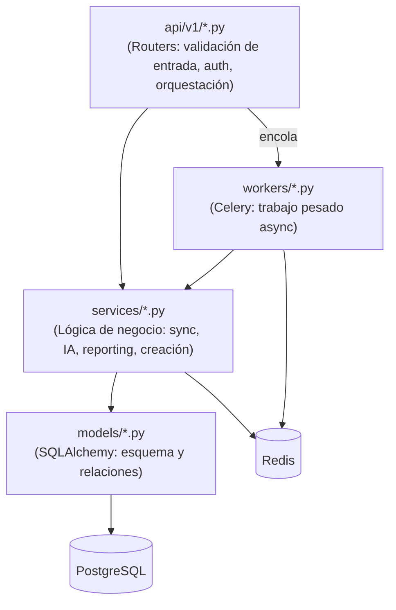

# 03 · Backend

## 1. Stack y dependencias

Definidas en `backend/requirements.txt`:

| Categoría | Paquetes | Uso |
|-----------|----------|-----|
| Web | `fastapi`, `uvicorn`, `python-multipart` | API async, subida de archivos |
| ORM/DB | `sqlalchemy>=2.0`, `asyncpg`, `alembic`, `aiosqlite` | ORM async, migraciones, SQLite en tests |
| Validación | `pydantic>=2`, `pydantic-settings`, `email-validator` | Schemas, settings |
| Async tasks | `celery>=5.3`, `redis>=5.0` | Workers, broker, pubsub |
| Seguridad | `pyjwt[crypto]`, `bcrypt==3.2.2`, `passlib[bcrypt]`, `cryptography` (Fernet) | JWT, hashing, cifrado de tokens |
| HTTP cliente | `httpx` | Llamadas a Meta y LLMs |
| IA | `google-genai` | (dependencia declarada; el cliente LLM usa endpoints OpenAI-compatibles vía `httpx`) |
| Reporting | `jinja2`, `weasyprint>=62.3` | PDF server-side |
| Observabilidad | `sentry-sdk` | Captura de errores (opcional) |
| Testing | `pytest`, `pytest-asyncio`, `pytest-mock` | Tests async |

Python **3.11** (fijado en el `Dockerfile`).

## 2. Punto de entrada (`app/main.py`)

- Configura **logging estructurado** (`%(asctime)s %(levelname)s [%(name)s] %(message)s`) con nivel desde `LOG_LEVEL`.
- Inicializa **Sentry** solo si hay `SENTRY_DSN` (import guardado, `traces_sample_rate=0.1`).
- **Lifespan** (`asynccontextmanager`):
  - Si `AUTO_CREATE_TABLES=true` → `Base.metadata.create_all` (solo dev/test). En prod, el esquema lo gestiona Alembic.
  - Lanza `redis_listener()` como tarea de fondo (Pub/Sub → WebSocket).
- **CORS**: orígenes fijos (`localhost:3000`, `localhost`, `lrojas.dev`) + regex configurable, y `TUNNEL_ORIGIN_REGEX` opcional para túneles.
- **Middleware `tenant_slug_middleware`**: registra el `X-Tenant-Slug` que inyecta Nginx (solo logging).
- Registra los routers bajo `/api/v1` (excepto el WebSocket, que vive en `/ws/`).
- Configura `docs_url`/`redoc_url`/`openapi_url` condicionados a `ENABLE_API_DOCS`.

### Healthchecks

| Endpoint | Auth | Qué comprueba |
|----------|------|---------------|
| `GET /` | No | Liveness: `{status, mock_mode, base_domain}` |
| `GET /health/deep` | No | Salud del **pipeline** (`D-2`): busca el último `SyncJob COMPLETED`; si no hubo sync exitoso en 24 h devuelve `status: "degraded"` (el Beat/worker de sync está caído). Sin auth a propósito (solo expone un timestamp global). |

## 3. Capas y responsabilidades

- **Routers** (`api/v1/`): definen endpoints, resuelven dependencias (`get_current_user`, `get_active_ad_account_id`, `get_db`), validan con Pydantic y delegan en servicios o encolan tareas Celery. No contienen lógica de negocio pesada.
- **Servicios** (`services/`): el núcleo. Cada uno recibe una `AsyncSession` (o un limiter) y encapsula un dominio. Son reutilizables desde routers y workers.
- **Modelos** (`models/`): declarativos con `Mapped[...]`; contienen algo de comportamiento (cifrado de tokens en `MetaCredential`/`AdAccount`, `organization_id` activo en `User`). Ver [07-modelos](07-modelos.md).
- **Workers** (`workers/`): tareas Celery que ejecutan corrutinas vía `run_async` (un event loop limpio por tarea).

## 4. Base de datos y sesiones (`app/database.py`)

- Engine **async** (`create_async_engine`) con `pool_size=10, max_overflow=20`.
- `async_sessionmaker` con `expire_on_commit=False`, `autoflush=False`.
- **Dependencia `get_db`**: abre sesión, hace `commit` al salir, `rollback` ante excepción, `close` en `finally`. Es el patrón de commit implícito para los endpoints de lectura/escritura simples.
- En workers y en canales laterales (token tracking, notificaciones, rate limiter) se abre una sesión propia con `async_session()` para no acoplar el ciclo de vida.

## 5. Patrones de diseño recurrentes

- **Repository/Service ligero**: no hay una capa Repository formal; los servicios consultan directamente con SQLAlchemy `select(...)`.
- **Upsert idempotente** en el sync: se busca por clave natural `(ad_account_id, entidad_id, date)` y se actualiza o inserta. Protegido por `UniqueConstraint`.
- **Saga (orquestación por pasos)** con `celery.chain(...).on_error(...)` para crear campañas. Cada paso persiste su avance en `CampaignDraft.payload["result"]`. Ver [20](20-creacion-campanas.md).
- **Debounce con lock Redis** (`SET NX EX`) para no disparar N² análisis cuando una org con N cuentas termina de sincronizar (`D-1`).
- **Cache-aside** para el `ReportBuilder` (`report_cache.py`), con invalidación explícita tras cada sync.
- **Feature-flag gating** para escrituras a Meta (`settings.simulate_meta_writes_for(...)`).
- **Fail-open** en todos los usos de Redis (throttle, revocación de JWT, cache, pubsub).
- **Clasificación de errores** (`meta_ads/exceptions.py`): `TransientMetaError` (reintentable con backoff) vs `PermanentMetaError`.

## 6. Middlewares, interceptores y validaciones

- **Middleware HTTP** único (`tenant_slug_middleware`) — informativo.
- **Dependencias de FastAPI** como interceptores efectivos:
  - `get_current_user` — valida JWT, resuelve org activa, valida pertenencia (`S-8`).
  - `get_active_ad_account_id` — resuelve/valida la cuenta publicitaria activa.
  - `enforce_cooldown` / `enforce_rate_limit` — throttling (Redis, fail-open).
- **Validación de entrada** con Pydantic v2 (`schemas/`), más validaciones de negocio en `CampaignValidator` (regex de nombres, límites de caracteres de Meta, estado de cuenta contra Meta).

## 7. Gestión de errores

- **HTTP**: `HTTPException` con `status_code` y `detail` (string u objeto estructurado, ej. `MULTIPLE_AD_ACCOUNTS_NO_SELECTION`).
- **Sync/creación**: excepciones clasificadas → Celery reintenta (`autoretry_for=(TransientMetaError,)`, backoff exponencial con jitter) o marca fallo permanente.
- **Ejecución de acciones**: `AIExecutor` marca `FAILED` y, si hay `backup_state`, intenta **rollback automático**.
- **Saga**: `task_handle_chain_error` marca el `CampaignDraft` (y la `AIAction` si aplica) como `FAILED` con el mensaje real, y notifica por WebSocket.
- **Canales laterales** (token tracking, notificaciones): tragan cualquier excepción y solo la registran — medir/notificar nunca debe tumbar la funcionalidad medida.

## 8. Logging y observabilidad

- Loggers namespaced: `lejovista.main`, `lejovista.sync`, `lejovista.ai_engine`, `lejovista.llm`, `lejovista.planner`, `lejovista.executor`, `lejovista.security`, `lejovista.throttle`, `lejovista.tokens`, `lejovista.outcome`, `lejovista.archiver`, `lejovista.report_cache`, `celery.task`, etc.
- **Auditoría persistida**:
  - `APICallLog` — cada llamada HTTP a Meta (endpoint, método, status, preview; el `access_token` se enmascara).
  - `ActionLog` — eventos de negocio (`AuditLogService`).
  - `AITokenUsage` — consumo de tokens por funcionalidad.
- Sentry captura excepciones en API y workers si está configurado (`D-2`).

## 9. Workers Celery (`app/workers/`)

Ver detalle en [12-flujos](12-flujos.md) y [18-motor-ia](18-motor-ia.md). Puntos clave:

- **App** (`celery_app.py`): broker/result = Redis; `timezone="America/Lima"`; serializador JSON.
- **Colas dedicadas** (`task_routes`): `sync`, `ai`, `creation`, `celery` (mantenimiento). Cada worker atiende una cola con concurrency distinta (`I-2`).
- **Beat schedule**:
  - `daily-incremental-sync` — 06:00, `schedule_all_syncs("INCREMENTAL")`.
  - `daily-ai-analysis` — 07:00, `schedule_all_analyses`.
  - `daily-campaign-outcomes` — 08:00, `evaluate_campaign_outcomes`.
  - `weekly-snapshot-archival` — domingo 03:00, `archive_old_snapshots_task`.
- **Escalonado con jitter** (`countdown=random(0, 1800)`) al hacer fan-out para no saturar el rate limit de Meta.
- **`run_async`**: ejecuta cada corrutina en un event loop nuevo con `asyncio.run` y hace `engine.dispose()` al terminar (evita reutilizar conexiones asyncpg ligadas a un loop cerrado).

## 10. Cómo añadir un endpoint (guía rápida)

1. Definir el schema Pydantic en `app/schemas/`.
2. Crear la función en el router correspondiente de `app/api/v1/`, con dependencias `get_current_user` y (si es por cuenta) `get_active_ad_account_id`.
3. Filtrar **siempre** por `current_user.organization_id` (y cuenta activa) — es el contrato de aislamiento.
4. Delegar la lógica en un servicio de `app/services/`; para trabajo pesado, encolar en Celery en vez de bloquear el request.
5. Si el cambio toca el esquema, generar una migración Alembic (ver [05](05-base-de-datos.md)).
6. Actualizar el tipo espejo en `frontend/lib/types.ts` y el cliente en `frontend/lib/api.ts`.
