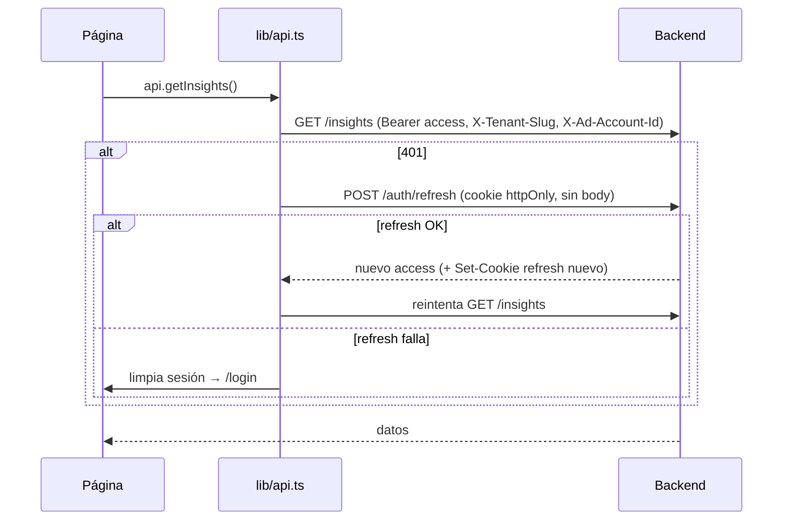

# 04 · Frontend

## 1. Stack

Definido en `frontend/package.json`:

| Área | Tecnología |
|------|-----------|
| Framework | **Next.js 16.2.9** (App Router, `output: "standalone"`) |
| UI | **React 19.2**, componentes de servidor y de cliente |
| Lenguaje | TypeScript 5 |
| Gráficos | **Recharts 3** |
| Markdown | `react-markdown` + `remark-gfm` (render de la narrativa del Master Brief) |
| Estilos | CSS global (`app/globals.css`) con tokens/variables; **sin** framework de UI (no Tailwind, no MUI) |
| Testing | Jest 30 + Testing Library + `jest-environment-jsdom` |

> `AGENTS.md` advierte que esta versión de Next.js puede diferir de versiones previas; consultar `node_modules/next/dist/docs/` antes de tocar convenciones.

## 2. Estructura de rutas (App Router)

```
app/
├── layout.tsx                # Root: fuentes (Inter, JetBrains Mono), metadata, <html lang="es">
├── landing/page.tsx          # Landing pública (sin auth)
├── (auth)/login/page.tsx     # Login + signup
└── (dashboard)/              # Grupo de rutas autenticadas
    ├── layout.tsx            # Guard de auth + sidebar + providers
    ├── page.tsx              # "Resumen" (KPIs 7d, gráficos, ranking)
    ├── campaigns/
    │   ├── page.tsx          # Listado de campañas (estado real de Meta)
    │   ├── [id]/page.tsx     # Detalle + historial (gráfico)
    │   ├── new/page.tsx      # Creación asistida por IA (622 líneas)
    │   └── learning/page.tsx # Historial de entrenamiento de la IA
    ├── reporte/page.tsx      # Master Brief + descarga PDF + comparativa 7/30/90d
    ├── diagnostics/page.tsx  # Insights de IA (Capa 1 y 2)
    ├── actions/page.tsx      # Acciones sugeridas (aprobar/rechazar)
    ├── ai-usage/page.tsx     # Consumo de tokens por funcionalidad
    └── settings/page.tsx     # Org, cuentas, páginas/WhatsApp, rubro, modelo IA
```

- Los **grupos de rutas** `(auth)` y `(dashboard)` no afectan la URL; separan layouts.
- Casi todas las páginas del dashboard son **client components** (`"use client"`) porque dependen de `localStorage` (token) y de estado interactivo.

## 3. Autenticación en el cliente (S-2)

- El **access token** vive en una variable de módulo dentro de `lib/api.ts` (`getAccessToken`/`hasAccessToken`) — nunca en `localStorage`. El **refresh token** es una cookie `httpOnly` que el backend fija; el frontend nunca la lee ni la maneja directamente, solo llama a `/auth/refresh` con `credentials: "include"` y el navegador la adjunta solo. Solo `user` (no sensible) sigue en `localStorage`.
- **Login/signup** (`(auth)/login/page.tsx`) navegan al dashboard con el `router` de Next (`router.push("/")`), **no** `window.location` — una recarga completa destruiría el access token recién obtenido en memoria antes de que el dashboard llegue a usarlo.
- El **guard** vive en `(dashboard)/layout.tsx`: si ya hay un access token en memoria (se acaba de loguear, misma pestaña), lo confirma con `GET /auth/me`; si no (recarga de página, pestaña nueva), intenta renovar la sesión con `api.bootstrapSession()` (`POST /auth/refresh` vía la cookie). Sin sesión válida en ningún caso, `safeRedirect("/login")` (`window.location.replace` — aquí sí es correcto, es una salida, no hay estado en memoria que preservar).
- El cliente API (`lib/api.ts`) adjunta `Authorization: Bearer <access>` y, ante un `401`, intenta **un** refresh antes de expulsar al usuario y limpiar la sesión.



> Limitación conocida en desarrollo local con subdominios `*.localhost` (Chrome no las trata como el mismo "site"): ver [08-autenticacion](08-autenticacion.md).

## 4. Cliente API (`lib/api.ts`)

- `apiRequest<T>()` centraliza `fetch`: base URL resuelta por `getApiUrl()`, headers de auth, tenant y cuenta activa, parseo de errores (`detail` string u objeto).
- Headers automáticos (solo en navegador):
  - `X-Tenant-Slug` — derivado del subdominio con `getTenantSlugFromHostname` (solo si el hostname termina en `BASE_DOMAIN`).
  - `X-Ad-Account-Id` — leído de `localStorage["active_ad_account_id"]`, cuyo **único escritor** es `AdAccountProvider`.
- Funciones especializadas que no pueden reusar `apiRequest`:
  - `apiUploadRequest` — subida multipart (el navegador fija el boundary).
  - `downloadReportPdf` — descarga el blob del PDF con los mismos headers.
- El objeto `api` expone métodos tipados (`login`, `getRecentCampaigns`, `getInsights`, `getPendingActions`, `approveAction`, `getBriefData`, `getKpisSummary`, `getAiUsage`, `createCampaign`, `getCampaignSuggestion`, `previewCampaignRisk`, …).

## 5. Resolución de entorno (`lib/config.ts`)

Tres modos de despliegue soportados:

| Modo | `getApiUrl()` | Tenant slug |
|------|---------------|-------------|
| **Local (2 subdominios)** | `http://localhost:8000` | subdominio de `*.localhost` |
| **Producción (2 subdominios)** | `https://api.<BASE_DOMAIN>` | subdominio de `<BASE_DOMAIN>` |
| **Single-host (túnel)** | `""` (origen relativo; Nginx rutea `/api` y `/ws`) | `null` |

- `SINGLE_HOST_MODE` (`NEXT_PUBLIC_SINGLE_HOST_MODE`) activa el modo túnel.
- `getTenantSlugFromHostname` es defensivo: solo devuelve slug si el hostname realmente termina en `BASE_DOMAIN` (evita mandar `X-Tenant-Slug` falso desde `*.ngrok-free.app`, que causaba 403).
- **Las `NEXT_PUBLIC_*` se inlinean en build** (ver `Dockerfile` y `build-push.sh`): cambiar de dominio requiere reconstruir la imagen.

## 6. Middleware (`middleware.ts`)

- Extrae el subdominio del `Host` y lo inyecta como header `x-tenant-slug` para Server Components.
- Reescribe la raíz sin subdominio (`/`) hacia `/landing`.
- Excluye assets estáticos y `/api`.

## 7. Providers de contexto (`components/providers/`)

### `AdAccountProvider`
- Carga las cuentas de la org (`api.getAdAccounts()`).
- Resuelve la **cuenta activa**: la guardada (`active_ad_account_<orgId>`) si sigue existiendo, o la única si solo hay una, o ninguna (fuerza selección).
- Escribe la clave fija `active_ad_account_id` que `lib/api.ts` lee de forma síncrona para el header `X-Ad-Account-Id`.
- El **selector** en el sidebar solo aparece si hay 2+ cuentas; al cambiar, recarga la página.

### `WebSocketProvider`
- Abre `ws(s)://.../ws/notifications/<tenantId>?token=<JWT>`.
- Reconexión automática cada 3 s; expone `lastEvent` e `isConnected` por contexto.
- Las páginas escuchan `lastEvent` para refrescar (ej. `analysis_status`, `sync_status`, `campaign_creation`).

## 8. Estilo y accesibilidad

- Tema oscuro con tokens CSS (`--color-obsidian`, `--color-paper`, `--color-ash`, `--color-graphite`, `--text-secondary`, …) en `globals.css`.
- **Accesibilidad** (`E-6`): los badges no dependen solo del color — `lib/badge.ts` añade un ícono redundante (`✓ ⚠ ✕ ✦`).
- Distinción explícita entre **estado real de Meta** (`metaStatusBadge`: Activa/Pausada/Archivada/Eliminada) y **evaluación de rendimiento** de la IA (GANADORA/CARA/…), que antes se confundían en la columna "Estado".

## 9. Tipos compartidos (`lib/types.ts`) — generados desde OpenAPI (M-4)

(M-4, resuelto) Ya no es un espejo manual. `frontend/lib/generated-api-types.ts` se genera con `npm run generate-types` (usa `openapi-typescript` contra `GET /openapi.json` del backend corriendo — configurable con `BACKEND_URL`) y contiene el schema completo, tal como lo declara el backend. `frontend/lib/types.ts` es una capa fina de **alias** sobre ese archivo (`export type CampaignSnapshot = components["schemas"]["CampaignSnapshotResponse"]`, etc.) — mantiene los nombres cortos que ya usan `lib/api.ts` y las páginas, sin que el resto del código tenga que cambiar.

- Para que esto fuera posible, **todos** los endpoints que devolvían un dict plano sin schema (`ReportBuilder`, `kpi_period`, `ai_usage`, `learning-history`, `api-call-history`, `ai-models`, políticas de negocio, sugerencia de campaña, y las respuestas simples `{"message": ...}`) ganaron un `response_model` Pydantic nuevo en `app/schemas/response_schemas.py` — antes solo `frontend/lib/types.ts` documentaba esas formas, ahora `GET /openapi.json` también las expone correctamente.
- **Regenerar**: con el backend corriendo, `npm run generate-types` (frontend). Si el backend cambia una forma de respuesta, el tipo se actualiza solo — ya no hay que editar `types.ts` a mano.
- Los campos de tipo `Dict[str, Any]` (payload de campañas, targeting de adsets, execution_result de acciones) siguen siendo JSON libre por diseño (no tienen una forma fija que declarar) — generan `{[key: string]: unknown}` en TS; el código que los consume hace un cast local puntual (`as Record<string, any>` o una forma mínima esperada) donde necesita leer un campo específico.
- `AIAction.reject_reason`/`rejected_at` (UX-2, resuelto): el backend ya los guardaba pero `AIActionResponse` no los exponía — el historial de acciones (`/actions`) ya tenía el JSX listo para mostrarlos (`Razón: {act.reject_reason}`), solo esperaba el dato.

## 10. Testing del frontend

`frontend/__tests__/` (Jest + Testing Library, jsdom): `login.test.tsx`, `page.test.tsx`, `diagnostics.test.tsx`, `learning.test.tsx`. Configuración en `jest.config.ts` + `jest.setup.ts`. Ver [13-testing](13-testing.md).
