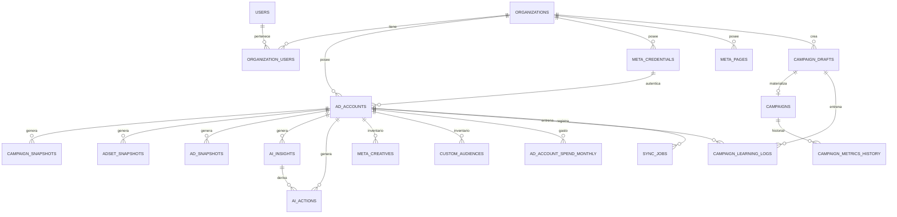

# 05 · Base de Datos

## 1. Motor y acceso

- **PostgreSQL 16** (`postgres:16-alpine`).
- Acceso **async** vía SQLAlchemy 2.0 + `asyncpg` (`postgresql+asyncpg://…`).
- En **tests** se usa SQLite async (`aiosqlite`) con `NullPool` (ver `conftest.py`).
- Compatibilidad de dialecto: `SyncJob.payload_json` usa `JSON().with_variant(JSONB, "postgresql")` — JSONB en prod, JSON genérico en SQLite.

## 2. Modelo de datos: enfoque de "snapshots diarios"

El corazón analítico del sistema son **snapshots idempotentes**: una fila por entidad y día. En vez de un data warehouse, cada sync hace *upsert* por clave natural `(ad_account_id, entidad_id, date)`.

- `campaign_snapshots` — métricas diarias por campaña + breakdowns (placement, edad, género, dispositivo, región).
- `adset_snapshots` — métricas diarias por adset + `targeting_summary` + presupuesto (clave para cuentas ABO).
- `ad_snapshots` — métricas diarias por anuncio + copy real del creativo (título/cuerpo/CTA).
- `ad_account_spend_monthly` — gasto total por mes calendario (sin desglose), con backfill único.

Las tablas calientes crecen sin límite, por eso existe el **archivado** (ver §6).

## 3. Esquema completo (tablas)

| Tabla | Propósito | Claves / constraints notables |
|-------|-----------|-------------------------------|
| `organizations` | Tenant | `slug` único indexado |
| `users` | Usuario global | `email` único indexado |
| `organization_users` | N:M usuario↔org con `role` | FKs CASCADE |
| `ad_accounts` | Cuenta publicitaria conectada | `uq_org_platform_acc`; narrativa cacheada + metadatos |
| `meta_credentials` | Token de Meta cifrado (Fernet) | `token_expires_at`, `status` |
| `meta_pages` | Página FB + WhatsApp + IG actor | `uq_org_meta_page` |
| `campaigns` | Campaña "real" (vinculada a draft) | `external_campaign_id` único |
| `campaign_drafts` | Estado de la Saga de creación | `payload` JSON con `result` incremental |
| `campaign_snapshots` | Métrica diaria por campaña | `uq_snapshot_acc_campaign_date` + 2 índices |
| `adset_snapshots` | Métrica diaria por adset | `uq_adset_snapshot_acc_adset_date` |
| `ad_snapshots` | Métrica diaria por anuncio | `uq_ad_snapshot_acc_ad_date` |
| `campaign_metrics_history` | Historial simple por campaña real | `uq_campaign_date` |
| `ai_insights` | Hallazgos de Capa 1/2 | índices por account/campaign/org |
| `ai_actions` | Acciones propuestas/ejecutadas | ciclo de vida en `status` |
| `sync_jobs` | Registro de cada sync | `payload_json` (JSONB) = Master Brief |
| `api_call_logs` | Auditoría HTTP a Meta | token enmascarado |
| `action_logs` | Auditoría de eventos de negocio | por org + timestamp |
| `meta_creatives` | Inventario de imágenes (adimages) | `uq_creative_acc_hash` |
| `custom_audiences` | Audiencias personalizadas | `uq_audience_acc_external` |
| `ai_token_usage` | Consumo de tokens por llamada LLM | por org/cuenta/feature |
| `campaign_learning_logs` | Entrenamiento de la IA (creación) | `status`, `outcome_json` |
| `ad_account_spend_monthly` | Gasto mensual | `uq_ad_account_year_month`, `closed` |
| `campaign_snapshots_archive` | Archivo (D-3) | sin FKs, índice por acc+date |
| `adset_snapshots_archive` | Archivo (D-3) | sin FKs |
| `ad_snapshots_archive` | Archivo (D-3) | sin FKs |

Detalle campo a campo de cada modelo en [07-modelos](07-modelos.md).

## 4. Diagrama entidad-relación (principal)



> Nota: los `*_snapshots` referencian `campaign_id`/`adset_id`/`ad_id` como **IDs externos de Meta** (no FKs a `campaigns`), porque el sync trae entidades que pueden no existir como filas `Campaign` locales.

## 5. Índices y rendimiento

Índices pensados para las consultas dominantes:

- `campaign_snapshots`:
  - `idx_snapshot_org_date (organization_id, date)`
  - `idx_snapshot_acc_date (ad_account_id, date)` — query dominante del `AIEngine`/`ReportBuilder` (`WHERE ad_account_id AND date >= X`).
  - `uq_snapshot_acc_campaign_date` — idempotencia del sync.
- `adset_snapshots` / `ad_snapshots`: `idx_*_acc_date` + unique por entidad/día.
- Tablas de archivo: `idx_*_archive_acc_date` (lectura ocasional por rango).
- Índices por FK (`organization_id`, `ad_account_id`, `campaign_id`) en insights, acciones, tokens, etc.

**Optimizaciones observadas** (hallazgo `B-2`): agregaciones como el CPL objetivo o el `budget_map` del planner se hacen en SQL (`func.sum`) o se acotan a los últimos 30 días para no cargar historiales completos a Python.

## 6. Archivado de datos (`D-3`)

`snapshot_archiver.py` (Beat semanal, domingo 03:00) mueve las filas con `date` anterior a `SNAPSHOT_RETENTION_DAYS` (default **180**) desde las tablas calientes a las `*_archive`:

- Las tablas de archivo **no tienen FKs** (sobreviven al borrado del tenant) ni índices únicos (no necesitan idempotencia).
- Se eligió archivado periódico en vez de particionado nativo de Postgres para no migrar PKs/constraints de tablas ya en producción.
- El proceso es resiliente: si una tabla falla, se continúa con las demás.

## 7. Migraciones (Alembic)

- Configuración **async** (`alembic/env.py` usa `async_engine_from_config` + `NullPool`); `target_metadata = Base.metadata`; URL tomada de `settings.DATABASE_URL`.
- En **producción**: `AUTO_CREATE_TABLES=false` y el esquema se gestiona con `alembic upgrade head`. `create_all` solo en dev/test.

### Cadena de migraciones (orden lineal)

```
f7ffe513f0fb  initial_schema_session_1        (base)
  → a70ab36472b6  add_payload_json_to_sync_jobs
  → c3d1e5a9f7b2  snapshot_unique_and_index
  → d5f2b1c8a3e4  narrative_meta_and_fk_ondelete
  → e6a4c2f1b9d3  snapshot_extra_breakdowns
  → f1b7d9c4e2a6  reporting_tables_p2
  → b3e8f4a1c9d7  narrative_provider
  → c4d9e2b6f3a1  snapshot_archive_tables
  → a1b2c3d4e5f6  adset_snapshot_budget
  → e1a2b3c4d5f6  meta_page_whatsapp
  → f2b3c4d5e6a7  ad_snapshot_creative_copy
  → a3b8c1d4e7f2  ai_token_usage
  → b4c9d2e5f8a3  campaign_learning_logs
  → c8d3e5f1a9b4  ad_account_spend_monthly
  → d2f6a8c3b1e7  organization_industry
  → a4f8c2d6e9b1  drop_tenant_api_quotas  (head)
```

Cada migración cuenta la evolución del producto: breakdowns extra, tablas de reporting P-2, archivado, presupuesto de adset (cuentas ABO), WhatsApp por página, copy de creativos, medición de tokens, aprendizaje, gasto mensual, rubro de negocio y, la más reciente, la limpieza de `tenant_api_quotas` (M-1 — tabla huérfana del cliente Meta viejo que nunca tuvo un lector/escritor real).

### Crear una migración

```bash
docker compose exec backend alembic revision --autogenerate -m "descripcion"
docker compose exec backend alembic upgrade head
```

> Buenas prácticas presentes como skills del repo (`sqlalchemy-alembic-expert-*`): índices concurrentes, evitar cambios de tipo bloqueantes, separar FKs/constraints en pasos. Revisar antes de migrar tablas grandes en producción.

## 8. Cifrado en reposo

`meta_credentials.access_token_encrypted` se guarda cifrado con **Fernet** (`ENCRYPTION_KEY`). El token nunca se persiste ni se loguea en claro (`APICallLog` lo enmascara como `***`). Ver [09-seguridad](09-seguridad.md).
