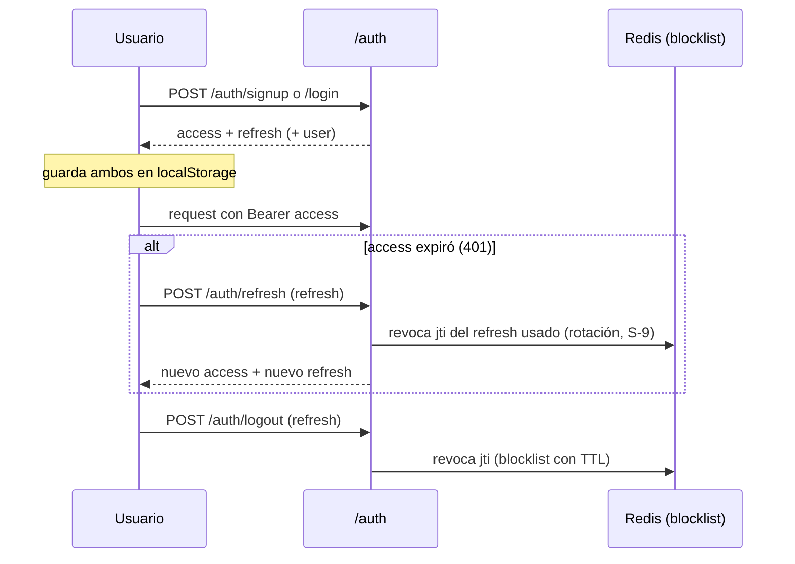

# 08 · Autenticación y Autorización

Implementada en `app/utils/security.py`, `app/api/v1/auth.py` y consumida como dependencias de FastAPI.

## 1. Esquema general

- **JWT** firmados con `SECRET_KEY` (algoritmo `HS256`).
- Dos tipos de token: **access** (default 1440 min = 24 h) y **refresh** (default 10080 min = 7 días), configurables con `ACCESS_TOKEN_EXPIRE_MINUTES` / `REFRESH_TOKEN_EXPIRE_MINUTES`.
- Contraseñas hasheadas con **bcrypt** vía `passlib` (`CryptContext(schemes=["bcrypt"])`).
- Claims del token: `sub` (user id), `type` (`access`/`refresh`), `jti` (UUID, para revocación), `exp`, y opcional `org` (organización activa de la sesión).

## 2. Flujo de sesión

- **Signup** (`/auth/signup`): valida slug reservado y unicidad de email/slug; crea `Organization` (si no existe) + `User` + `OrganizationUser(ADMIN)`. Rate-limit 5/hora por IP.
- **Login** (`/auth/login`): verifica password; emite tokens con la primera organización como activa. Rate-limit 10/5min por IP.
- **Refresh** (`/auth/refresh`): valida `type=="refresh"` y que el `jti` no esté revocado; **rota** (revoca el usado, emite nuevo par) — mitiga reuso de tokens robados.
- **Logout** (`/auth/logout`): revoca el `jti` del refresh (los access caducan solos).

## 3. Revocación (blocklist en Redis)

- `revoke_jti(jti, ttl)` → `SET revoked:{jti} 1 EX ttl`.
- `is_revoked(jti)` → lectura. **Fail-open**: si Redis no responde, no bloquea (se prioriza disponibilidad sobre revocación estricta).
- Los **access tokens no se revocan** activamente; se confía en su expiración corta relativa. La blocklist aplica a los refresh.

## 4. Dependencia `get_current_user`

Es el interceptor de autorización principal:

1. Decodifica el JWT del header `Authorization` (`oauth2_scheme`, `auto_error=False`).
2. Carga el `User` con sus `organizations` (`selectinload`).
3. Resuelve la **organización activa** (`S-8`):
   - Si viene `X-Tenant-Slug`: busca la org por slug y **exige** que el usuario pertenezca (403 si no).
   - Si no: usa el claim `org` del token si el usuario pertenece a esa org.
   - Fija `user._active_org_id`, que alimenta la propiedad `User.organization_id`.

Esto garantiza que un usuario con acceso a varias organizaciones no pueda operar sobre una a la que no pertenece, aunque manipule el subdominio.

## 5. Dependencia `get_active_ad_account_id`

Resuelve la **cuenta publicitaria** de la request (aislamiento multi-cuenta dentro de una org):

- Con header `X-Ad-Account-Id`: valida que la cuenta pertenezca a la org y no esté archivada (403 si no).
- Sin header: `None` si la org tiene 0 cuentas; auto-selecciona si tiene exactamente 1; **400 `MULTIPLE_AD_ACCOUNTS_NO_SELECTION`** si tiene 2+ (obliga a elegir explícitamente en vez de "la primera" en silencio).

## 6. Autorización WebSocket

`/ws/notifications/{tenant_id}` (`app/api/v1/ws.py`):

- El handshake exige `?token=<JWT>`. `_authenticate_ws` decodifica el token, carga el usuario y comprueba que `tenant_id` (= `organization_id`) esté entre sus organizaciones.
- Si falla, cierra con código `4401` (violación de política) sin aceptar la conexión.

## 7. Roles

- `OrganizationUser.role`: `ADMIN`, `OPERATOR`, `VIEWER`.
- El rol se **expone** (en `/auth/me` y el JWT de sesión enriquecido) pero **no se aplican políticas de autorización por rol** en los endpoints hoy: cualquier miembro autenticado de la org puede operar. Ver [15-deuda-tecnica](15-deuda-tecnica.md) (RBAC pendiente).

## 8. Token temporal (in-memory)

`create_temp_token` / `consume_temp_token` mantienen tokens efímeros en un dict en memoria del proceso. No se observan usos activos en los routers; es un mecanismo latente (no sobrevive a reinicios ni funciona con múltiples réplicas). Ver [15](15-deuda-tecnica.md).

## 9. Superficie de credenciales

- El **token de Meta** nunca es una credencial de sesión del usuario; se cifra en `MetaCredential` y se usa solo server-side. Ver [09-seguridad](09-seguridad.md).
- El frontend guarda `token`/`refresh_token` en `localStorage` (no cookies httpOnly) — implicaciones de XSS descritas en [09](09-seguridad.md).
