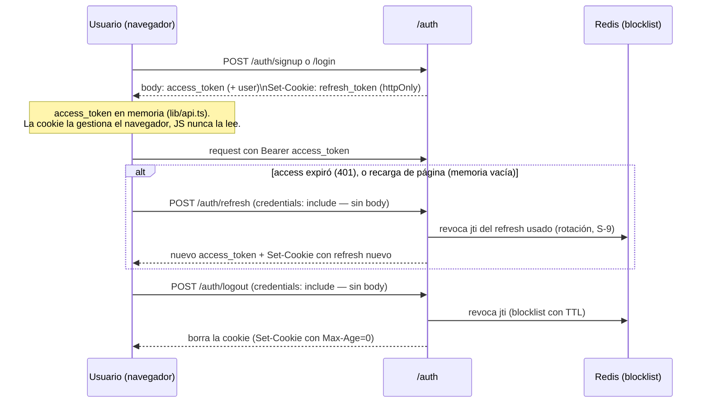

# 08 · Autenticación y Autorización

Implementada en `app/utils/security.py`, `app/api/v1/auth.py` y consumida como dependencias de FastAPI.

## 1. Esquema general

- **JWT** firmados con `SECRET_KEY` (algoritmo `HS256`).
- Dos tipos de token: **access** (default 1440 min = 24 h) y **refresh** (default 10080 min = 7 días), configurables con `ACCESS_TOKEN_EXPIRE_MINUTES` / `REFRESH_TOKEN_EXPIRE_MINUTES`.
- Contraseñas hasheadas con **bcrypt** vía `passlib` (`CryptContext(schemes=["bcrypt"])`).
- Claims del token: `sub` (user id), `type` (`access`/`refresh`), `jti` (UUID, para revocación), `exp`, y opcional `org` (organización activa de la sesión).

## 2. Flujo de sesión

(S-2) El **access token** viaja en el cuerpo JSON y vive **en memoria** del módulo `frontend/lib/api.ts` — nunca en `localStorage`. El **refresh token** nunca aparece en el cuerpo JSON: viaja **solo como cookie `httpOnly`** que el navegador adjunta automáticamente. Ninguno de los dos es alcanzable desde JavaScript ante una vulnerabilidad XSS de la forma en que `localStorage` lo era.

- **Signup** (`/auth/signup`): valida slug reservado y unicidad de email; **funda una organización nueva** (`Organization` + `User` + `OrganizationUser(ADMIN)`). Rate-limit 5/hora por IP. (S-1) Si el slug ya pertenece a una organización existente, devuelve 400 — no existe flujo de invitación, así que unirse a una org por slug ya no es posible desde signup: antes, cualquiera que conociera/adivinara el slug de un tenant ajeno (visible en el subdominio) podía registrarse contra él y quedaba vinculado como **ADMIN** de esa organización sin verificación alguna.
- **Login** (`/auth/login`): verifica password; emite tokens con la primera organización como activa. Rate-limit 10/5min por IP.
- **Refresh** (`/auth/refresh`): lee el refresh de `request.cookies` (no de un body — nada que enviar, el navegador ya lo adjuntó); valida `type=="refresh"` y que el `jti` no esté revocado; **rota** (revoca el usado, emite nuevo par, fija cookie nueva) — mitiga reuso de tokens robados. 401 si no hay cookie.
- **Logout** (`/auth/logout`): revoca el `jti` del refresh leído de la cookie y la borra (los access caducan solos, no se revocan activamente).

### Cookie del refresh (`set_refresh_cookie`, `app/utils/security.py`)

| Atributo | Valor | Por qué |
|---|---|---|
| `HttpOnly` | siempre | Inalcanzable desde JS — el objetivo central de S-2. |
| `Path` | `/api/v1/auth` | El navegador no la envía a endpoints que no la necesitan. |
| `Max-Age` | `REFRESH_TOKEN_EXPIRE_MINUTES * 60` | Espejo del claim `exp` del JWT. |
| `Secure` | `true` si la request llegó por HTTPS (directo o vía `X-Forwarded-Proto`, que Nginx ya reenvía) | En local (HTTP plano) sería descartada por el navegador si fuera `true` siempre. |
| `Domain` | el host base (`BASE_DOMAIN`) **solo si** el `Host` de la request pertenece a ese esquema de subdominios; si no (túnel/single-host, hostname ajeno a `BASE_DOMAIN`), se omite y la cookie queda scoped al host exacto | Fijar un `Domain` que no coincide con el host visto hace que el navegador **rechace la cookie entera** — crítico para no romper el modo túnel. |
| `SameSite` | `Lax` | Cruza de `<slug>.BASE_DOMAIN` (frontend) a `api.BASE_DOMAIN` (backend) sigue siendo "same-site" (mismo eTLD+1) en un dominio real; `Lax` alcanza. |

> **Limitación conocida de desarrollo local** (modo "2 subdominios" con `*.localhost`): Chrome no trata `cliente1.localhost` y `localhost` como el mismo "site" para efectos de `SameSite` (a diferencia de un dominio real como `lrojas.dev`, donde todos los subdominios sí comparten sitio). Esto significa que **recargar la página** mientras se navega un tenant vía subdominio local (`cliente1.localhost:3000`) no logra renovar la sesión desde la cookie — el refresh devuelve 401 y se redirige a `/login`, aunque en producción (dominio real) o en modo túnel/single-host (mismo origen) esto funciona correctamente. Verificado en vivo durante la implementación. Workarounds para probar el flujo completo de sesión localmente: usar `http://localhost:3000` sin subdominio, o el modo túnel. Dentro de la misma sesión de navegador (login → navegar → logout, sin recargar), el flujo funciona igual en cualquier modo, porque el access token vive en memoria y no depende de la cookie hasta que se pierde (recarga o pestaña nueva).

## 3. Revocación (blocklist en Redis)

- `revoke_jti(jti, ttl)` → `SET revoked:{jti} 1 EX ttl`. Sigue siendo **best-effort**: si Redis no responde al revocar (logout/rotación), se registra un warning pero no se falla la request — el token queda sin revocar hasta su expiración natural.
- `is_revoked(jti)` → lectura. (S-3) **Fail-closed**: si Redis no responde, no se puede afirmar que el token NO esté revocado, así que se levanta `RevocationCheckUnavailable` y `POST /auth/refresh` responde **503** (no 401 — no es que el token sea inválido, es que no se pudo verificar) en vez de aceptar la renovación a ciegas. Es el único punto de la blocklist con este trade-off; el resto de mecanismos basados en Redis (rate limiting, cooldown, cache) siguen fail-open a propósito.
- Los **access tokens no se revocan** activamente; se confía en su expiración corta relativa. La blocklist aplica a los refresh.

## 4. Dependencia `get_current_user`

Es el interceptor de autorización principal:

1. Decodifica el JWT del header `Authorization` (`oauth2_scheme`, `auto_error=False`).
2. Carga el `User` con sus `organizations` (`selectinload`).
3. Resuelve la **organización activa** (`S-8`):
   - Si viene `X-Tenant-Slug`: busca la org por slug y **exige** que el usuario pertenezca (403 si no).
   - Si no: usa el claim `org` del token si el usuario pertenece a esa org.
   - Fija `user._active_org_id`, que alimenta la propiedad `User.organization_id`.

Esto garantiza que un usuario con acceso a varias organizaciones no pueda operar sobre una a la que no pertenece, aunque manipule el subdominio.

## 5. Dependencia `get_active_ad_account_id`

Resuelve la **cuenta publicitaria** de la request (aislamiento multi-cuenta dentro de una org):

- Con header `X-Ad-Account-Id`: valida que la cuenta pertenezca a la org y no esté archivada (403 si no).
- Sin header: `None` si la org tiene 0 cuentas; auto-selecciona si tiene exactamente 1; **400 `MULTIPLE_AD_ACCOUNTS_NO_SELECTION`** si tiene 2+ (obliga a elegir explícitamente en vez de "la primera" en silencio).

## 6. Autorización WebSocket

`/ws/notifications/{tenant_id}` (`app/api/v1/ws.py`):

- El handshake exige `?token=<JWT>`. `_authenticate_ws` decodifica el token, carga el usuario y comprueba que `tenant_id` (= `organization_id`) esté entre sus organizaciones.
- Si falla, cierra con código `4401` (violación de política) sin aceptar la conexión.

## 7. Roles y autorización — `require_role` (S-1)

- `OrganizationUser.role`: `ADMIN` > `OPERATOR` > `VIEWER` (jerarquía, no categorías independientes). Hoy solo `signup` asigna un rol (siempre `ADMIN`, al fundar la organización) — no existe todavía un flujo de invitación que agregue miembros con `OPERATOR`/`VIEWER`.
- `require_role(min_role)` (`app/utils/security.py`) es una dependencia FastAPI que reconsulta `OrganizationUser.role` en cada request (no queda cacheada en el JWT) para la organización **activa** de la sesión (misma resolución que `get_current_user`, `S-8`) y exige ese rol o uno de rango superior — `403` si no. Sin fila de membresía (dato corrupto/borrado) también deniega, no asume acceso.
- Endpoints protegidos:

  | Rol mínimo | Endpoints |
  |---|---|
  | `ADMIN` | `PUT /organizations/my`, `POST /organizations/my/ad-accounts` (conectar), `.../ad-accounts/{id}/archive`, `.../restore` |
  | `OPERATOR` | `PATCH /organizations/my/pages/{id}/whatsapp`, `POST /campaigns/sync-trigger`, `POST /campaigns/upload-image`, `POST /campaigns/risk-preview`, `POST /campaigns/` (crear), `POST /insights/{id}/dismiss`, `POST /insights/analyze-trigger`, `POST /actions/{id}/approve` |

  El resto de endpoints (lecturas `GET`) no están gateados por rol: cualquier miembro autenticado de la org puede ver dashboard, reportes, insights e historial — el filtro es solo de **escritura**.

## 8. Token temporal (in-memory)

`create_temp_token` / `consume_temp_token` mantienen tokens efímeros en un dict en memoria del proceso. No se observan usos activos en los routers; es un mecanismo latente (no sobrevive a reinicios ni funciona con múltiples réplicas). Ver [15](15-deuda-tecnica.md).

## 9. Superficie de credenciales

- El **token de Meta** nunca es una credencial de sesión del usuario; se cifra en `MetaCredential` y se usa solo server-side. Ver [09-seguridad](09-seguridad.md).
- (S-2, resuelto) El frontend ya **no** guarda ningún token en `localStorage`. El access token vive en memoria (`frontend/lib/api.ts`); el refresh token es una cookie `httpOnly`. Solo `user` (nombre, email, rol, organization_id — no sensible para XSS) sigue en `localStorage`, para mostrar la sesión sin un round-trip extra. Ver [09-seguridad](09-seguridad.md).
