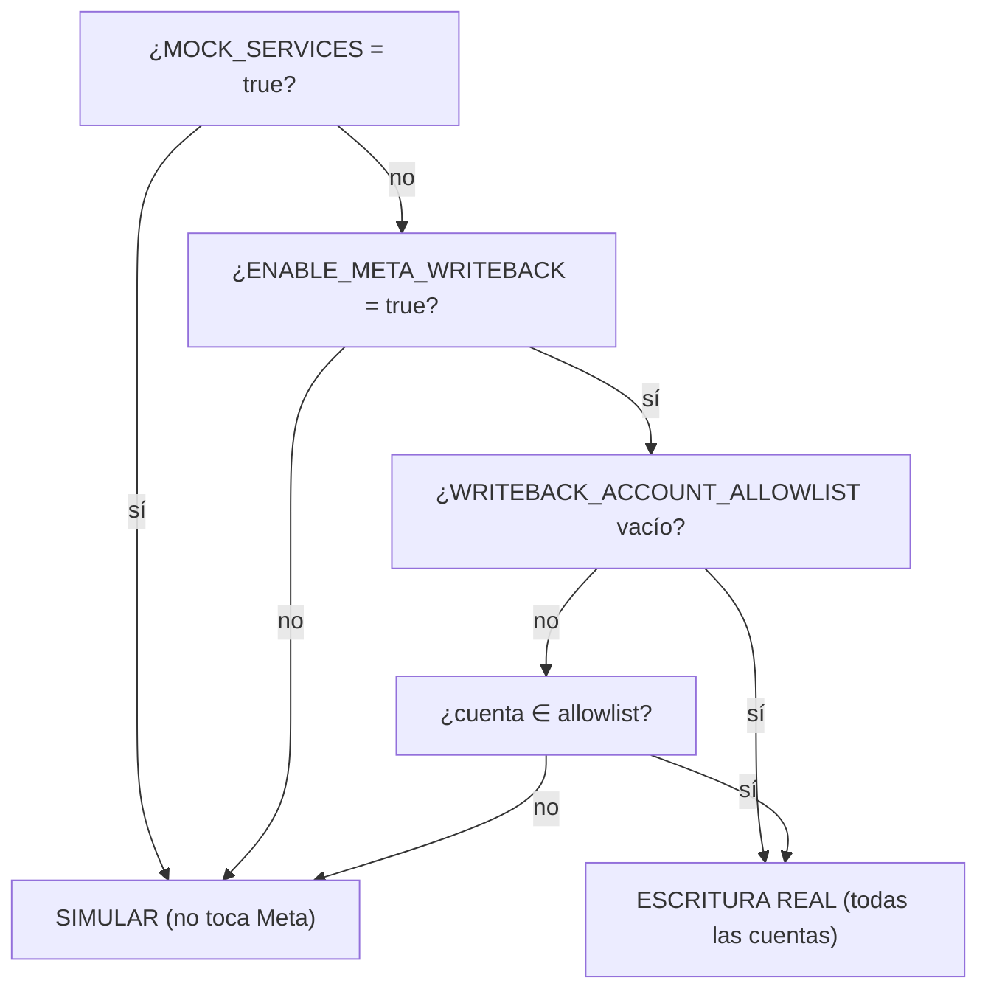

# 09 · Seguridad

Este documento reúne los controles de seguridad **presentes en el código** y sus límites. Ver riesgos priorizados en [15-deuda-tecnica](15-deuda-tecnica.md).

## 1. Modelo de amenazas resumido

El activo más sensible es el **token de acceso a Meta Ads**: permite leer datos y, potencialmente, **gastar dinero real** creando/modificando campañas. El diseño gira en torno a proteger ese token y a evitar escrituras accidentales o cruzadas entre tenants.

## 2. Cifrado de credenciales en reposo

- `MetaCredential.access_token_encrypted` se cifra con **Fernet** (`cryptography`) usando `ENCRYPTION_KEY`.
- Cifrado/descifrado solo en memoria del backend (`get_access_token`).
- En logs, el token se **enmascara** (`APICallLog` reemplaza `access_token` por `***`; el rate limiter y `MetaApiClient` hacen lo mismo).
- `ENCRYPTION_KEY` y `SECRET_KEY` **no** deben committearse (documentado en `.env.example`; el `.env` real está gitignored).

## 3. Gating de escrituras a Meta (defensa en profundidad)

Tres flags independientes controlan si una escritura es real o simulada:

- `settings.SIMULATE_META_WRITES` (global) y `settings.simulate_meta_writes_for(ad_account_id)` (`F-2`, por cuenta piloto).
- Las **lecturas** dependen solo de `MOCK_SERVICES`; las **escrituras** requieren además `ENABLE_META_WRITEBACK` y, si hay allowlist, estar en ella.
- Regla de oro: las campañas se crean siempre `PAUSED` (`TENANT_CAMPAIGN_RULES["default_status"]`); la activación es manual en Ads Manager.
- El resultado de una modificación marca `simulated: true/false` para que el frontend no asuma que se aplicó de verdad (`P-1`).

## 4. Aislamiento multi-tenant

- Cada endpoint filtra por `current_user.organization_id` (organización activa validada, `S-8`).
- `get_active_ad_account_id` valida que la cuenta pertenezca a la org y rechaza cuentas ajenas con 403 **sin distinguir** "no existe" de "es de otra org" (no filtra qué cuentas existen).
- El WebSocket valida pertenencia al tenant antes de aceptar la conexión.
- Los `404` en recursos (insight/acción/draft de otra org) no revelan existencia.

## 5. Reglas de seguridad financiera en modificaciones

En `MetaCampaignModifier`:
- **Presupuesto**: rechaza subir a más del **150%** del actual.
- **Placements**: siempre incluye `facebook_reels` (`required_placements`) y **nunca** posiciones de Instagram.
- **Targeting**: siempre mantiene la región por defecto (Lima, key `2771`).
- **Backup + rollback**: antes de modificar guarda `backup_state`; ante fallo, `AIExecutor` intenta rollback automático. El `backup_state` se **reasigna** (no muta in-place) para que SQLAlchemy lo persista (`A-3`).
- **Anti-bloqueo de creación**: máx. 5 campañas nuevas por org / 24 h (playbook §2), y `countdown=40s` entre pasos de la Saga.

## 6. Rate limiting y throttling

| Mecanismo | Dónde | Propósito |
|-----------|-------|-----------|
| `enforce_rate_limit` (Redis INCR + TTL) | signup 5/h, login 10/5min por IP | Fuerza bruta / spam de registro |
| `enforce_cooldown` (Redis SET NX EX) | sync 60 s, análisis 120 s por org | Evitar spam de operaciones costosas (Meta/LLM) |
| `MetaAPIRateLimiter` | llamadas a Meta | Backoff por `x-business-use-case-usage`, pausas preventivas, reintentos |
| `RateLimiter` (Redis) | `MetaApiClient` | Token bucket + uso reportado por Meta |

Todos los limitadores basados en Redis son **fail-open**. La IP del cliente se toma de `X-Forwarded-For` (primer valor) con fallback al socket — suficiente para limitar, no para autorizar.

## 7. CORS y exposición

- CORS con orígenes fijos + regex (`localhost`, `lrojas.dev`) y `TUNNEL_ORIGIN_REGEX` opcional; `allow_credentials=True`.
- `ENABLE_API_DOCS` debe ponerse en `false` al exponer la app públicamente (los docs revelan el esquema completo sin auth).
- `User-Agent` honesto que identifica la app ante Meta (cumplimiento de Platform Terms); **no** se falsifica un navegador ni se simula comportamiento humano.

## 8. Manejo de tokens de Meta expirados

- `_maybe_mark_expired` detecta `OAuthException code 190` y marca cuenta + credencial como `EXPIRED` (`S-6`), para que el frontend pida reconectar.
- `MetaCredentialService.get_valid_token` rechaza tokens expirados y los marca.

## 9. Validación de subida de archivos

`POST /campaigns/upload-image`: whitelist de tipos (`image/jpeg|png|webp`), límite 8 MB, nombre generado con UUID, guardado en `MEDIA_ROOT/{org_id}/`. `MetaAssetRepository` valida con `os.path.realpath` que la ruta no escape de `MEDIA_ROOT` (anti path-traversal).

## 9b. RBAC (S-1) — resuelto

`require_role(min_role)` (ver [08-autenticacion §7](08-autenticacion.md)) protege todos los endpoints de escritura de organizaciones/cuentas, campañas, insights y acciones con la jerarquía `ADMIN > OPERATOR > VIEWER`. Cierra también una escalada de privilegios relacionada: signup ya no permite unirse a una organización existente por slug (antes vinculaba al nuevo usuario como `ADMIN` de esa org sin invitación).

## 10. Límites conocidos (ver detalle en [15](15-deuda-tecnica.md))

- **Tokens en `localStorage`**: expuestos a XSS (no cookies httpOnly).
- **Blocklist de JWT fail-open**: si Redis cae, un refresh revocado podría aceptarse.
- **`X-Forwarded-For` no verificado**: confiable solo detrás del propio Nginx.
- **Prompt injection**: los datos de Meta (nombres de campaña, copy) se inyectan en prompts del LLM; el system prompt mitiga (regla de no inventar cifras) pero no hay sanitización específica anti-inyección.
