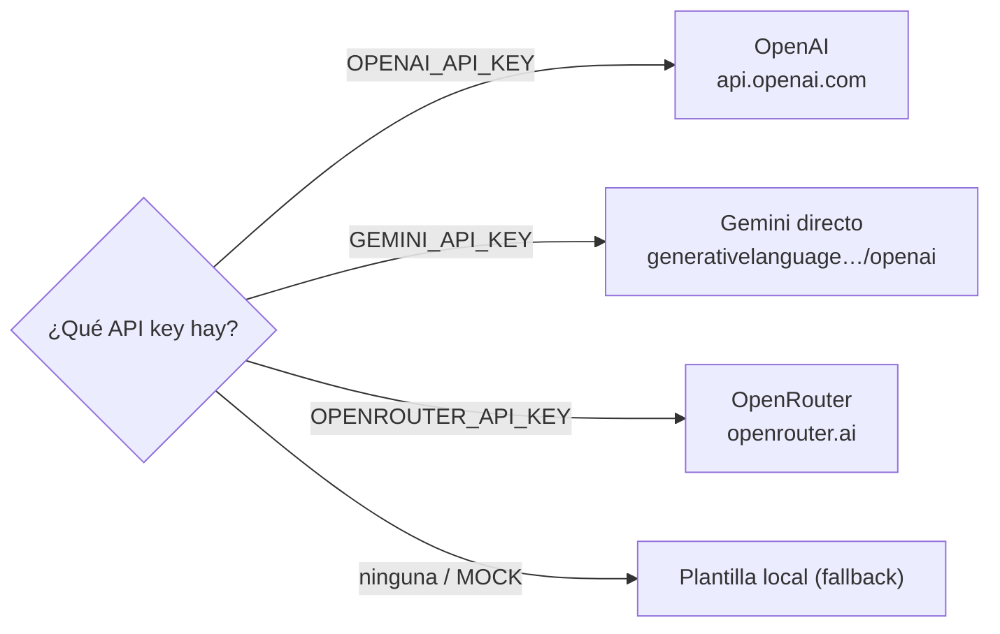

# 11 · Servicios Externos e Integraciones

## 1. Meta Graph / Marketing API

Integración central del producto. Versión configurable (`META_API_VERSION`, default `v25.0`).

### Dos clientes HTTP conviven

| Cliente | Módulo | Uso real hoy |
|---------|--------|--------------|
| **`MetaAPIRateLimiter`** | `services/meta_ads/rate_limiter.py` | **El activo**: sync, modifier, creación, subida de imágenes. Soporta `call_api`, `call_api_paginated`, `call_api_multipart` |
| `MetaApiClient` | `services/meta_api_client.py` | Cliente alternativo con `RateLimiter` Redis y `AuditLogService`. Poco/no usado en el flujo principal (ver [15](15-deuda-tecnica.md)) |

### `MetaAPIRateLimiter` — comportamiento

- **Base URL**: `https://graph.facebook.com/{META_API_VERSION}/{endpoint}`.
- **Gating**: lecturas simuladas si `MOCK_SERVICES`; escrituras si `simulate_meta_writes_for(cuenta)`.
- **Rate limiting adaptativo**: lee la cabecera `x-business-use-case-usage` de Meta y pausa (proporcional al % de uso; espera `estimated_time_to_regain_access` si Meta lo indica).
- **Reintentos**: hasta 2 intentos internos ante `408/429/5xx` con espera de 60 s; errores de red también reintentan.
- **Paginación por cursor** (`call_api_paginated`): sigue `paging.cursors.after` hasta agotar o `max_pages=50`; ante error con datos ya acumulados devuelve parcial (no descarta lo sincronizado). Corrige el bug de traer solo la primera página (~25 filas).
- **Multipart** (`call_api_multipart`): sube imágenes a `/{act}/adimages` con `files=`.
- **Auditoría**: cada llamada se registra en `APICallLog` (token enmascarado).

### Endpoints de Meta consumidos (sync real)
`/{act}` (info de cuenta), `/{act}/campaigns`, `/{act}/insights` (campaign/adset/ad + breakdowns), `/{act}/adsets`, `/{act}/ads`, `/{act}/adimages`, `/{act}/customaudiences`, `/me/accounts` (páginas) y `/{page_id}?fields=whatsapp_number`. En creación: `POST` a `/campaigns`, `/adsets`, `/adcreatives`, `/ads`, `/adimages`. Detalle en [19](19-sincronizacion-meta.md).

### Clasificación de errores
`services/meta_ads/exceptions.py`: por el mensaje, un error se clasifica como `TransientMetaError` (429/5xx/timeout/red → Celery reintenta con backoff) o `PermanentMetaError` (no reintentar).

## 2. Proveedores de LLM

Cliente unificado `OpenRouterClient` (`services/ai/llm.py`) contra endpoints **OpenAI-compatibles**:

- **Prioridad**: OpenAI > Gemini directo > OpenRouter. `provider` se registra con la narrativa/tokens para trazabilidad (`AI-4`).
- **Modelos por proveedor** (`MODELS_BY_PROVIDER`): el selector de Preferencias solo ofrece los del proveedor activo.
- **Dos usos**:
  - `analyze_campaigns` → narrativa del Master Brief (`temperature=0.2`, prompt `master-brief-v2`, contrato de 5 secciones).
  - `suggest_campaign_copy` → copy de campaña (`temperature=0.7`, prompt `campaign-copy-v2`, `response_format: json_object`, 2 variantes de headline/primary_text con límites de caracteres de Meta).
- **Fallback local determinista**: si `MOCK_SERVICES`, no hay key, o el LLM falla/responde mal, se usa una plantilla local que **nunca inventa cifras** (deriva números de los datos reales) y respeta el mismo contrato. Se marca `used_fallback` para no presentar un template como "Procesado por IA" (`C-4`).
- **Anti-alucinación**: system prompt con "regla inquebrantable" de usar solo cifras provistas y clasificar contra `target_cpl`.
- **Medición**: `record_token_usage` persiste el bloque `usage` en `AITokenUsage` con costo estimado (`MODEL_PRICING`). Canal lateral que nunca rompe la llamada real.

## 3. Redis

Un solo Redis con múltiples roles:

| Rol | Base/Canal | Módulo |
|-----|-----------|--------|
| Broker + result backend de Celery | `/0`, `/1` | `celery_app.py` |
| Cache de reportes (TTL 600 s) | keys `report:{acc}:{window}` | `report_cache.py` |
| Cooldowns / rate limits | keys `cooldown:*`, `ratelimit:*` | `utils/throttle.py` |
| Debounce de análisis | key `analysis_pending:{org}` | `workers/tasks.py` |
| Blocklist de JWT | keys `revoked:{jti}` | `utils/security.py` |
| Rate limit de Meta (uso) | keys `rate_limit:*` | `services/rate_limiter.py` |
| Pub/Sub → WebSocket | canal `ws_notifications` | `notification_service.py`, `ws.py` |

Todos los usos de Redis degradan **fail-open** salvo el broker de Celery (que es requisito duro para los workers).

## 4. Sentry (opcional)

- Se inicializa en `main.py` (API) y `celery_app.py` (workers) solo si hay `SENTRY_DSN` (`traces_sample_rate=0.1`).
- Import guardado: si el paquete no está o falla, se registra un warning y se continúa.
- Motivación (`D-2`): los fallos de sync/IA ocurren en los workers; sin Sentry nadie se entera hasta que el cliente reclama.

## 5. WhatsApp / páginas de Facebook

No hay integración directa con la API de WhatsApp Business. El sistema:
- Descubre páginas del token (`/me/accounts`) y su `whatsapp_number` (`GET /{page_id}?fields=whatsapp_number`, que requiere permiso `whatsapp_business_management`).
- Permite un **fallback manual** del número (`PATCH /pages/{id}/whatsapp`) porque muchos tokens no exponen el campo.
- Las campañas se crean con destino `WHATSAPP` (`promoted_object` con `page_id` + `whatsapp_phone_number`).
