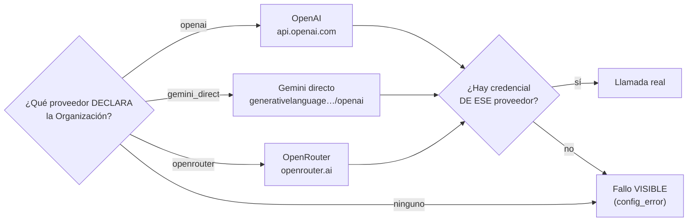

# 11 · Servicios Externos e Integraciones

## 1. Meta Graph / Marketing API

Integración central del producto. Versión configurable (`META_API_VERSION`, default `v26.0`).
La fuente de verdad es `app/services/meta_ads/version.py`; una comprobación de CI
falla si algún otro sitio declara una versión distinta (spec 08).

### Un único cliente HTTP (M-1, resuelto)

Antes convivían dos: `MetaAPIRateLimiter` (el usado de verdad en todo el flujo real) y `MetaApiClient` + `services/rate_limiter.py` + `meta_credential_service.py` (un cliente alternativo sin llamadores vivos en ningún router/servicio ni test). Se confirmó que el segundo grupo no tenía ni un solo import fuera de sí mismo y se eliminó junto con el modelo huérfano `TenantApiQuota` (tabla `tenant_api_quotas`, migración `a4f8c2d6e9b1`). Ver [15-deuda-tecnica §M-1](15-deuda-tecnica.md).

| Cliente | Módulo | Uso real |
|---------|--------|----------|
| **`MetaAPIRateLimiter`** | `services/meta_ads/rate_limiter.py` | El único: sync, modifier, creación, subida de imágenes, validador. Soporta `call_api`, `call_api_paginated`, `call_api_multipart` |

### `MetaAPIRateLimiter` — comportamiento

- **Base URL**: `https://graph.facebook.com/{META_API_VERSION}/{endpoint}`.
- **Gating**: lecturas simuladas si `MOCK_SERVICES`; escrituras si `simulate_meta_writes_for(cuenta)`.
- **Rate limiting adaptativo**: lee la cabecera `x-business-use-case-usage` de Meta y pausa (proporcional al % de uso; espera `estimated_time_to_regain_access` si Meta lo indica).
- **Reintentos**: hasta 2 intentos internos ante `408/429/5xx` con espera de 60 s; errores de red también reintentan.
- **Paginación por cursor** (`call_api_paginated`): sigue `paging.cursors.after` hasta agotar o `max_pages=50`; ante error con datos ya acumulados devuelve parcial (no descarta lo sincronizado). Corrige el bug de traer solo la primera página (~25 filas).
- **Multipart** (`call_api_multipart`): sube imágenes a `/{act}/adimages` con `files=`.
- **Auditoría**: cada llamada se registra en `APICallLog` (token enmascarado).

### Endpoints de Meta consumidos (sync real)
`/{act}` (info de cuenta), `/{act}/campaigns`, `/{act}/insights` (campaign/adset/ad + breakdowns), `/{act}/adsets`, `/{act}/ads`, `/{act}/adimages`, `/{act}/customaudiences`, `/me/accounts` (páginas) y `/{page_id}?fields=whatsapp_number`. En creación: `POST` a `/campaigns`, `/adsets`, `/adcreatives`, `/ads`, `/adimages`. Detalle en [19](19-sincronizacion-meta.md).

### Clasificación de errores
`services/meta_ads/exceptions.py`: por el mensaje, un error se clasifica como `TransientMetaError` (429/5xx/timeout/red → Celery reintenta con backoff) o `PermanentMetaError` (no reintentar).

## 2. Proveedores de LLM

Cliente unificado `OpenRouterClient` (`services/ai/llm.py`) contra endpoints **OpenAI-compatibles**:

- **La elección es explícita, no una deducción** (spec 10, ADR-26). El proveedor sale de `Organization.llm_provider`; las claves de entorno solo aportan la credencial **de ese** proveedor. La cascada `OpenAI > Gemini > OpenRouter` quedó derogada: añadir una clave movía a todas las organizaciones sin clave propia en el siguiente reinicio, con otro modelo y otro precio.
- **Sin la credencial del proveedor declarado no se usa la de otro**: se falla de forma visible y `config_error` dice qué falta.
- **Catálogo de modelos** (`ai_model_catalog`, `services/ai/catalogo.py`): dato administrable con capacidades, precio y estado. El selector solo ofrece los disponibles del proveedor activo; un modelo retirado deja de ofrecerse **sin desplegar código** y señala a quien lo usaba.
- **Techo de consumo**: presupuesto mensual por Organización en USD, con avisos al 70/90 % y bloqueo al 100 % (`services/ai/presupuesto.py`). La clave es del cliente y el gasto se le factura a él.
- **Dos usos**:
  - `analyze_campaigns` → narrativa del Master Brief (`temperature=0.2`, prompt `master-brief-v2`, contrato de 5 secciones).
  - `suggest_campaign_copy` → copy de campaña (`temperature=0.7`, prompt `campaign-copy-v2`, `response_format: json_object`, 2 variantes de headline/primary_text con límites de caracteres de Meta).
- **Fallback local determinista**: si `MOCK_SERVICES`, no hay key, o el LLM falla/responde mal, se usa una plantilla local que **nunca inventa cifras** (deriva números de los datos reales) y respeta el mismo contrato. Se marca `used_fallback` para no presentar un template como "Procesado por IA" (`C-4`).
- **Anti-alucinación**: system prompt con "regla inquebrantable" de usar solo cifras provistas y clasificar contra `target_cpl`.
- **Medición**: `record_token_usage` persiste el bloque `usage` en `AITokenUsage` con proveedor, modelo, **versión de prompt** y costo estimado desde el catálogo. Canal lateral que nunca rompe la llamada real.

## 3. Redis

Un solo Redis con múltiples roles:

| Rol | Base/Canal | Módulo |
|-----|-----------|--------|
| Broker + result backend de Celery | `/0`, `/1` | `celery_app.py` |
| Cache de reportes (TTL 600 s) | keys `report:{acc}:{window}` | `report_cache.py` |
| Cooldowns / rate limits | keys `cooldown:*`, `ratelimit:*` | `utils/throttle.py` |
| Debounce de análisis | key `analysis_pending:{org}` | `workers/tasks.py` |
| Blocklist de JWT | keys `revoked:{jti}` | `utils/security.py` |
| Pub/Sub → WebSocket | canal `ws_notifications` | `notification_service.py`, `ws.py` |

El rate limiting real de Meta (`MetaAPIRateLimiter`) es **puramente en memoria del proceso** — lee la cabecera `x-business-use-case-usage` de cada respuesta y decide su propia pausa, sin persistir estado en Redis. El `services/rate_limiter.py` que sí usaba Redis (keys `rate_limit:*`) era del cliente muerto eliminado en M-1.

Todos los usos de Redis degradan **fail-open**, salvo el broker de Celery (requisito duro para los workers) y la blocklist de JWT para el refresh, que es **fail-closed** (S-3, ver [09-seguridad](09-seguridad.md)).

## 4. Sentry (opcional)

- Se inicializa en `main.py` (API) y `celery_app.py` (workers) solo si hay `SENTRY_DSN` (`traces_sample_rate=0.1`).
- Import guardado: si el paquete no está o falla, se registra un warning y se continúa.
- Motivación (`D-2`): los fallos de sync/IA ocurren en los workers; sin Sentry nadie se entera hasta que el cliente reclama.

## 5. WhatsApp / páginas de Facebook

No hay integración directa con la API de WhatsApp Business. El sistema:
- Descubre páginas del token (`/me/accounts`) y su `whatsapp_number` (`GET /{page_id}?fields=whatsapp_number`, que requiere permiso `whatsapp_business_management`).
- Permite un **fallback manual** del número (`PATCH /pages/{id}/whatsapp`) porque muchos tokens no exponen el campo.
- Las campañas se crean con destino `WHATSAPP` (`promoted_object` con `page_id` + `whatsapp_phone_number`).
