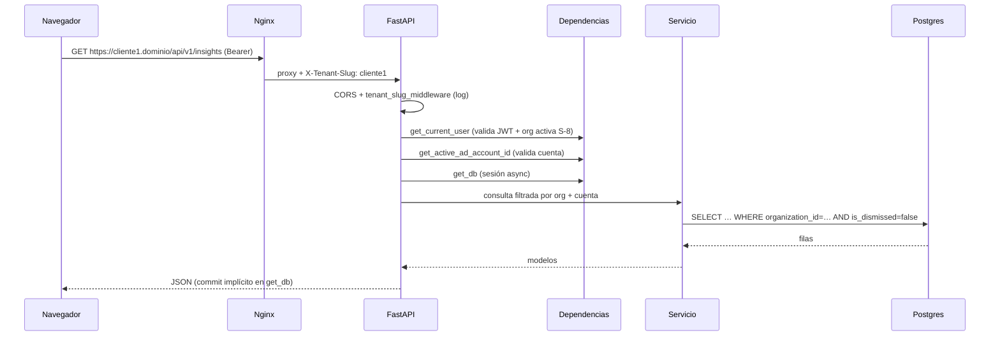
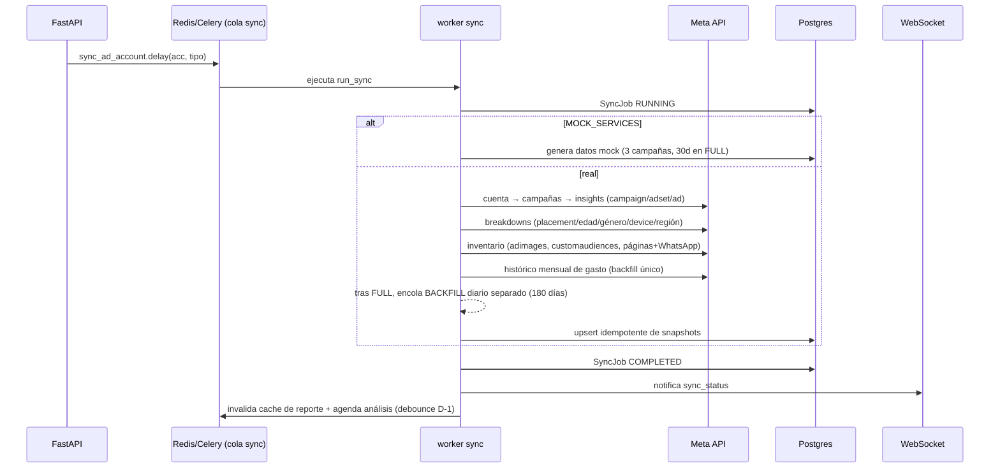
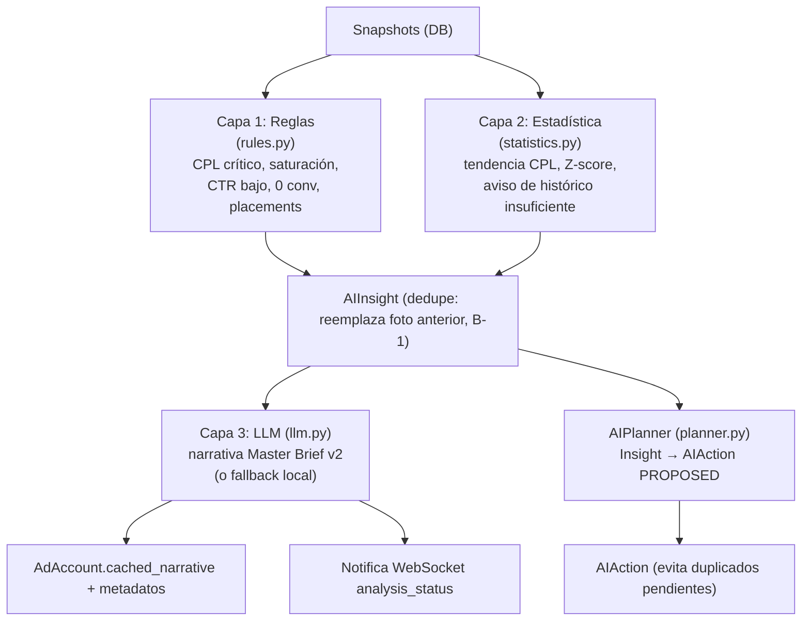
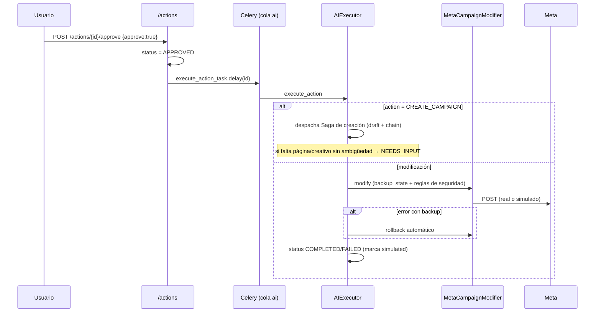
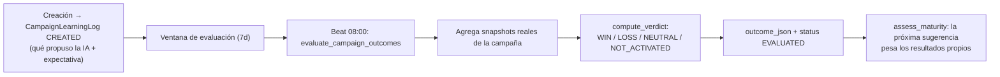
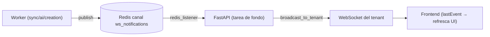

# 12 · Flujos del Sistema

## 1. Ciclo de vida de una petición HTTP

## 2. Sincronización con Meta

Disparadores: conexión de cuenta (`FULL`), trigger manual (`INCREMENTAL`, cooldown 60 s), Beat diario 06:00 (`INCREMENTAL`, escalonado con jitter).

Reintentos automáticos ante `TransientMetaError` (backoff exponencial, `max_retries=5`, `acks_late=True`). Detalle en [19](19-sincronizacion-meta.md).

## 3. Análisis de IA (3 capas)

Disparadores: post-sync con debounce (5 min tras el 1er sync de la org), trigger manual (cooldown 120 s), Beat 07:00.

Detalle de umbrales, planner y contexto enriquecido en [18](18-motor-ia.md).

## 4. Aprobación y ejecución de una acción

## 5. Creación de campaña (Saga)

Ver el flujo completo, con los 5 pasos del `chain` y el manejo de errores, en [20-creacion-campanas](20-creacion-campanas.md).

## 6. Aprendizaje (outcome loop)

Los WIN/LOSS propios influyen en si la IA declara "convergencia" (modo optimizado) o sigue explorando. Detalle en [18](18-motor-ia.md).

## 7. Generación de reportes

- **En pantalla**: `GET /reports/brief-data` → `ReportBuilder` (cacheado en Redis) arma KPIs, ranking, adsets, ads, segmentación, audiencias, creativos, alertas, parámetros óptimos, hallazgos y recomendaciones + narrativa cacheada + comparativa Δ% (7/30/90 días).
- **PDF**: `GET /reports/pdf` → `pdf_report.py` renderiza los **mismos datos** con Jinja2 + WeasyPrint (sin recalcular ni inventar cifras).
- **Dashboard**: `GET /reports/kpis-summary` → resumen liviano (KPIs 7d + Δ%, alertas críticas, último sync).

## 8. Tareas programadas (Celery Beat, hora Lima)

| Hora | Tarea | Efecto |
|------|-------|--------|
| 06:00 diario | `schedule_all_syncs("INCREMENTAL")` | Sync de todas las cuentas activas (escalonado) |
| 07:00 diario | `schedule_all_analyses` | Análisis de todas las orgs activas |
| 08:00 diario | `evaluate_campaign_outcomes` | Cierra el ciclo de aprendizaje |
| Domingo 03:00 | `archive_old_snapshots_task` | Archiva snapshots > 180 días |

## 9. Notificaciones en tiempo real

`NotificationService.notify_job_status` (síncrono, desde Celery) publica; el `redis_listener` (async, en el lifespan de FastAPI) retransmite al `ConnectionManager` que hace broadcast por `tenant_id`.
