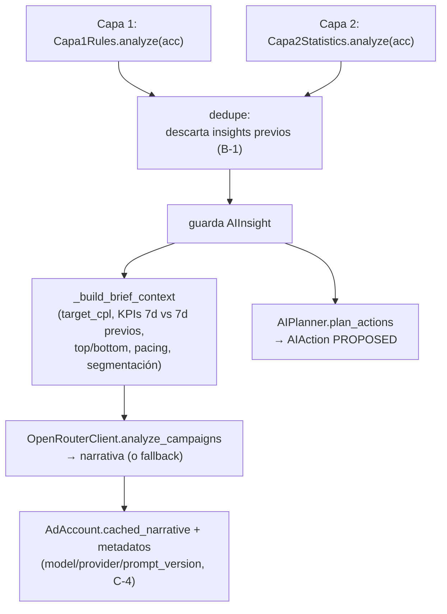

# 18 · Motor de IA

El motor vive en `app/services/ai/` y se orquesta desde `AIEngine.run_analysis`. Combina **tres capas** (reglas deterministas → estadística → narrativa LLM) más un **planner** que traduce insights en acciones, un **executor** que las aplica, y un **ciclo de aprendizaje** que mide resultados reales.

## 1. Orquestación (`engine.py`)

`AIEngine.run_analysis(org_id)` para cada cuenta `ACTIVE` de la organización:

- **Dedupe (`B-1`)**: cada análisis marca `is_dismissed=True` los insights previos no descartados antes de crear los nuevos; evita acumulación tras cada sync + trigger + Beat.
- El contexto del brief (`_build_brief_context`) se deriva de `ReportBuilder` (misma fuente que `/reporte`), no se recalcula.

## 2. Capa 1 — Reglas (`rules.py`)

Reglas fijas sobre datos agregados de 7 días, con umbrales de `AIThresholds`:

| Regla | Condición | Insight | Acción sugerida |
|-------|-----------|---------|-----------------|
| Cuenta inactiva | `status != ACTIVE` | CRITICAL/ACCOUNT | `PAUSE_CAMPAIGN` |
| Spend cap casi agotado | restante < 100 | CRITICAL/ACCOUNT | — |
| CPL crítico | `cpl > target_cpl × 2` | CRITICAL/PERFORMANCE | `PAUSE_CAMPAIGN` |
| Saturación | `frecuencia > 3` | WARNING/SATURATION | `MODIFY_TARGETING` |
| CTR bajo | `impresiones > 200 y ctr < 0.5%` | WARNING/PERFORMANCE | `CREATE_CAMPAIGN` |
| Cero conversiones | `impresiones > 500 y conv == 0` | CRITICAL/PERFORMANCE | `PAUSE_CAMPAIGN` |
| Instagram ineficiente | placement IG con `cpl > 5` | WARNING/PLACEMENT | `MODIFY_PLACEMENTS` |
| Oportunidad en Reels | `cpl_reels < feed_cpl × 0.7` | INFO/PLACEMENT | `MODIFY_PLACEMENTS` |

El `target_cpl` se calcula con `compute_target_cpl` (SQL `SUM(spend)/SUM(conversions)`, acotado a `[1.50, 10.00]`, fallback 3.50).

## 3. Capa 2 — Estadística (`statistics.py`)

Sobre 14-30 días de historia por campaña (mínimo `min_history_days=7`):

- **Tendencia de CPL**: compara ventana reciente (3 días) vs base (14 días); si sube > 30% → WARNING (`MODIFY_BUDGET` a la baja); si baja > 30% → INFO (`MODIFY_BUDGET` al alza).
- **Anomalía (Z-score)**: media/desviación muestral del CPL diario; si el CPL de hoy tiene `z > 2` → CRITICAL (`PAUSE_CAMPAIGN`).
- **Histórico insuficiente (`AI-3`)**: emite un INFO explícito para las campañas sin días suficientes, en vez de callar (ese aviso se filtra antes de mandarlo al LLM).

## 4. Umbrales centralizados (`thresholds.py`)

`AIThresholds` (dataclass frozen) reúne todos los umbrales (multiplicadores de CPL, frecuencia, CTR mínimo, ventanas estadísticas, Z-score, etc.). `get_thresholds_for_org` es el punto de extensión para overrides por organización (hoy devuelve los defaults). Aquí viven también:
- `compute_target_cpl(spend, conv)` — CPL objetivo dinámico.
- `classify_campaign(cost, conv, target_cpl)` — clasificador único (`GANADORA`/`BUENA`/`REGULAR`/`CARA`/`PAUSAR`, relativo a `target_cpl`, `C-2`).

## 5. Capa 3 — LLM (`llm.py`)

- **`analyze_campaigns`**: genera la narrativa del Master Brief (prompt `master-brief-v2`, `temperature=0.2`, contrato de 5 secciones: Resumen / Ganadoras / En alerta / Fallidas / Prioridades). System prompt con "regla inquebrantable" anti-alucinación.
- **`suggest_campaign_copy`**: genera copy de campaña (prompt `campaign-copy-v2`, `temperature=0.7`, `response_format: json_object`, 2 variantes con límites de caracteres de Meta y evitando lenguaje farmacéutico).
- **Fallback local determinista**: si `MOCK_SERVICES`, sin key o error, usa plantillas locales que derivan cifras de datos reales y respetan el mismo contrato; se marca `used_fallback` (`C-4`).
- **Proveedor** auto-seleccionado (OpenAI > Gemini > OpenRouter). Consumo registrado en `AITokenUsage` (`token_tracking.py`).

## 6. Planner (`planner.py`)

`AIPlanner.plan_actions(acc, insights)` convierte cada insight con `suggested_action_type` en una `AIAction` `PROPOSED`, evitando duplicados pendientes.

Puntos clave:
- **Presupuesto real** (`AI-2`): `MODIFY_BUDGET` usa el presupuesto del snapshot más reciente (no valores hardcodeados); +25% para escalar, -30% para recortar. Si no se conoce, no propone a ciegas.
- **Nivel adset** (`AI-2`): `MODIFY_BUDGET`/`MODIFY_PLACEMENTS`/`MODIFY_TARGETING` escriben a nivel de **adset**; solo se proponen si la campaña tiene exactamente 1 adset vigente (sin ambigüedad).
- **Placements reales** (`A-4`): `old_placements` sale del `targeting_summary` real; `new_placements` son `facebook_positions` (no `publisher_platforms`).
- **`CREATE_CAMPAIGN`**: usa `CampaignSuggester` (parámetros deterministas) + copy del LLM; nombre derivado de la marca (`derive_brand_code`); confianza según haya histórico.

## 7. Executor (`executor.py`)

`AIExecutor.execute_action(acc, action)`:
- Valida `status == APPROVED` y org activa; marca `EXECUTING`.
- **`CREATE_CAMPAIGN`** → despacha la **misma Saga** que la creación manual (`A-1`). Si no puede resolver página+WhatsApp o creativo sin ambigüedad, marca `NEEDS_INPUT` (no adivina).
- **Modificaciones** → `MetaCampaignModifier.modify` (backup + reglas de seguridad); ante fallo con backup, **rollback automático**. Marca `simulated` según el gating (`P-1`).

## 8. Aprendizaje (`campaign_learning.py` + `campaign_outcome.py`)

### Razonamiento y madurez (`campaign_learning.py`, deterministas)
- `assess_maturity(campaigns, evaluated_outcomes)`: decide modo **exploración** vs **optimizado**. Exige (a) ≥3 campañas ganadoras con CPL estable (CV ≤ 0.25) **y** (b) ≥2 WIN propios verificados. Dos LOSS propios seguidos fuerzan volver a explorar.
- `build_analysis(...)`: arma el objeto explicable (fortalezas, debilidades, cambios propuestos con su porqué, fallos pasados, track record, ventana de evaluación, confianza) que se muestra antes de crear y se persiste en `CampaignLearningLog`.

### Outcome loop (`campaign_outcome.py`, Beat 08:00)
- `evaluate_pending_outcomes`: para cada `CampaignLearningLog CREATED` cuya ventana venció, resuelve la campaña real (vía `draft.payload.result.campaign_id`), agrega sus snapshots y calcula el veredicto:

| Veredicto | Condición |
|-----------|-----------|
| `WIN` | costo/conv ≤ esperado × 1.2 |
| `LOSS` | 0 conversaciones con gasto, o costo/conv > esperado × 2 |
| `NEUTRAL` | entre medio, o sin expectativa con qué comparar |
| `NOT_ACTIVATED` | Saga falló o sin actividad |

El "costo esperado" = `suggested_budget / 20` (el colchón de ~20 conversaciones que usó el sugeridor). El veredicto retroalimenta la madurez de la próxima sugerencia (Fase 1, `C-1`/`B-3`).

## 9. Medición de consumo (`token_tracking.py`)

- `record_token_usage` persiste el bloque `usage` de la respuesta del LLM en `AITokenUsage`, etiquetado por `feature` (`master_brief`, `campaign_copy`, `campaign_copy_action`).
- `estimate_cost_usd` usa `MODEL_PRICING` (por 1M tokens); si el modelo no está tarifado, deja `None` en vez de mentir un 0.
- Canal lateral: usa su propia sesión de DB y traga excepciones — medir nunca rompe la funcionalidad medida. Expuesto en `GET /ai-usage`.
