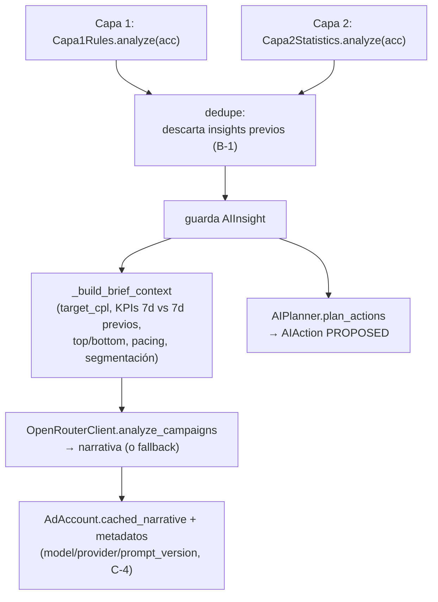

# 18 · Motor de IA

El motor vive en `app/services/ai/` y se orquesta desde `AIEngine.run_analysis`. Combina **tres capas** (reglas deterministas → estadística → narrativa LLM) más un **planner** que traduce insights en acciones, un **executor** que las aplica, y un **ciclo de aprendizaje** que mide resultados reales.

## 1. Orquestación (`engine.py`)

`AIEngine.run_analysis(org_id)` para cada cuenta `ACTIVE` de la organización:



- **Dedupe (`B-1`)**: cada análisis marca `is_dismissed=True` los insights previos no descartados antes de crear los nuevos; evita acumulación tras cada sync + trigger + Beat.
- El contexto del brief (`_build_brief_context`) se deriva de `ReportBuilder` (misma fuente que `/reporte`), no se recalcula.

## 2. Capa 1 — Reglas (`rules.py`)

Reglas fijas sobre datos agregados de 7 días, con umbrales de `AIThresholds`:

| Regla | Condición | Insight | Acción sugerida |
|-------|-----------|---------|-----------------|
| Cuenta inactiva | `status != ACTIVE` | CRITICAL/ACCOUNT | `PAUSE_CAMPAIGN` |
| Spend cap casi agotado | restante < 100 | CRITICAL/ACCOUNT | — |
| CPL crítico | `cpl > target_cpl × 2` | CRITICAL/PERFORMANCE | `PAUSE_CAMPAIGN` |
| Saturación | `frecuencia > 3` | WARNING/SATURATION | `MODIFY_TARGETING` |
| CTR bajo | `impresiones > 200 y ctr < 0.5%` | WARNING/PERFORMANCE | `CREATE_CAMPAIGN` |
| Cero conversiones | `impresiones > 500 y conv == 0` | CRITICAL/PERFORMANCE | `PAUSE_CAMPAIGN` |
| Instagram ineficiente | placement IG con `cpl > 5` | WARNING/PLACEMENT | `MODIFY_PLACEMENTS` |
| Oportunidad en Reels | `cpl_reels < feed_cpl × 0.7` | INFO/PLACEMENT | `MODIFY_PLACEMENTS` |

El `target_cpl` se calcula con `compute_target_cpl` (SQL `SUM(spend)/SUM(conversions)`, acotado a `[1.50, 10.00]`, fallback 3.50).

## 3. Capa 2 — Estadística (`statistics.py`)

Sobre 14-30 días de historia por campaña (mínimo `min_history_days=7`):

- **Tendencia de CPL**: compara ventana reciente (3 días) vs base (14 días); si sube > 30% → WARNING (`MODIFY_BUDGET` a la baja); si baja > 30% → INFO (`MODIFY_BUDGET` al alza).
- **Anomalía (Z-score)**: media/desviación muestral del CPL diario; si el CPL de hoy tiene `z > 2` → CRITICAL (`PAUSE_CAMPAIGN`).
- **Histórico insuficiente (`AI-3`)**: emite un INFO explícito para las campañas sin días suficientes, en vez de callar (ese aviso se filtra antes de mandarlo al LLM).

## 4. Umbrales centralizados (`thresholds.py`)

`AIThresholds` (dataclass frozen) reúne todos los umbrales (multiplicadores de CPL, frecuencia, CTR mínimo, ventanas estadísticas, Z-score, etc.). `get_thresholds_for_org` (M-2, resuelto) lee `Organization.ai_thresholds_overrides` (JSON, vacío por defecto) y superpone solo las claves presentes sobre `DEFAULT_THRESHOLDS` — una org sin overrides se comporta igual que antes. Aquí viven también:
- `compute_target_cpl(spend, conv)` — CPL objetivo dinámico.
- `classify_campaign(cost, conv, target_cpl)` — clasificador único (`GANADORA`/`BUENA`/`REGULAR`/`CARA`/`PAUSAR`, relativo a `target_cpl`, `C-2`).

## 5. Capa 3 — LLM (`llm.py`)

- **`analyze_campaigns`**: genera la narrativa del Master Brief (prompt `master-brief-v2`, `temperature=0.2`, contrato de 5 secciones: Resumen / Ganadoras / En alerta / Fallidas / Prioridades). System prompt con "regla inquebrantable" anti-alucinación.
- **`suggest_campaign_copy`**: genera copy de campaña (prompt `campaign-copy-v2`, `temperature=0.7`, `response_format: json_object`, 2 variantes con límites de caracteres de Meta y evitando lenguaje farmacéutico).
  - **Multimodal (F6)**: si se pasa `image_path`, la foto subida viaja al modelo como data URI (`content` pasa de string a lista de partes), reescalada a 1024px/JPEG — una foto de celular en base64 se cobra por tokens de imagen sin aportar detalle. Antes el redactor escribía a ciegas y podía describir algo que la imagen contradecía. Sin imagen el payload queda **idéntico** al anterior, y si la foto no se puede leer se degrada a texto en vez de fallar. `image_path` se valida contra `MEDIA_ROOT` y contra la organización: llega del cliente y termina leyendo del disco.
  - **Diagnósticos (F6)**: recibe el `analysis` del `CampaignSuggester` (fortalezas, debilidades, `past_failures`, `track_record`) — el mismo que ya se le mostraba al usuario, pero no al redactor. Se interpola con `_delimit_untrusted` como el resto del contexto no confiable.
  - La regla AI-1 no cambia: el LLM sigue redactando **solo texto**; las cifras las decide `CampaignSuggester`.
- **Fallback local determinista**: si `MOCK_SERVICES`, sin key o error, usa plantillas locales que derivan cifras de datos reales y respetan el mismo contrato; se marca `used_fallback` (`C-4`).
- **Proveedor**: EXPLÍCITO por Organización desde la spec 10 (ver §10). La cascada `OpenAI > Gemini > OpenRouter` quedó derogada. Consumo registrado en `AITokenUsage` (`token_tracking.py`), ahora con `prompt_version`.

## 6. Planner (`planner.py`)

`AIPlanner.plan_actions(acc, insights)` convierte cada insight con `suggested_action_type` en una `AIAction` `PROPOSED`, evitando duplicados pendientes.

Puntos clave:
- **Presupuesto real** (`AI-2`): `MODIFY_BUDGET` usa el presupuesto del snapshot más reciente (no valores hardcodeados); +25% para escalar, -30% para recortar. Si no se conoce, no propone a ciegas.
- **Nivel adset** (`AI-2`): `MODIFY_BUDGET`/`MODIFY_PLACEMENTS`/`MODIFY_TARGETING` escriben a nivel de **adset**; solo se proponen si la campaña tiene exactamente 1 adset vigente (sin ambigüedad).
- **Placements reales** (`A-4`): `old_placements` sale del `targeting_summary` real; `new_placements` son `facebook_positions` (no `publisher_platforms`).
- **`CREATE_CAMPAIGN`**: usa `CampaignSuggester` (parámetros deterministas) + copy del LLM; nombre derivado de la marca (`derive_brand_code`); confianza según haya histórico.

## 7. Executor (`executor.py`)

`AIExecutor.execute_action(acc, action)`:
- Valida `status == APPROVED` y org activa; marca `EXECUTING`.
- **`CREATE_CAMPAIGN`** → despacha la **misma Saga** que la creación manual (`A-1`). Si no puede resolver página+WhatsApp o creativo sin ambigüedad, marca `NEEDS_INPUT` (no adivina).
- **Modificaciones** → `MetaCampaignModifier.modify` (backup + reglas de seguridad); ante fallo con backup, **rollback automático**. Marca `simulated` según el gating (`P-1`).

## 8. Aprendizaje (`campaign_learning.py` + `campaign_outcome.py`)

### Razonamiento y madurez (`campaign_learning.py`, deterministas)
- `assess_maturity(campaigns, evaluated_outcomes)`: decide modo **exploración** vs **optimizado**. Exige (a) ≥3 campañas ganadoras con CPL estable (CV ≤ 0.25) **y** (b) ≥2 WIN propios verificados. Dos LOSS propios seguidos fuerzan volver a explorar.
- `build_analysis(...)`: arma el objeto explicable (fortalezas, debilidades, cambios propuestos con su porqué, fallos pasados, track record, ventana de evaluación, confianza) que se muestra antes de crear y se persiste en `CampaignLearningLog`.

### Outcome loop (`campaign_outcome.py`, Beat 08:00)
- `evaluate_pending_outcomes`: para cada `CampaignLearningLog CREATED` cuya ventana venció, resuelve la campaña real (vía `draft.payload.result.campaign_id`), agrega sus snapshots y calcula el veredicto:

| Veredicto | Condición |
|-----------|-----------|
| `WIN` | costo/conv ≤ esperado × 1.2 |
| `LOSS` | 0 conversaciones con gasto, o costo/conv > esperado × 2 |
| `NEUTRAL` | entre medio, o sin expectativa con qué comparar |
| `NOT_ACTIVATED` | Saga falló o sin actividad |

El "costo esperado" = `suggested_budget / 20` (el colchón de ~20 conversaciones que usó el sugeridor).

### Qué cambia cada veredicto (el eslabón cerrado)

Hasta este cambio el ciclo **medía y recordaba, pero no adaptaba**: los veredictos solo alimentaban texto explicativo y el `mode` se calculaba, se mostraba… y ningún código ramificaba sobre él (la IA proponía lo mismo con 5 WIN que con 5 LOSS). `CampaignSuggester._own_evaluated_outcomes` devuelve ahora pares `{params, outcome}` — hacían falta ambos lados para replicar lo que ganó y señalar lo que perdió — y los resultados reales cambian la propuesta así:

| Regla | Qué afecta | Cómo |
|-------|-----------|------|
| **R1 · Calibración** | `suggested_budget` | Base = **mediana del `cost_per_conv` real** de las campañas propias evaluadas (WIN + NEUTRAL + LOSS; solo las WIN sería sesgo de supervivencia). Sin resultados propios medibles → fallback a `min(costs)`, el comportamiento anterior. |
| **R2 · Réplica** | `best_device`, `best_age_range`, `excluded_placements` | Al converger, salen del `params_json` del **WIN propio más reciente** en vez de recalcularse del histórico — es lo que el modo optimizado ya prometía en pantalla. Campo a campo, con fallback al calculado. |
| **R3 · Transparencia** | `past_failures` | Los LOSS propios se listan con su configuración y cifras reales. **No se culpa a un parámetro concreto**: un LOSS no dice *cuál* falló, y atribuirlo sobre 2-3 muestras sería inventar causalidad. La corrección la hacen R1 (recalibrar) y R2 (solo se replica lo que ganó). |

**Por qué R1 era condición previa**: con base `min(costs)`, el outcome loop derivaba `expected_cost_per_conv = min(costs)` — el **récord histórico de la cuenta**. Se exigía que cada campaña nueva igualara (±20%) el mejor caso jamás visto; casi ninguna lo logra → veredictos NEUTRAL/LOSS → `own_wins` rara vez llegaba a 2 → **`converged` era prácticamente inalcanzable**. Calibrar con el costo real vuelve la vara realista y hace la convergencia posible.

**Propiedad de despliegue seguro**: una cuenta sin resultados propios evaluados se comporta *exactamente* igual que antes — todos los caminos nuevos caen al fallback.

**Límite real**: el ciclo no da una vuelta completa hasta que alguien **active** las campañas creadas (siguen `PAUSED` por la regla de oro); sin gasto todo veredicto sería `NOT_ACTIVATED`, que `_own_verdicts` ignora correctamente.

Fuera de alcance (anotado): atribuir un LOSS a un parámetro concreto y la variación deliberada de parámetros en exploración — ambos exigen experimentación controlada (A/B con una variable por vez), no inferencia sobre 2-3 muestras.

## 9. Medición de consumo (`token_tracking.py`)

- `record_token_usage` persiste el bloque `usage` de la respuesta del LLM en `AITokenUsage`, etiquetado por `feature` (`master_brief`, `campaign_copy`, `campaign_copy_action`).
- `estimate_cost_usd` toma las tarifas del **catálogo** (`ai/catalogo.py`); `MODEL_PRICING` queda como respaldo en código para el arranque previo a la siembra. Si el modelo no está tarifado deja `None` en vez de mentir un 0 — y `None` importa más desde la spec 10: un cero aportaría gasto invisible a la suma que decide contra el presupuesto.
- `estimated_cost_usd_exact` (`Numeric(12,6)`) es la columna que **decide**; el `Float` se conserva para el panel (expansión, spec 02).
- Canal lateral: usa su propia sesión de DB y traga excepciones — medir nunca rompe la funcionalidad medida. Expuesto en `GET /ai-usage`.

## 10. Gobernanza del LLM (spec 10)

Cuatro mecanismos que acotan qué puede hacer el modelo, con qué y cuánto.

### 10.1 Proveedor y modelo explícitos (`proveedor.py`, `catalogo.py`)

**El proveedor es el que la Organización declara.** La credencial se busca solo
para ese proveedor —primero la suya, si no la global—; si falta, la llamada falla
de forma visible y `config_error` dice qué cargar y dónde. Nunca se usa la
credencial de otro proveedor, ni siquiera cuando es la única disponible.

Lo que había antes eran dos cascadas y las dos cambiaban de proveedor sin que
nadie lo decidiera: una deducía el proveedor por la **forma** de la clave, y la
otra tomaba la primera credencial global del entorno. Añadir `OPENAI_API_KEY`
movía a todas las organizaciones sin clave propia en el siguiente reinicio.

El catálogo (`ai_model_catalog`) es **dato**: capacidades, precio y estado
(`disponible` / `en_retirada` / `retirado`) en una fila. Retirar un modelo lo saca
del selector y **señala** a quien lo usaba, sin reasignarlo — reasignar sería el
mismo cambio silencioso por otra puerta, y el modelo nuevo puede costar un
múltiplo.

Cambios registrados en `ai_config_changes` con actor, momento y valores. La
credencial se registra como el *hecho* de que cambió, nunca su valor.

### 10.2 Guardas de salida (`validacion.py`, `guardas.py`, `contrato.py`)

Una sola función valida toda salida del modelo y registra el descarte con su
motivo. Antes cada camino elegía qué guardas aplicar, así que el camino nuevo no
tenía ninguna.

| Guarda | Qué ataja | Por qué no basta la numérica |
|---|---|---|
| Cuenta ajena | La respuesta habla de otra AdAccount | Los nombres de cuenta son texto: todas las cifras están respaldadas y la conclusión es falsa |
| Periodo cambiado | Otro mes u otra ventana | Un mes se escribe con letras; una ventana de 30 días puede estar respaldada por cualquier otra cifra |
| Promesa de éxito visual | "esta imagen va a funcionar" | No es una cifra |
| Cifras sin respaldo | La guarda de AI-1 de siempre | — |

Cualquiera invalida la salida **completa**: una respuesta parcialmente inventada
no es parcialmente confiable. La única excepción es el enlace, que se limpia.

El **contrato de salida** (`contrato.py`) se declara antes de la llamada: campos,
tipos y catálogos cerrados. Lo que no encaja se descarta — no se corrige ni se
rellena con defaults. Un corrector de "casi encaja" es una elección que nadie
tomó sobre un campo que termina en una campaña con dinero real.

**Modo de registro** (`GROUNDING_MODO_REGISTRO=true`): la guarda anota lo que
descartaría y **no** descarta. Es como se activa el endurecimiento, midiendo el
falso positivo sobre tráfico real. El riesgo no es teórico: un tope mal calibrado
ya dejó al analista contestando plantillas durante días, con los tests en verde.

### 10.3 Presupuesto y límites (`presupuesto.py`, `limites.py`, `compuerta.py`)

La clave del LLM es del **cliente**. Techo mensual por Organización en USD, con
avisos al 70 % y 90 % y bloqueo al 100 %; aritmética en `Decimal` y ventana en la
zona horaria del negocio, igual que la compuerta publicitaria de la spec 02.

El bloqueo **no apaga el producto**: métricas, estados, tablas, clasificador e
informes deterministas siguen funcionando. El cliente pierde el redactor, no el
tablero, y el chat se lo dice.

Vive en `_post_chat`, el punto por el que pasa toda llamada real, para que una
superficie nueva quede cubierta por construcción. `NULL` = sin techo, que es el
estado de toda organización anterior a la spec.

Dos topes independientes: **reintentos** (repetir una llamada, con retroceso) y
**frecuencia** por minuto (volver a empezar). Contra el segundo, el tope de
reintentos no puede nada. Fail-open ante caída de Redis —es un throttle, no
autoriza gasto irreversible— pero con un contador en memoria del proceso que
sigue acotando el caso que importa: un proceso girando en falso.

### 10.4 Origen de la respuesta (`origen.py`)

Tres orígenes donde antes había dos:

- `modelo` — lo redactó el LLM y pasó las guardas.
- `determinista` — lo escribió el código con datos reales. **Legítimo en
  producción**, identificado como tal.
- `simulado` — texto de relleno con datos de ejemplo. **Prohibido en producción**,
  sin excepción; `assert_no_simulado` levanta en vez de devolver.

Los dos últimos se llamaban "fallback" y volvían por el mismo camino, así que el
cliente no tenía forma de saber cuál estaba leyendo. El producto tampoco.

### 10.5 Conjunto de evaluación (`backend/evaluacion/`)

Requisito de **publicación**, no de CI: corre cuando cambia un prompt, una regla
o un modelo, y compara contra la línea base en grounding, seguridad y costo.

```bash
.venv/bin/python scripts/evaluar_cambio_ia.py --etiqueta "prompt analista v2"
```

Sale con código distinto de cero si alguna dimensión se degrada. El corpus tiene
casos **hostiles** y **legítimos**: uno solo de hostiles se aprueba endureciendo
la guarda hasta que rechace todo, que es la regresión que ya ocurrió.

### 10.6 Observabilidad

- `GET /ai-usage/budget` — techo, consumo, margen y umbral. Misma fuente que la
  compuerta: calcularlo aparte permitiría que la pantalla muestre margen mientras
  el backend bloquea.
- `GET /ai-usage/discards` — descartes por motivo, separando los aplicados de los
  del modo de registro. Convierte "el chat suena a plantilla" en un diagnóstico.

Ambos solo para agencia (spec 05).

## 11. Recuperación, evidencia y aprendizaje por cliente (spec 11)

Lo que convierte una recomendación en una recomendación *respaldada*.

### 11.1 Comparabilidad (`comparabilidad.py`)

Puro y determinista: el LLM no decide qué campañas son comparables.

**Dos condiciones duras.** Mismo `objective` y mismo evento de conversión. Sin
eso las métricas no se pueden poner en la misma escala, y una mediana sobre
campañas de tráfico y de mensajería no describe nada. Las incompatibles se
**excluyen** antes de puntuar; ponderarlas a cero las deja dentro con peso
minúsculo y hace que el conjunto parezca grande.

El evento de conversión sale de `optimization_goal`, que el sync captura del
adset y sube a la campaña. Para las filas anteriores a esa columna se **deriva**
de qué métrica primaria tuvo la campaña — el mismo hecho por la otra cara.
`desconocido` no es comparable con nada, ni siquiera con otro desconocido.

**Un grado sobre el resto.** Temporada, presupuesto, público, formato y
ubicación producen un número entre 0 y 1 que solo ORDENA el conjunto. Las
dimensiones que no se pueden evaluar se sacan del promedio en vez de contarse
como cero: contarlas castigaría a las campañas peor registradas.

Los pesos no son una calibración empírica y el código lo dice. Son un orden de
prioridad declarado, para poder discutirlo con evidencia.

### 11.2 Confianza y registros de lenguaje (`evidencia.py`)

La confianza sale del conjunto: cuántas campañas, cuánto se parecen, cuánto
volumen aportan y qué **dispersos** son sus costos. Se degrada, nunca se
promueve — así muchas campañas no pueden compensar una dispersión enorme.

| Nivel | Cuándo | Qué implica |
|---|---|---|
| `sin_evidencia` | Ninguna comparable | Propuesta exploratoria |
| `baja` | Pocas, dispersas o poco parecidas | Propuesta exploratoria |
| `media` / `alta` | Conjunto suficiente y consistente | Sostiene la recomendación |

Tres registros, marcados **estructuralmente** y no por redacción: *hecho
observado*, *asociación* e *hipótesis*. Cada uno viaja con su explicación,
porque "Asociación" a secas se lee como causa. El lenguaje causal no se admite
en ninguno: haría falta una prueba controlada y ese mecanismo no existe.

### 11.3 Recuperación y aislamiento (`recuperacion.py`)

Lee de las tablas calientes **y del archivo**: una campaña archivada tiene que
poder seguir siendo evidencia, o el producto pierde su propuesta de valor a
medida que envejece.

Restringida a la Organización y a la AdAccount activas, sin excepción para el
usuario que alcanza las dos. Dos cuentas de la misma Organización tampoco se
mezclan (ADR-31).

### 11.4 Trazabilidad y aprendizaje

`proposal_evidence` fija, **al proponer**, las campañas fuente, la ventana, el
baseline congelado, la versión de reglas, la de prompt, el modelo y la
confianza. Al proponer y no al crear: una propuesta rechazada tiene que dejar
rastro, y esas son las que conviene revisar.

`proposal_changes` guarda cada corrección humana con motivo obligatorio y
estructurado — `NOT NULL` en el esquema, no solo en la validación.

`candidate_rules` propone como regla los motivos que se repiten, con sus
ocurrencias. **No entra en vigor hasta que alguien la acepta**; el rechazo abre
un plazo de espera.

El Outcome loop compara contra el baseline **congelado** de esa versión
(`expectativa_origen: "baseline_congelado"`), no contra el vigente.

### 11.5 Observabilidad

`GET /proposals/aprendizaje` — proporción de exploratorias, confianza y tamaño
del conjunto por propuesta, correcciones por motivo y veredictos del Outcome
loop. Solo agencia.
