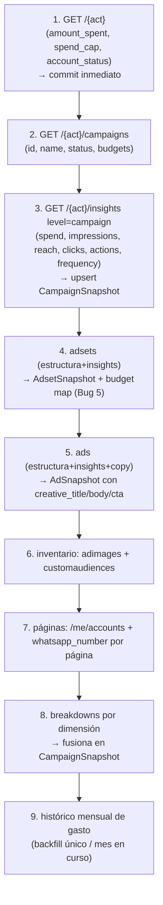

# 19 · Sincronización con Meta

El pipeline de sync vive en `app/services/meta_ads/sync.py` (`MetaAdsSyncService`), disparado por la tarea Celery `sync_ad_account` (`workers/tasks.py`) y apoyado en `MetaAPIRateLimiter`.

## 1. Punto de entrada

`run_sync(ad_account, sync_type)`:
1. Crea un `SyncJob` `RUNNING`.
2. Según `MOCK_SERVICES`, llama a `_sync_mock_data` o `_sync_real_data`.
3. Marca `COMPLETED` (con `records_synced`) o, ante excepción, `FAILED`.
4. Clasifica el error: `TransientMetaError` se **re-lanza** para que Celery reintente (backoff); `PermanentMetaError` se registra como fallo definitivo (no reintenta).

La tarea `sync_ad_account` está decorada con `autoretry_for=(TransientMetaError,)`, `retry_backoff=True`, `retry_backoff_max=600`, `retry_jitter=True`, `max_retries=5`, `acks_late=True`.

## 2. Tipos de sync

| Tipo | Disparador | Ventana |
|------|-----------|---------|
| `FULL` | Conexión de una cuenta nueva | 30 días (`last_30d`) |
| `INCREMENTAL` | Trigger manual + Beat diario 06:00 | ayer (`yesterday`) |
| `BACKFILL` | Una vez por cuenta, después del primer `FULL` | últimos `SNAPSHOT_RETENTION_DAYS` (180 por defecto) |

`BACKFILL` corre en `backfill_ad_account_history`, no dentro del sync diario.
Consulta Meta con `time_range={since,until}` + `time_increment=1`, pagina la
respuesta y llena campañas, adsets y anuncios. No backfillea breakdowns: las
cinco dimensiones multiplicarían el volumen y ni la Capa 2 ni el chat las usan
para el análisis histórico. Un `SyncJob(BACKFILL, COMPLETED)` es la marca
persistente que evita repetirlo; los upserts siguen siendo idempotentes si una
tarea se reintenta.

## 3. Sync real (`_sync_real_data`)

Secuencia de llamadas a la Graph API (todas vía `call_api_paginated` salvo las puntuales):



### Detalles relevantes

- **Commit inmediato** de la info de cuenta (paso 1): si algo más adelante falla, `spend_cap`/`amount_spent`/`status` ya quedan persistidos (antes se descartaban en silencio).
- **Upsert idempotente**: cada snapshot se busca por `(cuenta, entidad, fecha)` y se actualiza o inserta (protegido por `UniqueConstraint`). Esto permite reintentar el `BACKFILL` sin duplicar filas.
- **Conversiones vs conversaciones** (`_extract_conversions_conversations`): `conversions` suma solo una **whitelist** de action types de lead (evita doble-conteo); `conversations` suma `messaging_conversation_started`, con fallback a leads si no hay mensajería.
- **Presupuesto ABO (`Bug 5`)**: si el `daily_budget`/`lifetime_budget` de campaña viene 0 (cuentas ABO), se usa la suma de los `daily_budget` de los adsets **ACTIVOS** de esa campaña.
- **Breakdowns** (`_sync_real_breakdowns`): 5 dimensiones (placement+posición, edad, género, dispositivo, región), cada una una llamada independiente; si Meta rechaza una (permiso o combinación no permitida) se registra y se continúa (no aborta el sync). Se fusionan en `placements_breakdown`/`demographics_breakdown`/`extra_breakdowns`.
- **Páginas + WhatsApp** (`_sync_real_pages`): descubrimiento **multi-fuente** con dedupe por `external_page_id` — `/me/accounts` (rol directo del usuario), `/me/businesses` → `owned_pages`/`client_pages` (Business Manager) y `act_X/promote_pages` (promocionables por la cuenta). Motivo (caso "Althea pack", 15-jul-2026): la página que Ads Manager ofrece promocionar puede no salir en `/me/accounts` si el usuario del token no tiene rol directo en ella. Cada fuente es tolerante a fallo individual. El `whatsapp_number` se pide por página y, si falla (falta permiso `whatsapp_business_management`), solo esa página se queda sin número; un número cargado a mano (`PATCH /my/pages/{id}/whatsapp`) **no se pisa** cuando Meta no devuelve el campo. También se puede re-descubrir solo páginas bajo demanda: `POST /organizations/my/pages/refresh` → tarea `refresh_org_pages` (sin sync completo).
- **Copy real de creativos**: `_sync_real_ads` captura `title`/`body`/`call_to_action_type` del creativo ganador para que la IA se inspire en el texto que funcionó (antes solo se guardaba la imagen).
- **Histórico mensual** (`_sync_spend_history`): backfill único con `time_increment=monthly&date_preset=maximum`; en syncs siguientes solo refresca el mes en curso y cierra perezosamente los meses viejos (`closed=True`).
- **Token expirado** (`_maybe_mark_expired`, `S-6`): ante `OAuthException code 190`, marca cuenta + credencial como `EXPIRED`.

## 4. Sync mock (`_sync_mock_data`)

Con `MOCK_SERVICES=true` genera datos realistas para probar todo el pipeline sin credenciales:
- 3 campañas de ejemplo con perfiles distintos: una **exitosa** (Reels barato), una **saturándose** (frecuencia creciente) y una **fallando** (0 leads los últimos días).
- 30 días de historia en `FULL`, 2 en `INCREMENTAL` y la ventana de retención completa en `BACKFILL`; genera snapshots de campaña, adsets y anuncios. Los breakdowns históricos quedan vacíos por diseño, igual que en producción.
- Simula las llamadas en el rate limiter para poblar `APICallLog`.

Los datos mock están calibrados para disparar exactamente las reglas de la Capa 1/2 (CPL crítico, saturación, oportunidad en Reels), lo que hace el sistema demostrable end-to-end.

## 5. Rate limiting (`rate_limiter.py`)

`MetaAPIRateLimiter` (ver también [11](11-servicios-externos.md)):
- **Backoff adaptativo** por la cabecera `x-business-use-case-usage`: espera `estimated_time_to_regain_access` si Meta lo indica; pausa preventiva de 15 s (>85%) o 3 s (>50%).
- **Pausas de cortesía** entre llamadas (0.2 s lecturas, 0.5 s escrituras; 0.05 s en mock).
- **Reintentos** ante 408/429/5xx (2 intentos, espera 60 s) y errores de red.
- **Paginación por cursor** (`call_api_paginated`), con parcial ante error tras datos acumulados.
- **Auditoría** en `APICallLog` con token enmascarado.

## 6. Post-sync

Al completar (`sync_ad_account`):
1. Notifica `sync_status` por WebSocket.
2. **Invalida** el cache del `ReportBuilder` de la cuenta.
3. Si era el primer `FULL` y no existe un backfill completo, encola `backfill_ad_account_history` con 60 s de separación.
4. **Agenda el análisis** de la organización con **debounce** (`D-1`): solo el primer sync de la org lo encola (lock Redis `SET NX EX`).

## 7. Programación (Beat)

`schedule_all_syncs("INCREMENTAL")` (06:00 Lima) itera todas las cuentas `ACTIVE` y encola cada una con `countdown=random(0, 1800)` (escalonado con jitter) para no golpear el rate limit de Meta con N cuentas a la vez.

## 8. Backfill operativo de cuentas existentes

El backfill es de **solo lectura** contra Meta, pero en una cuenta real se hace
primero sobre una sola cuenta y se verifica antes de encolar las demás.

```bash
# Una cuenta piloto. Usar los UUID internos de organization y ad_account.
docker compose exec backend celery -A app.workers call \
  app.workers.tasks.schedule_pending_history_backfills \
  --kwargs='{"organization_id":"ORG_UUID","ad_account_id":"ACCOUNT_UUID"}'
```

Verificar el `SyncJob` y la ventana diaria:

```sql
SELECT status, records_synced, error_message, started_at, completed_at
FROM sync_jobs
WHERE organization_id = 'ORG_UUID'
  AND ad_account_id = 'ACCOUNT_UUID'
  AND sync_type = 'BACKFILL'
ORDER BY started_at DESC
LIMIT 1;

SELECT min(date), max(date), count(DISTINCT date)
FROM campaign_snapshots
WHERE organization_id = 'ORG_UUID'
  AND ad_account_id = 'ACCOUNT_UUID';
```

Solo después de validar esa cuenta, encolar el resto de una organización
(cada una recibe jitter de hasta 30 minutos):

```bash
docker compose exec backend celery -A app.workers call \
  app.workers.tasks.schedule_pending_history_backfills \
  --kwargs='{"organization_id":"ORG_UUID"}'
```

Con `MOCK_SERVICES=true` estos comandos no salen a Meta y generan localmente los
180 días. Con `MOCK_SERVICES=false` usan el token real de cada cuenta.
