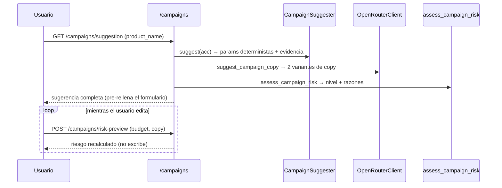
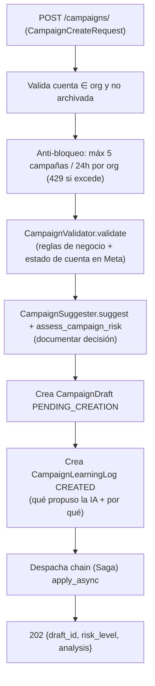
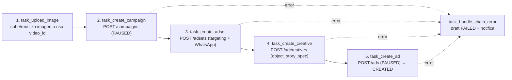

# 20 · Creación de Campañas (Saga)

La creación de campañas es el flujo de escritura más complejo. Combina sugerencia determinista, copy del LLM, evaluación de riesgo, validación síncrona y una **Saga asíncrona de 5 pasos** contra Meta.

> Dos puertas de entrada a este mismo motor: el formulario (`campaigns/new`, descrito en la §8 de este documento) y el **chat conversacional** (`campaigns/chat`, ver [23-chat-creacion-campanas](23-chat-creacion-campanas.md)). Ninguna de las dos abre un camino de escritura propio — ambas terminan en `start_campaign_creation` (antes inline en el endpoint, extraído a `app/services/campaign_creation.py` para que el chat pudiera reusarlo sin duplicar lógica).

## 1. Actores

| Componente | Módulo | Rol |
|-----------|--------|-----|
| `CampaignSuggester` | `services/campaign_suggester.py` | Parámetros estructurales deterministas (3A) |
| `OpenRouterClient.suggest_campaign_copy` | `services/ai/llm.py` | Copy del anuncio (3B, LLM) |
| `assess_campaign_risk` | `services/campaign_risk.py` | Nivel de riesgo (Ajuste 1) |
| `CampaignValidator` | `services/campaign_validator.py` | Validación síncrona + estado de cuenta |
| `build_targeting` | `services/campaign_targeting.py` | Targeting del adset desde el histórico ganador |
| `CreativeBuilder` | `services/creative_builder.py` | `object_story_spec` de Meta |
| `MetaAssetRepository` | `services/meta_asset_repository.py` | Subida/reutilización de imagen |
| Saga | `workers/creation_tasks.py` | 5 tareas encadenadas |
| `derive_brand_code` | `services/brand_code.py` | Código de marca para la nomenclatura |
| `TENANT_CAMPAIGN_RULES` / `get_campaign_rules_for_org` | `tenant_rules/campaign_defaults.py` | Reglas por defecto (objetivo, placements, PAUSED) + overrides por org (M-2) |

## 2. Flujo previo a la creación (endpoints)

### `CampaignSuggester` (Fase 3A, determinista — regla `AI-1`)
Deriva del `ReportBuilder` (histórico real): objetivo/optimization_goal/destination (de `get_campaign_rules_for_org(organization)`, M-2 — defaults globales si la org no tiene overrides), `suggested_budget` (colchón de ~20 conversaciones al menor costo observado), `excluded_placements` (gasto sin conversiones), mejor dispositivo y rango de edad, campaña/anuncio ganador (con su copy real como inspiración), madurez/convergencia y razonamiento explicable. Sin histórico, cae a defaults marcados como "sin evidencia".

### `assess_campaign_risk` (Ajuste 1)
`LOW`/`MEDIUM`/`HIGH` según: presupuesto vs sugerido (×1.2 o ×2), presupuesto absoluto alto (≥500), términos que Meta suele rechazar (farmacéutico), estado de cuenta e histórico. Siempre recuerda que la campaña se crea `PAUSED`. Nunca `CRITICAL` (crear pausado no gasta).

## 3. Disparo de la creación (`POST /campaigns/`)

`CampaignValidator` verifica: presencia de imagen/hash/video (+thumbnail si video), nombre de producto sin tildes/emojis (regex), límites de caracteres de Meta (headline ≤40, description ≤30), y —en real— el estado de la cuenta y el spend cap contra Meta.

## 4. La Saga (`creation_tasks.py`)

Un `celery.chain` de 5 tareas con `countdown=40s` entre pasos (pausa anti-bloqueo del playbook) y `.on_error(task_handle_chain_error)`:

- Cada paso recibe/retorna un `context` dict y persiste su avance con `_merge_draft_result` en `CampaignDraft.payload["result"]` (campaign_id, adset_id, creative_id, ad_id) → el frontend hace un **polling real** (`GET /campaigns/drafts/{id}`).
- Cada POST está gateado por `simulate_meta_writes_for(cuenta)`: en simulación se generan IDs `mock_*`; en real se toma `result.id` de Meta.
- Reintentos por paso ante `TransientMetaError` (`autoretry_for`, backoff, `max_retries=3`).
- **Targeting** (`build_targeting`): dispositivo y placements salen de las señales del histórico ganador (o defaults); siempre incluye `facebook_reels`.
  **La edad NO se segmenta por defecto** (2026-08): la data es plana entre rangos y segmentar obliga a apagar Advantage+, así que desactivaba justo lo que conviene usar. Se reactiva por organización con `use_age_targeting`.
  **Geografía**: `geo_countries` (códigos ISO) cuando está configurada, y si no la región de siempre. Antes solo se entendía una clave de región, así que una campaña LATAM era imposible de armar.
- **Advantage+ vs edad mínima** (`_ADVANTAGE_AUDIENCE_MAX_AGE_MIN`): Meta impone **dos reglas simultáneas** sobre `targeting_automation.advantage_audience` — (a) `1870188`: no se admite `=1` con `age_min > 25` (con Advantage+ la edad es solo una *sugerencia*, no un control); (b) `1870227`: el campo es **obligatorio**, hay que declararlo explícitamente como `1` o `0` (omitirlo también rechaza el adset). Por eso siempre se envía, y vale `0` cuando el histórico ganador apunta a un público mayor (caso real: 45-54) — se prioriza esa señal como restricción **dura**. Con públicos de 25 o menos —incluido el default sin histórico (`age_min=25`)— vale `1`.
  **Desde 2026-08 el caso normal es `1`**: al no segmentar por edad, el público queda amplio y Advantage+ deja de ser un caso especial.
- **Creativo** (`CreativeBuilder`): construye `object_story_spec` con `link_data` (imagen) o `video_data` (UGC), `call_to_action` WhatsApp y `page_welcome_message` obligatorio para destino WhatsApp.
- **Nomenclatura**: `{MARCA}_MSJ_{PRODUCTO}_{MESAÑO}` con marca derivada de `AdAccount.name` (`derive_brand_code`).

## 5. Creación disparada por la IA (`CREATE_CAMPAIGN`)

Cuando una `AIAction CREATE_CAMPAIGN` se aprueba, `AIExecutor._dispatch_campaign_creation_saga` reutiliza la **misma Saga** (`A-1`, sin flujo duplicado). Antes resuelve dos datos que el planner no puede inventar (`AI-1`):
- **Página + WhatsApp**, en este orden: (1) la **página predeterminada** de la cuenta (`AdAccount.default_page_id`, configurable en Settings → "Páginas y WhatsApp") si está activa y tiene WhatsApp — si la default existe pero no tiene WhatsApp, `NEEDS_INPUT` explícito (no se cae en silencio a otra página); (2) sin default, la regla original: exactamente 1 página activa con WhatsApp en la org; si no, `NEEDS_INPUT`.
- **Creativo**: reutiliza el `MetaCreative` más reciente de la cuenta; si no hay, `NEEDS_INPUT`.

El paso final (`task_create_ad`) cierra también la `AIAction` como `COMPLETED`/`FAILED` (no solo el draft).

## 6. Estados y observabilidad

- `CampaignDraft.status`: `PENDING_CREATION` → `CREATED` / `FAILED`.
- Notificación WebSocket `campaign_creation` (`READY`/`FAILED`) al terminar.
- `CampaignLearningLog` queda `CREATED` con la hipótesis; el outcome loop (Beat 08:00) la evaluará tras la ventana (ver [18](18-motor-ia.md)).

## 7. Reglas de negocio por tenant (M-2, resuelto)

`TENANT_CAMPAIGN_RULES` (default global): geo Lima (`2771`), objetivo `OUTCOME_LEADS`, optimización `CONVERSATIONS`, destino `WHATSAPP`, `bid_strategy` `LOWEST_COST_WITHOUT_CAP`, placement requerido `facebook_reels`, posiciones de Instagram `stream/story/reels/explore` (antes IG estaba **prohibido** vía `banned_placements`, una clave que además nunca se leía), **estado por defecto `PAUSED`** (la activación siempre es manual — este campo no es overrideable en el sentido de saltarse la regla de oro del playbook: los tres pasos de la Saga que fijan `PAUSED` siguen leyendo `default_status` de las reglas resueltas, pero nada en el producto ofrece hoy una forma de cambiarlo a `ACTIVE`).

`Organization.campaign_rules_overrides` (columna JSON, vacía por defecto) permite personalizar cualquier subconjunto de esas claves por organización — `get_campaign_rules_for_org(organization)` superpone el override sobre el default global y es lo que consumen `CampaignSuggester`, `AIPlanner._create_action_from_insight` y las 3 tareas de la Saga que escriben `objective`/`optimization_goal`/`destination_type`/`bid_strategy`/`default_status`/geo/placements (`creation_tasks.py`). Una org sin overrides se comporta exactamente igual que antes de M-2.

## 8. Capa de producto — el formulario de creación (`campaigns/new/page.tsx`)

La Saga es el motor; la página de creación es donde el cliente toma la decisión. El diseño busca que un no-experto lance una campaña **sin poder gastar por accidente**. Puntos de producto que no se ven en el backend:

- **Pre-llenado con evidencia, no en blanco** (`✨ Sugerir con IA`): `GET /campaigns/suggestion` rellena presupuesto, días, copy y headline con los valores derivados del histórico real. La UI muestra explícitamente si la sugerencia viene de *"el histórico real de tu cuenta"* o de *"valores por defecto (sin histórico todavía)"* (`has_history`) — el usuario sabe cuánta confianza darle.
- **"Qué está haciendo la IA"**: el bloque `analysis` se muestra en la propia pantalla de creación (modo EXPLORACIÓN vs OPTIMIZADO, confianza, cambios propuestos con su porqué, aprendizajes de fallos pasados, días de evaluación recomendados). Es la ventana de transparencia que convierte a la IA de caja negra en copiloto explicable, con enlace al historial completo (`/campaigns/learning`).
- **Dos variantes de copy** (`3.4`): el LLM devuelve 2 headlines + 2 primary_text; el usuario elige con un toggle. `copy_text` es el único campo obligatorio del anuncio; headline/description son opcionales y se validan contra los límites de Meta (40/30) solo si vienen.
- **Doble compuerta de riesgo** (Ajuste 1): al pulsar "Revisar riesgo y crear" NO se crea aún — se llama `POST /campaigns/risk-preview` con el presupuesto/copy **actuales** y se muestra un panel de confirmación (`BAJO`/`MEDIO`/`ALTO` con razones). Solo el botón *"Entiendo el riesgo — Crear Campaña (PAUSADA)"* dispara `POST /campaigns/`. Si el cálculo de riesgo falla, no se bloquea: se marca `MEDIUM` con aviso y se deja confirmar.
- **Subida de imagen, no URL a mano**: `input file` → preview local instantáneo (`URL.createObjectURL`) + subida en background a `POST /campaigns/upload-image`; el `image_path` resultante viaja en la creación. Bloquea el submit mientras `imageUploading`. **Al terminar la subida el copy se regenera solo** pasando `image_path` a `/suggestion` (F6): el texto pasa a describir lo que de verdad se ve. Si esa segunda llamada falla, el copy anterior sigue en pie — no se rompe el formulario.
- **Video MP4/MOV** (F7): `POST /campaigns/upload-video` (hasta 100MB) devuelve un `video_path`; la Saga lo sube a `/advideos`, **espera a que Meta termine de procesarlo** (crear el anuncio antes falla con un error poco descriptivo) y toma la miniatura `is_preferred`, obligatoria para `video_data`. Imagen y video son excluyentes: elegir uno limpia el otro.
- **Presupuesto diario o total** (F2): un selector cambia entre `lifetime_budget` y `daily_budget`; el monto se convierte al alternar para que el gasto total no salte sin que se note, y en modo diario se muestra el total resultante. El riesgo y el aprendizaje siempre razonan sobre el **total normalizado** (`total_budget()`).
- **Título y descripción** (F5): campos propios con contador (40/30, los límites de Meta). Ya se pedían antes, pero no llegaban al creativo — se validaban y se descartaban en silencio.
- **Nombre con la nomenclatura de la casa** (F3): la sugerencia muestra `suggested_campaign_name`, inferido de los nombres reales de la cuenta (`campaign_naming.py`), y es exactamente el que usa la Saga.
- **Número de WhatsApp elegible** (F1): un dropdown con el catálogo de la organización (`GET /organizations/my/whatsapp-numbers`), preseleccionando el de la página. Antes el número salía fijo de la página y **no había forma de corregirlo una vez guardado**: la UI solo mostraba el campo mientras estuviera vacío. La gestión (alta, edición, borrado) vive en Settings; los descubiertos en Meta son de solo lectura porque el sync los reescribe.
- **Preselección de página**: el dropdown preselecciona la página predeterminada de la cuenta activa (`default_page_id`, configurada en Settings → "Páginas y WhatsApp"); sin default, autoselecciona solo si hay exactamente 1 página. La gestión completa (lista de páginas, WhatsApp editable, default por cuenta, botón "Actualizar páginas desde Meta") vive en Settings.
- **Estado de la Saga en vivo**: tras crear, la pantalla entra en `polling` (`GET /campaigns/drafts/{id}` cada 2.5 s, hasta 120 intentos ≈ 5 min) **y** escucha el evento WebSocket `campaign_creation` (`READY`/`FAILED`) que resuelve sin esperar al siguiente tick (el polling es el fallback si el WS cae). Se comunica honestamente que la creación *"toma ~3 minutos"* (4 pasos con `countdown=40s`).
- **Cierre orientado a la acción correcta**: al terminar, recuerda que la campaña quedó **PAUSADA**, que hay que subir el spend cap si está topado, y ofrece un deep-link directo a Ads Manager (`adsmanager.facebook.com/...&selected_campaign_ids=`) para revisarla y activarla manualmente.

> El endpoint `/campaigns/suggestion` devuelve también `objective`, `optimization_goal`, `destination_type` y `winning_ad_copy`, que hoy el tipo `Suggestion` del frontend y la UI **no consumen** (la UI de creación no expone un selector para editarlos). Es una asimetría menor, no un bug: ahora que esos parámetros pueden variar por organización (M-2, resuelto), el contrato ya los transporta — falta solo la superficie de UI si en algún momento un tenant necesita ver/editar sus propias reglas en vez de solo heredarlas.

---

## Disciplinas agregadas en 2026-08 (`execution/05`)

Vienen del documento de trabajo con el que se arman campañas a mano.

- **Verificación posterior (paso 6 de la Saga).** Se releen los cuatro niveles
  en Meta y se guarda `issues_info` en `payload["result"]["verificacion"]`.
  Antes, *"creada con éxito"* solo significaba *"Meta aceptó el POST"* — y Meta
  acepta la creación y después marca el objeto con problemas de política. La
  verificación no falla la Saga: los objetos ya existen y no poder releerlos no
  es motivo para disparar el rollback.
- **Pausar antes de editar.** `MetaCampaignModifier` pausa cualquier objeto
  `ACTIVE` antes de un cambio estructural y lo devuelve a su estado. Si no se
  puede pausar, no se edita; si la edición falla, queda pausado a propósito.
- **Acortadores prohibidos en el copy.** Rompen la atribución: el clic pierde el
  parámetro de seguimiento y la conversión no vuelve a su campaña, así que el
  costo se ve más caro sin razón visible. Lista cerrada, con el porqué en el
  mensaje de error.
- **Piso de presupuesto por aprendizaje** (`min_daily_budget_for_learning`,
  S/16/día). **Avisa, no bloquea**: por debajo, el conjunto no junta los ~50
  eventos semanales que Meta necesita y nunca sale de la fase de aprendizaje.
  El aviso viaja en `warnings` de `POST /campaigns/preflight`.

**Pendiente y deliberado:** las plantillas de formulario de leads nativo y LATAM.
Un formulario nativo no es un parámetro distinto, es otra forma de creativo
(`/leadgen_forms` + ramificación de `CreativeBuilder`). Con el write-back
encendido en producción, media plantilla no falla al crearla: falla al entregar,
y eso se descubre gastando. Ver `execution/05-chat-creacion.md`.
