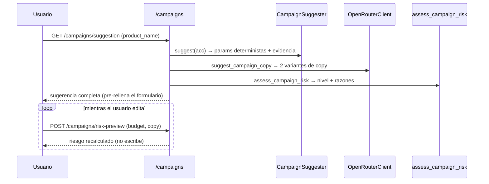
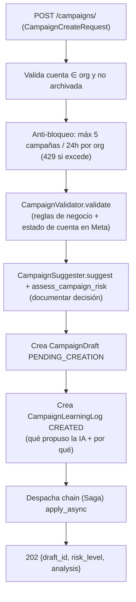
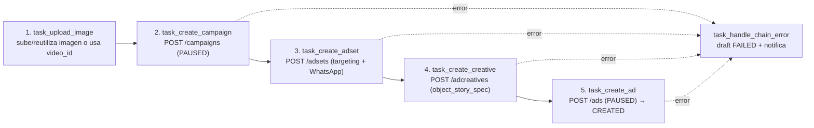

# 20 · Creación de Campañas (Saga)

La creación de campañas es el flujo de escritura más complejo. Combina sugerencia determinista, copy del LLM, evaluación de riesgo, validación síncrona y una **Saga asíncrona de 5 pasos** contra Meta.

## 1. Actores

| Componente | Módulo | Rol |
|-----------|--------|-----|
| `CampaignSuggester` | `services/campaign_suggester.py` | Parámetros estructurales deterministas (3A) |
| `OpenRouterClient.suggest_campaign_copy` | `services/ai/llm.py` | Copy del anuncio (3B, LLM) |
| `assess_campaign_risk` | `services/campaign_risk.py` | Nivel de riesgo (Ajuste 1) |
| `CampaignValidator` | `services/campaign_validator.py` | Validación síncrona + estado de cuenta |
| `build_targeting` | `services/campaign_targeting.py` | Targeting del adset desde el histórico ganador |
| `CreativeBuilder` | `services/creative_builder.py` | `object_story_spec` de Meta |
| `MetaAssetRepository` | `services/meta_asset_repository.py` | Subida/reutilización de imagen |
| Saga | `workers/creation_tasks.py` | 5 tareas encadenadas |
| `derive_brand_code` | `services/brand_code.py` | Código de marca para la nomenclatura |
| `TENANT_CAMPAIGN_RULES` | `tenant_rules/campaign_defaults.py` | Reglas fijas (objetivo, placements, PAUSED) |

## 2. Flujo previo a la creación (endpoints)

### `CampaignSuggester` (Fase 3A, determinista — regla `AI-1`)
Deriva del `ReportBuilder` (histórico real): objetivo/optimization_goal/destination (de `TENANT_CAMPAIGN_RULES`), `suggested_budget` (colchón de ~20 conversaciones al menor costo observado), `excluded_placements` (gasto sin conversiones), mejor dispositivo y rango de edad, campaña/anuncio ganador (con su copy real como inspiración), madurez/convergencia y razonamiento explicable. Sin histórico, cae a defaults marcados como "sin evidencia".

### `assess_campaign_risk` (Ajuste 1)
`LOW`/`MEDIUM`/`HIGH` según: presupuesto vs sugerido (×1.2 o ×2), presupuesto absoluto alto (≥500), términos que Meta suele rechazar (farmacéutico), estado de cuenta e histórico. Siempre recuerda que la campaña se crea `PAUSED`. Nunca `CRITICAL` (crear pausado no gasta).

## 3. Disparo de la creación (`POST /campaigns/`)

`CampaignValidator` verifica: presencia de imagen/hash/video (+thumbnail si video), nombre de producto sin tildes/emojis (regex), límites de caracteres de Meta (headline ≤40, description ≤30), y —en real— el estado de la cuenta y el spend cap contra Meta.

## 4. La Saga (`creation_tasks.py`)

Un `celery.chain` de 5 tareas con `countdown=40s` entre pasos (pausa anti-bloqueo del playbook) y `.on_error(task_handle_chain_error)`:

- Cada paso recibe/retorna un `context` dict y persiste su avance con `_merge_draft_result` en `CampaignDraft.payload["result"]` (campaign_id, adset_id, creative_id, ad_id) → el frontend hace un **polling real** (`GET /campaigns/drafts/{id}`).
- Cada POST está gateado por `simulate_meta_writes_for(cuenta)`: en simulación se generan IDs `mock_*`; en real se toma `result.id` de Meta.
- Reintentos por paso ante `TransientMetaError` (`autoretry_for`, backoff, `max_retries=3`).
- **Targeting** (`build_targeting`): edad/dispositivo/placements salen de las señales del histórico ganador (o defaults), no hardcodeados; siempre incluye `facebook_reels` y excluye Instagram.
- **Creativo** (`CreativeBuilder`): construye `object_story_spec` con `link_data` (imagen) o `video_data` (UGC), `call_to_action` WhatsApp y `page_welcome_message` obligatorio para destino WhatsApp.
- **Nomenclatura**: `{MARCA}_MSJ_{PRODUCTO}_{MESAÑO}` con marca derivada de `AdAccount.name` (`derive_brand_code`).

## 5. Creación disparada por la IA (`CREATE_CAMPAIGN`)

Cuando una `AIAction CREATE_CAMPAIGN` se aprueba, `AIExecutor._dispatch_campaign_creation_saga` reutiliza la **misma Saga** (`A-1`, sin flujo duplicado). Antes resuelve dos datos que el planner no puede inventar (`AI-1`):
- **Página + WhatsApp**: exige exactamente 1 página activa con WhatsApp; si no, `NEEDS_INPUT`.
- **Creativo**: reutiliza el `MetaCreative` más reciente de la cuenta; si no hay, `NEEDS_INPUT`.

El paso final (`task_create_ad`) cierra también la `AIAction` como `COMPLETED`/`FAILED` (no solo el draft).

## 6. Estados y observabilidad

- `CampaignDraft.status`: `PENDING_CREATION` → `CREATED` / `FAILED`.
- Notificación WebSocket `campaign_creation` (`READY`/`FAILED`) al terminar.
- `CampaignLearningLog` queda `CREATED` con la hipótesis; el outcome loop (Beat 08:00) la evaluará tras la ventana (ver [18](18-motor-ia.md)).

## 7. Reglas de negocio fijas (playbook)

`TENANT_CAMPAIGN_RULES`: geo Lima (`2771`), objetivo `OUTCOME_LEADS`, optimización `CONVERSATIONS`, destino `WHATSAPP`, `bid_strategy` `LOWEST_COST_WITHOUT_CAP`, placement requerido `facebook_reels`, prohibido `instagram_positions`, **estado por defecto `PAUSED`** (la activación siempre es manual). Hoy globales; pendiente moverlas a tabla por tenant (ver [15](15-deuda-tecnica.md) M-2).

## 8. Capa de producto — el formulario de creación (`campaigns/new/page.tsx`)

La Saga es el motor; la página de creación es donde el cliente toma la decisión. El diseño busca que un no-experto lance una campaña **sin poder gastar por accidente**. Puntos de producto que no se ven en el backend:

- **Pre-llenado con evidencia, no en blanco** (`✨ Sugerir con IA`): `GET /campaigns/suggestion` rellena presupuesto, días, copy y headline con los valores derivados del histórico real. La UI muestra explícitamente si la sugerencia viene de *"el histórico real de tu cuenta"* o de *"valores por defecto (sin histórico todavía)"* (`has_history`) — el usuario sabe cuánta confianza darle.
- **"Qué está haciendo la IA"**: el bloque `analysis` se muestra en la propia pantalla de creación (modo EXPLORACIÓN vs OPTIMIZADO, confianza, cambios propuestos con su porqué, aprendizajes de fallos pasados, días de evaluación recomendados). Es la ventana de transparencia que convierte a la IA de caja negra en copiloto explicable, con enlace al historial completo (`/campaigns/learning`).
- **Dos variantes de copy** (`3.4`): el LLM devuelve 2 headlines + 2 primary_text; el usuario elige con un toggle. `copy_text` es el único campo obligatorio del anuncio; headline/description son opcionales y se validan contra los límites de Meta (40/30) solo si vienen.
- **Doble compuerta de riesgo** (Ajuste 1): al pulsar "Revisar riesgo y crear" NO se crea aún — se llama `POST /campaigns/risk-preview` con el presupuesto/copy **actuales** y se muestra un panel de confirmación (`BAJO`/`MEDIO`/`ALTO` con razones). Solo el botón *"Entiendo el riesgo — Crear Campaña (PAUSADA)"* dispara `POST /campaigns/`. Si el cálculo de riesgo falla, no se bloquea: se marca `MEDIUM` con aviso y se deja confirmar.
- **Subida de imagen, no URL a mano**: `input file` → preview local instantáneo (`URL.createObjectURL`) + subida en background a `POST /campaigns/upload-image`; el `image_path` resultante viaja en la creación. Bloquea el submit mientras `imageUploading`.
- **WhatsApp inline**: si la página elegida no expone WhatsApp (falta el permiso `whatsapp_business_management`), se puede escribir el número ahí mismo (`PATCH /pages/{id}/whatsapp`) sin salir del formulario.
- **Estado de la Saga en vivo**: tras crear, la pantalla entra en `polling` (`GET /campaigns/drafts/{id}` cada 2.5 s, hasta 120 intentos ≈ 5 min) **y** escucha el evento WebSocket `campaign_creation` (`READY`/`FAILED`) que resuelve sin esperar al siguiente tick (el polling es el fallback si el WS cae). Se comunica honestamente que la creación *"toma ~3 minutos"* (4 pasos con `countdown=40s`).
- **Cierre orientado a la acción correcta**: al terminar, recuerda que la campaña quedó **PAUSADA**, que hay que subir el spend cap si está topado, y ofrece un deep-link directo a Ads Manager (`adsmanager.facebook.com/...&selected_campaign_ids=`) para revisarla y activarla manualmente.

> El endpoint `/campaigns/suggestion` devuelve también `objective`, `optimization_goal`, `destination_type` y `winning_ad_copy`, que hoy el tipo `Suggestion` del frontend y la UI **no consumen** (el playbook los fija de forma constante). Es una asimetría menor, no un bug: si en el futuro esos parámetros dejan de ser globales (M-2), el contrato ya los transporta.
