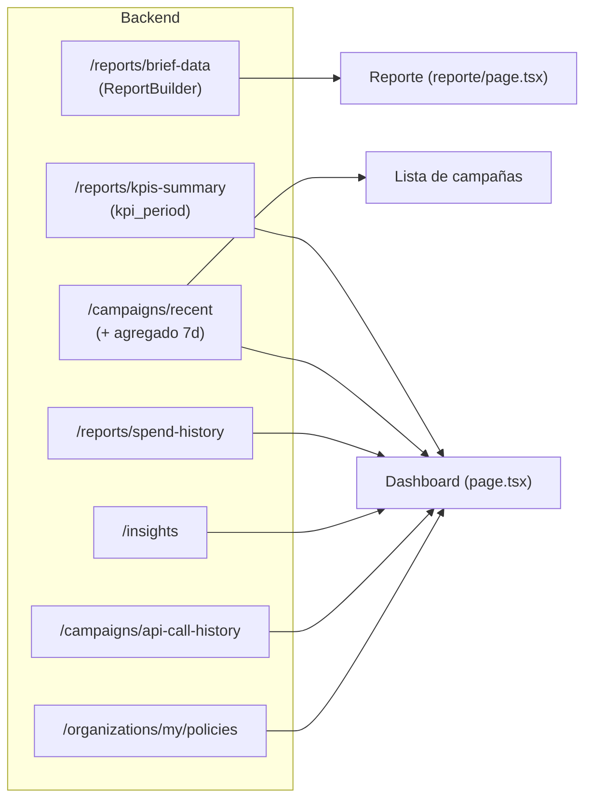

# 21 · Producto — Datos que se visualizan (dashboard, lista y reporte)

Este documento mira el sistema con lente de **ingeniero de producto**: qué dato ve el cliente, en qué pantalla, de dónde sale, qué decisión habilita y dónde hay fricción u oportunidad. Complementa el detalle técnico de [04-frontend](04-frontend.md), [06-api](06-api.md) y [18-motor-ia](18-motor-ia.md).

El principio de producto que atraviesa todo: **el cliente típico no es un media buyer experto**. Por eso cada número viene con contexto (ventana temporal, Δ% con dirección "buena", etiqueta relativa al desempeño de la cuenta) y las acciones peligrosas están detrás de compuertas explícitas.

## 1. De dónde sale cada dato

Todas las métricas de conversión usan la **métrica primaria unificada** `conversations or conversions` (conversaciones de WhatsApp, con leads como fallback) — ver [ADR-09](16-decisiones-arquitectonicas.md). La etiqueta de cada campaña (`GANADORA`/`BUENA`/`REGULAR`/`CARA`/`PAUSAR`) y el `target_cpl` se calculan **relativos al histórico real de la cuenta** ([ADR-10](16-decisiones-arquitectonicas.md)), no con umbrales absolutos en soles.

## 2. Dashboard (`(dashboard)/page.tsx`)

Rejerarquizado en `5.1 (E-3)`: primero las **métricas de negocio**, la actividad técnica al final. Se renderiza solo cuando hay datos (`campaigns.length > 0`); si no, muestra un *empty state* de bienvenida con botón "Comenzar Sincronización".

### 2.1 Fila de KPIs (héroe) — `kpis-summary`
Cuatro tarjetas de la ventana **7 días** con comparativa Δ% vs los 7 días previos:

| Tarjeta | Valor | Δ% "bueno cuando" | Nota de producto |
|---------|-------|-------------------|------------------|
| Gasto (7d) | `kpis_7d.spend` | **neutral** (gris) | Gastar más no es objetivamente bueno ni malo |
| Conversaciones (7d) | `kpis_7d.conversations` | sube (verde) | Más conversaciones = mejor |
| Costo/Conv. (7d) | `kpis_7d.cost_per_conv` | baja (verde) | Más barato = mejor |
| Alertas Críticas | `critical_alerts_count` | — | Rojo si >0; enlaza a `/diagnostics` |

- **`DeltaBadge`** traduce el Δ% a flecha + color según `goodWhen`: verde si la métrica se movió en la dirección buena, rojo si no, gris si es neutral. Si no hay período previo con qué comparar (`pct === null`), **no se muestra flecha** (honestidad: no inventa una tendencia).
- Encabezado con *"Última sincronización: hace X"* (`timeAgo(last_sync_at)`) — el cliente sabe si está viendo datos frescos o viejos.

### 2.2 Top alertas (hasta 3) — `insights`
Insights ordenados `CRITICAL > WARNING > INFO`, cada uno enlaza a `/diagnostics`. Es el puente entre "veo un número raro" y "la IA ya me dice qué pasa".

### 2.3 Gráficos (Recharts)
- **Top 5 Campañas por Inversión**: barras horizontales del `spend` del último snapshot.
- **Top 5 Campañas por Menor CPL**: usa el **agregado real de 7 días** (`cost_per_conv_7d`), no el snapshot de un día. Excluye campañas con **0 conversiones en la ventana** (`E-4`) — si no, una campaña de gasto cero dividiría por cero y aparecería como falsa "ganadora" de CPL. Este es un detalle de producto crítico: el ranking "más barato" debe premiar eficiencia real, no ausencia de datos.
- **Histórico de Inversión Mensual**: línea de `spend-history` (gasto total por mes, sin desglose), rotulado explícitamente como tal.

### 2.4 Resumen de Campañas Activas (tabla, top 5)
Campaña · **CPL 7d** (`cost_per_conv_7d ?? cpl`) · Inversión (`spend_7d ?? spend`) · Estado. Enlaza a `/campaigns`.

> **Inconsistencia de producto detectada:** esta tabla del dashboard pinta el "Estado" con un badge crudo (`ACTIVE`→verde, resto→ámbar) mostrando el string en inglés, mientras que la lista `/campaigns` usa `metaStatusBadge` (Activa/Pausada/Archivada/Eliminada, en español) y además separa "Rendimiento". Convendría unificar para no mostrar el estado de dos maneras distintas. Ver [15-deuda-tecnica](15-deuda-tecnica.md).

### 2.5 Políticas de Meta por rubro — `policies`
Recordatorios de política según el `industry` de la organización; si no hay rubro configurado, invita a elegirlo en `/settings`. Se presenta como *"recordatorios, no un sustituto de la política oficial"* con enlace al documento real de Meta — encuadre honesto para no dar falsa sensación de compliance.

### 2.6 Actividad técnica (colapsada) — `api-call-history`
Historial de llamadas a la Graph API (fecha, cuenta, método, endpoint, status). Antes competía por atención con las métricas de negocio; ahora vive en un `
` cerrado como detalle de auditoría (`E-3`).

## 3. Lista de campañas (`campaigns/page.tsx`) — Estado vs Rendimiento

La distinción de producto más importante de esta pantalla, introducida junto a `metaStatusBadge`:

| Columna | Qué responde | Origen |
|---------|--------------|--------|
| **Estado** | ¿Está prendida o apagada en Meta? | `CampaignSnapshot.status` → `metaStatusBadge` (Activa/Pausada/Archivada/Eliminada) |
| **Rendimiento** | ¿Le va bien o mal? | Evaluación de la IA por CPL/frecuencia (Ganadora/Buena/Alerta) |

Antes ambos conceptos se mezclaban bajo una sola columna "Estado", haciendo ver como *"apagada/fallida"* a una campaña que en Meta seguía **activa** (o al revés). Separarlos evita que el cliente pause una campaña sana por un badge mal interpretado. Los badges nunca dependen solo del color: `badge.ts` añade un ícono redundante (`✓ ⚠ ✕ ✦`, accesibilidad `E-6`).

## 4. Reporte de rendimiento (`reporte/page.tsx`) — `brief-data`

El informe "de agencia" que el cliente puede exportar a PDF. Selector de ventana **7/30/90 días** (`5.2`); cada ventana trae su comparativa Δ% contra el período previo del mismo tamaño. Se **auto-refresca** al recibir por WebSocket tanto `sync_status: COMPLETED` (nuevos números) como `analysis_status: COMPLETED` (nueva narrativa) — sin refrescar en ambos, el reporte quedaba desincronizado.

Secciones, todas alimentadas por `ReportBuilder` (números reales, nunca inventados por el LLM):

| Sección | Contenido | Valor para el cliente |
|---------|-----------|-----------------------|
| **Resumen Ejecutivo** | 5 KPIs (invertido, alcance, conversaciones, mejor costo/conv, CTR) con Δ% | Foto rápida del período |
| **Lo más importante que encontramos** (`findings`) | Frases derivadas de los números (campaña más eficiente, canal dominante, Advantage+ vs intereses…) | Traduce datos a lenguaje de negocio |
| **Qué hacer con las nuevas campañas** (`recommendations`) | Acciones concretas (usar tal audiencia, excluir tal placement, meta de costo…) | Cierra el ciclo insight→acción |
| **Revisar/pausar** y **Ganadoras — replicar** (`alerts`) | Campañas rojas y verdes con su razón | Prioriza dónde mirar |
| **Rendimiento por Campaña** | Ordenado por costo/conv; badge **"Creada por IA"** (`created_by_ai`) y Δ% de costo/conv | Distingue lo que armó la IA de lo manual |
| **Por Conjunto (adset)** y **por Anuncio/Creativo** | Incluye targeting (Advantage+/Intereses + geo) y el copy del creativo ganador | Entiende *por qué* algo funciona |
| **¿Dónde convierte mejor?** (`segmentation`) | Barras de distribución de gasto (placement, dispositivo) + tablas de 5 dimensiones (placement/dispositivo/edad/género/geografía) | Reasigna presupuesto |
| **Audiencias** e **Inventario de creativos** | Audiencias personalizadas + thumbnails reales del creativo (`5.4c`, con fallback si la URL venció) | Inventario reutilizable |
| **Parámetros Óptimos** (`optimal_params`) | Tabla parámetro/valor/justificación derivada del adset y segmento ganadores | Receta para la próxima campaña |
| **Diagnóstico de la IA** (`narrative`) | Narrativa markdown; badge honesto *"Informe básico — IA no disponible"* si salió del fallback local (`C-4`) | Nunca se presenta una plantilla como análisis del modelo |

Los `findings` y `recommendations` son la pieza de producto más subestimada: convierten un tablero de métricas en un consejo accionable, y son 100% deterministas — el mismo motor que evita que la IA invente cifras.

## 5. Semántica que el cliente debe entender (glosario de producto)

- **7 días vs snapshot de un día**: los KPIs y rankings usan agregados de 7 días (`E-4`) porque un solo día puede tener 0 gasto (Meta aún procesando) o un pico atípico. La ventana `/campaigns/recent` es de 7 días a propósito (desfase UTC vs zona de la cuenta + latencia de Meta de 24–72 h).
- **Costo/Conversación** es la métrica norte, no CPC ni CPM: el producto vende campañas de **conversaciones a WhatsApp**.
- **PAUSADA por diseño**: toda campaña creada por el sistema (manual o por IA) nace pausada; la activación es siempre una acción humana en Ads Manager.

## 6. Brechas y oportunidades de producto (lente PM)

Hallazgos del audit que no son bugs de código pero sí deuda de experiencia — candidatos a backlog (registrados también en [15-deuda-tecnica](15-deuda-tecnica.md)):

1. ✅ **Estado mostrado de dos formas — resuelto (UX-1)**: `components/StatusBadge.tsx` unifica dashboard y lista de campañas (ambos muestran ahora `metaStatusBadge`).
2. ✅ **`findings`/`recommendations` solo vivían en `/reporte` — resuelto (UX-3)**: el dashboard ahora muestra 1 finding + 1 recommendation (vía `api.getBriefData(7)`), con link al reporte completo.
3. **Sin drill-down**: los gráficos del dashboard y las filas del reporte no enlazan al detalle de la campaña (`/campaigns/[id]`). El cliente ve "esta campaña es cara" pero no puede hacer clic para investigar.
4. ✅ **`reject_reason` no se mostraba — resuelto (UX-2)**: `AIActionResponse` ya expone `reject_reason`/`rejected_at`; el historial de acciones los muestra.
5. **Parámetros de la sugerencia sin usar**: `/campaigns/suggestion` devuelve `objective`/`optimization_goal`/`destination_type`/`winning_ad_copy` que la UI ignora (no hay selector para editarlos). Ya no son constantes globales — pueden variar por organización (M-2, resuelto) — pero la UI de creación aún no ofrece una forma de verlos/editarlos por tenant.
6. **Empty states desiguales**: el dashboard tiene un *empty state* cuidado; otras vistas (reporte, lista) muestran mensajes más secos. Consistencia de primera-ejecución.
