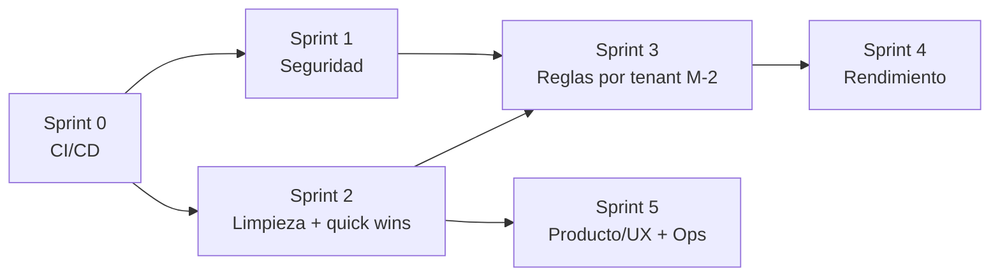

# 22 · Plan de Remediación de Deuda Técnica

Plan de trabajo para resolver los hallazgos de [15-deuda-tecnica](15-deuda-tecnica.md), secuenciado por riesgo y dependencias. Cada ítem referencia su ID en ese documento (gravedad, explicación e impacto completos viven ahí; aquí solo el plan de ejecución).

> **Mantenimiento de este documento**: al cerrar un ítem, márcalo `✅ Hecho` aquí con la fecha y el commit, y **actualiza `15-deuda-tecnica.md`** (mover el hallazgo a un estado resuelto o eliminarlo de la tabla priorizada, según corresponda). Los dos documentos deben quedar consistentes — no cerrar aquí sin reflejarlo allá.

## Principio de secuenciación

Primero la red de seguridad (CI), porque protege todo cambio posterior. Luego seguridad por gravedad (S-1 🔴 abre el sprint). La limpieza de arquitectura va antes que M-2 (reglas por tenant), que es la pieza más grande y se apoya en terreno despejado. Rendimiento, producto y ops cierran.

## Sprint 0 · Red de seguridad — `O-1, O-3` — *habilita todo lo demás* — ✅ Hecho

- [x] `.github/workflows/ci.yml`: job `backend` (Postgres 16 de servicio + dependencias nativas de WeasyPrint + `alembic upgrade head` + `pytest` con cobertura), job `frontend` (`tsc --noEmit`, `npm test`, `npm run build`). Corre en push/PR a `main`.
- [x] `pytest-cov` añadido a `backend/requirements.txt`; `--cov-fail-under=80` (piso fijado con margen sobre la cobertura real medida, ~84%).
- [x] `@types/jest` añadido al frontend — sin él, `tsc --noEmit` fallaba en los 4 archivos de test (`expect`/`describe`/`it` sin tipar); ahora el typecheck de CI cubre también los tests.
- [x] **Bug real encontrado y corregido durante la verificación**: la migración `a70ab36472b6_add_payload_json_to_sync_jobs.py` nunca se había ejecutado contra Postgres real (los tests usan SQLite vía `create_all`, no la cadena de Alembic) y fallaba con `NameError: Text is not defined`. Corregida a `sa.Text()`. Ver detalle en [15-deuda-tecnica §O-1](15-deuda-tecnica.md).
- [x] `.gitignore`: añadido `**/.coverage` (artefacto de `pytest-cov`).
- **Verificación**: 262 tests backend pasan (84% cobertura); `alembic upgrade head` aplica limpio contra Postgres 16 real (probado localmente); frontend `tsc --noEmit`, `npm test` (14 tests) y `npm run build` pasan limpios.
- **Salida**: ningún merge a `main` sin tests verdes. *Esfuerzo: Bajo-Medio.*

## Sprint 1 · Seguridad

- [ ] **S-1 · RBAC 🔴** — dependencia `require_role(*roles)` en FastAPI que lea `OrganizationUser.role` de la org activa. Aplicar a los endpoints de escritura: `POST /actions/{id}/approve`, `PUT /organizations/my`, `POST /organizations/my/ad-accounts`, `POST .../archive`, `POST .../restore`, `PATCH .../pages/{id}/whatsapp`, `POST /campaigns/sync-trigger`, `POST /campaigns/` (crear), `POST /insights/{id}/dismiss`, `POST /insights/analyze-trigger`. Matriz `ADMIN` > `OPERATOR` > `VIEWER`. Tests por rol. *Medio.*
- [ ] **S-2 · Tokens fuera de `localStorage` 🟠** — mover el refresh a cookie `httpOnly`+`Secure`+`SameSite`; `access` en memoria; CSP estricta. Toca `lib/api.ts`, `auth.py` y el guard del layout. *Medio.*
- [ ] **S-3 · Blocklist fail-open 🟠** — decisión consciente: fail-**closed** para el refresh (rechazar si Redis no responde), fail-open para el resto; healthcheck de Redis. *Bajo.*
- [ ] **S-4 🟡** — `X-Forwarded-For` solo desde el proxy conocido. *Bajo.*
- [ ] **S-5 🟡** — delimitar/escapar el contenido de Meta (nombres de campaña, copy) en los prompts del LLM. *Bajo.*

## Sprint 2 · Limpieza de arquitectura + quick wins

- [ ] **M-1 · Consolidar cliente Meta 🟠** — canónico = `MetaAPIRateLimiter`. Borrar la isla muerta: `services/meta_api_client.py`, `services/rate_limiter.py`, `services/meta_credential_service.py` (confirmado sin llamadores vivos fuera de sí mismos). *Medio.*
- [ ] **M-3 · Modelos marginales 🟡** — confirmar y eliminar `models/campaign.py`, `models/campaign_metrics_history.py`, `create/consume_temp_token`; migración de drop de tablas. *Bajo.*
- [ ] **M-4 · Tipos desde OpenAPI 🟡** — script `openapi-typescript` que genere `frontend/lib/types.ts`; elimina la deriva manual. *Bajo.*
- [ ] **UX-2 · `reject_reason` 🟡** *(quick win)* — añadir el campo a `AIActionResponse` (`schemas.py`) y renderizarlo en `/actions` (historial). *Trivial.*

## Sprint 3 · Reglas por tenant — `M-2 🟠 Alto` — *la pieza mayor*

- [ ] Tabla `organization_campaign_rules` / `organization_thresholds` (geo, moneda, objetivo, placements, umbrales de `AIThresholds`).
- [ ] `get_thresholds_for_org` y `TENANT_CAMPAIGN_RULES` leen de BD; migración + seed con los defaults Lima/PEN actuales (sin romper el parque existente).
- [ ] Quitar el hardcode de `2771`/`PEN` en engine, targeting y modifier. *Alto — planificar aparte, requiere su propio diseño detallado antes de implementar.*

## Sprint 4 · Rendimiento

- [ ] **P-1 · Paralelizar sync 🟠** — `asyncio.gather` de las lecturas independientes por cuenta dentro de `run_sync`; medir duración antes/después. *Medio.*
- [ ] **P-2 · Estado en memoria 🟡** — mover `temp_tokens` a Redis (el WS ya usa pubsub, solo falta esto). *Bajo.*

## Sprint 5 · Producto/UX + Ops

- [ ] **UX-1** — componente `StatusBadge` único, usado en dashboard (`(dashboard)/page.tsx`) y lista de campañas (`campaigns/page.tsx`).
- [ ] **UX-3** — subir 1–2 `findings`/`recommendations` al dashboard (el dato ya viaja en `brief-data`).
- [ ] **IA-1** — checklist de encendido de write-back (`F-2` allowlist) + tests de integración contra sandbox de Meta.
- [ ] **O-2** — migraciones en init-container antes de arrancar el API.

## Tabla maestra

| ID | Gravedad | Sprint | Esfuerzo | Depende de | Estado |
|----|----------|--------|----------|-----------|--------|
| O-1, O-3 | 🟠🟡 | 0 | Bajo-Medio | — | ✅ Hecho |
| S-1 | 🔴 | 1 | Medio | 0 | Pendiente |
| S-2 | 🟠 | 1 | Medio | 0 | Pendiente |
| S-3 | 🟠 | 1 | Bajo | 0 | Pendiente |
| S-4, S-5 | 🟡 | 1 | Bajo | 0 | Pendiente |
| M-1, M-3 | 🟠🟡 | 2 | Bajo-Medio | 0 | Pendiente |
| M-4, UX-2 | 🟡 | 2 | Bajo | 0 | Pendiente |
| M-2 | 🟠 | 3 | **Alto** | 1, 2 | Pendiente |
| P-1, P-2 | 🟠🟡 | 4 | Bajo-Medio | 0 | Pendiente |
| UX-1, UX-3, IA-1, O-2 | 🟡 | 5 | Bajo-Medio | 0 | Pendiente |

**Quick wins** para arrancar con impulso: UX-2, S-3, S-4, M-3 (todos bajos, sin dependencias más allá de CI).
