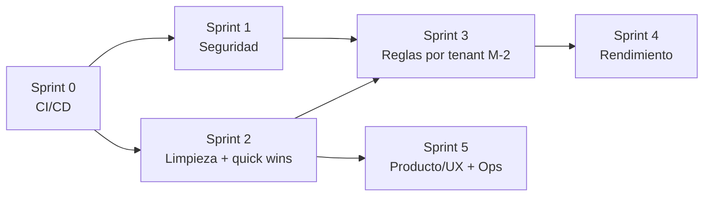

# 22 · Plan de Remediación de Deuda Técnica

Plan de trabajo para resolver los hallazgos de [15-deuda-tecnica](15-deuda-tecnica.md), secuenciado por riesgo y dependencias. Cada ítem referencia su ID en ese documento (gravedad, explicación e impacto completos viven ahí; aquí solo el plan de ejecución).

> **Mantenimiento de este documento**: al cerrar un ítem, márcalo `✅ Hecho` aquí con la fecha y el commit, y **actualiza `15-deuda-tecnica.md`** (mover el hallazgo a un estado resuelto o eliminarlo de la tabla priorizada, según corresponda). Los dos documentos deben quedar consistentes — no cerrar aquí sin reflejarlo allá.

## Principio de secuenciación

Primero la red de seguridad (CI), porque protege todo cambio posterior. Luego seguridad por gravedad (S-1 🔴 abre el sprint). La limpieza de arquitectura va antes que M-2 (reglas por tenant), que es la pieza más grande y se apoya en terreno despejado. Rendimiento, producto y ops cierran.

## Sprint 0 · Red de seguridad — `O-1, O-3` — *habilita todo lo demás* — ✅ Hecho

- [x] `.github/workflows/ci.yml`: job `backend` (Postgres 16 de servicio + dependencias nativas de WeasyPrint + `alembic upgrade head` + `pytest` con cobertura), job `frontend` (`tsc --noEmit`, `npm test`, `npm run build`). Corre en push/PR a `main`.
- [x] `pytest-cov` añadido a `backend/requirements.txt`; `--cov-fail-under=80` (piso fijado con margen sobre la cobertura real medida, ~84%).
- [x] `@types/jest` añadido al frontend — sin él, `tsc --noEmit` fallaba en los 4 archivos de test (`expect`/`describe`/`it` sin tipar); ahora el typecheck de CI cubre también los tests.
- [x] **Bug real encontrado y corregido durante la verificación**: la migración `a70ab36472b6_add_payload_json_to_sync_jobs.py` nunca se había ejecutado contra Postgres real (los tests usan SQLite vía `create_all`, no la cadena de Alembic) y fallaba con `NameError: Text is not defined`. Corregida a `sa.Text()`. Ver detalle en [15-deuda-tecnica §O-1](15-deuda-tecnica.md).
- [x] `.gitignore`: añadido `**/.coverage` (artefacto de `pytest-cov`).
- **Verificación**: 262 tests backend pasan (84% cobertura); `alembic upgrade head` aplica limpio contra Postgres 16 real (probado localmente); frontend `tsc --noEmit`, `npm test` (14 tests) y `npm run build` pasan limpios.
- **Salida**: ningún merge a `main` sin tests verdes. *Esfuerzo: Bajo-Medio.*

## Sprint 1 · Seguridad

- [x] **S-1 · RBAC 🔴** — ✅ Hecho. Dependencia `require_role(min_role)` en `app/utils/security.py` que reconsulta `OrganizationUser.role` de la org activa en cada request. Aplicada a los endpoints de escritura: `POST /actions/{id}/approve`, `PUT /organizations/my`, `POST /organizations/my/ad-accounts`, `POST .../archive`, `POST .../restore`, `PATCH .../pages/{id}/whatsapp`, `POST /campaigns/sync-trigger`, `POST /campaigns/upload-image`, `POST /campaigns/risk-preview`, `POST /campaigns/` (crear), `POST /insights/{id}/dismiss`, `POST /insights/analyze-trigger`. Jerarquía `ADMIN > OPERATOR > VIEWER`. Tests en `backend/tests/test_rbac.py` (7 tests: jerarquía en ambos sentidos, membresía faltante).
  - **Hallazgo adicional cerrado en el mismo cambio**: `POST /auth/signup` vinculaba como `ADMIN` a cualquiera que se registrara contra el slug de una organización YA EXISTENTE (sin invitación) — habría dejado el RBAC recién construido sin efecto (cualquiera podía auto-otorgarse ADMIN de un tenant ajeno). Signup ahora solo funda organizaciones nuevas; 400 si el slug ya existe. Ver [15-deuda-tecnica §S-1](15-deuda-tecnica.md) y [08-autenticacion §7](08-autenticacion.md).
- [x] **S-2 · Tokens fuera de `localStorage` 🟠** — ✅ Hecho. Refresh token movido a cookie `httpOnly`+`SameSite=Lax`(+`Secure` si HTTPS), fijada por `set_refresh_cookie`/`clear_refresh_cookie` (`app/utils/security.py`); nunca en el body de `/auth/login`, `/auth/signup`, `/auth/refresh`. Access token movido a memoria de módulo en `frontend/lib/api.ts` (`getAccessToken`/`hasAccessToken`), `user` sigue en `localStorage` (no sensible). Endpoints `/auth/refresh` y `/auth/logout` leen la cookie de `request.cookies` en vez de un body.
  - **Bug real encontrado y corregido**: `(dashboard)/layout.tsx` siempre forzaba `bootstrapSession()` (refresh por cookie) al montar, y `(auth)/login/page.tsx` navegaba con `window.location` tras login/signup — la recarga completa destruía el access token recién obtenido en memoria antes de usarlo, forzando SIEMPRE un refresh por cookie incluso con sesión recién válida. Corregido: login/signup navegan con `next/navigation`'s `useRouter().push()` (preserva memoria entre módulos); el guard solo llama a `bootstrapSession()` si no hay token ya en memoria (si lo hay, solo confirma con `GET /auth/me`).
  - **Limitación real descubierta y documentada, no corregida** (no aplica a producción): en desarrollo local con subdominios `*.localhost` (`cliente1.localhost:3000` + API en `localhost:8000`), Chrome no trata esos hosts como el mismo "site" para `SameSite`, así que un reload de página en ese modo pierde la sesión (cae al login). Confirmado con dos pruebas en vivo: (a) mismo flujo en `localhost:3000` sin subdominio → funciona; (b) `cliente1.localhost:3000` → falla solo al recargar. No afecta producción (dominio real, subdominios comparten site) ni el modo túnel/single-host (mismo origen). Ver workaround en [08-autenticacion](08-autenticacion.md).
  - **CSP estricta**: evaluada pero NO implementada en este cambio — Next.js inyecta scripts inline para la hidratación del App Router que una CSP sin `nonce`/`unsafe-inline` rompería, y verificar esto con rigor (sin romper hidratación en ningún modo de despliegue) es un cambio propio, no una extensión natural de mover cookies. La mitigación principal (httpOnly) ya cubre el objetivo central de S-2.
  - Tests nuevos: `backend/tests/test_audit_fixes.py` (`test_refresh_token_flow`, `test_refresh_without_cookie_rejected`, `test_refresh_rejects_access_token`, `test_logout_clears_cookie_and_revokes` — este último con un Redis en memoria simulado para ejercer la revocación real). `frontend/__tests__/login.test.tsx` actualizado al nuevo contrato (sin asserts de `localStorage`, mockea `next/navigation`). Verificado end-to-end en navegador real (signup, login, dashboard, reload) contra un Postgres/Redis locales.
  - *Esfuerzo real: Medio-Alto (más que lo estimado, por el bug de navegación y la investigación de SameSite).*
- [x] **S-3 · Blocklist fail-open 🟠** — ✅ Hecho. `is_revoked` (`app/utils/security.py`) es fail-**closed**: levanta `RevocationCheckUnavailable` si Redis no responde; `POST /auth/refresh` responde 503 en vez de aceptar el refresh a ciegas. `revoke_jti` (escritura) y el resto de la capa Redis siguen fail-open a propósito.
  - **Hallazgo real durante la implementación**: el cambio rompió varios tests de `/auth/refresh` que corrían con Redis genuinamente inalcanzable en el entorno de test — el fail-open anterior lo ocultaba en silencio (is_revoked devolvía `False`, el refresh se aceptaba igual). Se agregó un fake Redis en memoria por test (mismo patrón que `tests/test_throttle.py`), no un fixture global — se investigó y descartó una fixture global (`fakeredis` + autouse) por romper la convención ya establecida del repo de fakes locales por archivo, usados también para probar fail-open a propósito en otros mecanismos.
  - Tests nuevos: `test_refresh_fails_closed_when_redis_unavailable` en `backend/tests/test_audit_fixes.py`.
- [x] **S-4 🟡** — ✅ Hecho. `get_client_ip` (`app/api/v1/auth.py`) solo confía en `X-Forwarded-For` si el peer directo es una IP privada/loopback (Nginx, dentro de la red de docker — el backend nunca se publica al host en prod, `expose` no `ports`). Si el peer directo fuera público, se ignora el header. Tests en `backend/tests/test_client_ip.py` (4 tests).
- [x] **S-5 🟡** — ✅ Hecho. El texto libre interpolado en los prompts del LLM (nombre de org/cuenta, `product_name`, nombre/copy de la campaña ganadora) se envuelve en delimitadores explícitos (`_delimit_untrusted`, `app/services/ai/llm.py`); el `system_prompt` de ambas llamadas (Master Brief y copy de campaña) instruye tratar ese contenido como dato, nunca como instrucción. Los datos que ya viajaban en bloques `json.dumps(...)` no se tocaron (el escapado de JSON ya los protegía). Tests: `test_suggest_campaign_copy_delimits_untrusted_content`, `test_org_and_account_name_delimited_against_prompt_injection`.

**Sprint 1 completo — los 5 hallazgos de seguridad (S-1 a S-5) están resueltos.**

## Sprint 2 · Limpieza de arquitectura + quick wins

- [x] **M-1 · Consolidar cliente Meta 🟠** — ✅ Hecho. Canónico = `MetaAPIRateLimiter`. Eliminada la isla muerta confirmada sin llamadores vivos: `services/meta_api_client.py`, `services/rate_limiter.py`, `services/meta_credential_service.py`. También el modelo huérfano `TenantApiQuota` (tabla `tenant_api_quotas`, migración `a4f8c2d6e9b1` con downgrade fiel, probada en Postgres real ida y vuelta). Cobertura del backend 84%→86% solo por quitar código sin cubrir.
  - **Hallazgo adicional para M-3**: `services/audit_log_service.py` + el modelo `ActionLog` (solo él lo escribe) resultaron ser la misma categoría de código muerto — se dejan para el ítem M-3 de abajo.
- [x] **M-3 · Modelos marginales 🟡** — ✅ Hecho. Confirmado con grep exhaustivo que ninguno tenía consumidor real: eliminados `models/campaign.py`, `models/campaign_metrics_history.py`, `models/action_log.py`, `services/audit_log_service.py`, y `create_temp_token`/`consume_temp_token`/`temp_tokens` de `app/utils/security.py` (import `time` también quedó sin uso, removido). Migración `b7e2f4a8c3d5` (drop de `campaign_metrics_history` → `campaigns` → `action_logs`, orden por FK; downgrade fiel, probado ida y vuelta contra Postgres real). Cobertura del backend: 86.34% → 86.74%.
- [x] **M-4 · Tipos desde OpenAPI 🟡** — ✅ Hecho. Se agregó `response_model` Pydantic a **todos** los endpoints que devolvían dicts planos (nuevo `app/schemas/response_schemas.py`: `BriefDataResponse`, `KpisSummaryResponse`, `SpendHistoryResponse`, `AiUsageResponse`, `ApiCallHistoryEntry`, `SuggestionResponse`, `LearningLogResponse`, `AiModelsResponse`, `BusinessPoliciesResponse`, `MessageResponse` y afines) — antes eran la única razón por la que `frontend/lib/types.ts` no podía generarse solo. `frontend/lib/generated-api-types.ts` se genera con `npm run generate-types` (`openapi-typescript` contra `GET /openapi.json`); `lib/types.ts` quedó como alias fino sobre ese archivo, sin cambiar los nombres que ya usaban `lib/api.ts` y las páginas.
  - **Esfuerzo real: mayor al estimado** ("Bajo" en el plan original) — declarar los `response_model` faltantes para que el OpenAPI schema fuera completo fue la mayor parte del trabajo, no la generación en sí.
  - Efecto colateral: los tipos generados son más estrictos (`Dict[str, Any]` → `{[key: string]: unknown}`, no `any`), lo que expuso 5 puntos donde el frontend leía JSON libre sin narrowing (`execution_result`, `payload.result`, `targeting` en 3 páginas) — corregidos con un cast local puntual en cada uno. `tsc --noEmit`, `npm test` y `npm run build` limpios; verificado en navegador real.
- [x] **UX-2 · `reject_reason` 🟡** *(quick win)* — ✅ Hecho. `reject_reason` y `rejected_at` agregados a `AIActionResponse` (`schemas.py`). Sin cambios de frontend — `/actions` ya tenía el JSX listo, solo esperaba el dato. Test: `test_action_reject_exposes_reason_in_response`.

**Sprint 2 completo.**

## Sprint 3 · Reglas por tenant — `M-2 🟠 Alto` — *la pieza mayor*

- [ ] Tabla `organization_campaign_rules` / `organization_thresholds` (geo, moneda, objetivo, placements, umbrales de `AIThresholds`).
- [ ] `get_thresholds_for_org` y `TENANT_CAMPAIGN_RULES` leen de BD; migración + seed con los defaults Lima/PEN actuales (sin romper el parque existente).
- [ ] Quitar el hardcode de `2771`/`PEN` en engine, targeting y modifier. *Alto — planificar aparte, requiere su propio diseño detallado antes de implementar.*

## Sprint 4 · Rendimiento

- [ ] **P-1 · Paralelizar sync 🟠** — `asyncio.gather` de las lecturas independientes por cuenta dentro de `run_sync`; medir duración antes/después. *Medio.*
- [ ] **P-2 · Estado en memoria 🟡** — mover `temp_tokens` a Redis (el WS ya usa pubsub, solo falta esto). *Bajo.*

## Sprint 5 · Producto/UX + Ops

- [ ] **UX-1** — componente `StatusBadge` único, usado en dashboard (`(dashboard)/page.tsx`) y lista de campañas (`campaigns/page.tsx`).
- [ ] **UX-3** — subir 1–2 `findings`/`recommendations` al dashboard (el dato ya viaja en `brief-data`).
- [ ] **IA-1** — checklist de encendido de write-back (`F-2` allowlist) + tests de integración contra sandbox de Meta.
- [ ] **O-2** — migraciones en init-container antes de arrancar el API.

## Tabla maestra

| ID | Gravedad | Sprint | Esfuerzo | Depende de | Estado |
|----|----------|--------|----------|-----------|--------|
| O-1, O-3 | 🟠🟡 | 0 | Bajo-Medio | — | ✅ Hecho |
| S-1 | 🔴 | 1 | Medio | 0 | ✅ Hecho |
| S-2 | 🟠 | 1 | Medio | 0 | ✅ Hecho |
| S-3 | 🟠 | 1 | Bajo | 0 | ✅ Hecho |
| S-4, S-5 | 🟡 | 1 | Bajo | 0 | ✅ Hecho |
| M-1 | 🟠 | 2 | Medio | 0 | ✅ Hecho |
| M-3 | 🟡 | 2 | Bajo | 0 | ✅ Hecho |
| M-4, UX-2 | 🟡 | 2 | Bajo | 0 | ✅ Hecho |
| M-2 | 🟠 | 3 | **Alto** | 1, 2 | Pendiente |
| P-1, P-2 | 🟠🟡 | 4 | Bajo-Medio | 0 | Pendiente |
| UX-1, UX-3, IA-1, O-2 | 🟡 | 5 | Bajo-Medio | 0 | Pendiente |

**Quick wins** para arrancar con impulso: UX-2, S-3, S-4, M-3 (todos bajos, sin dependencias más allá de CI).
