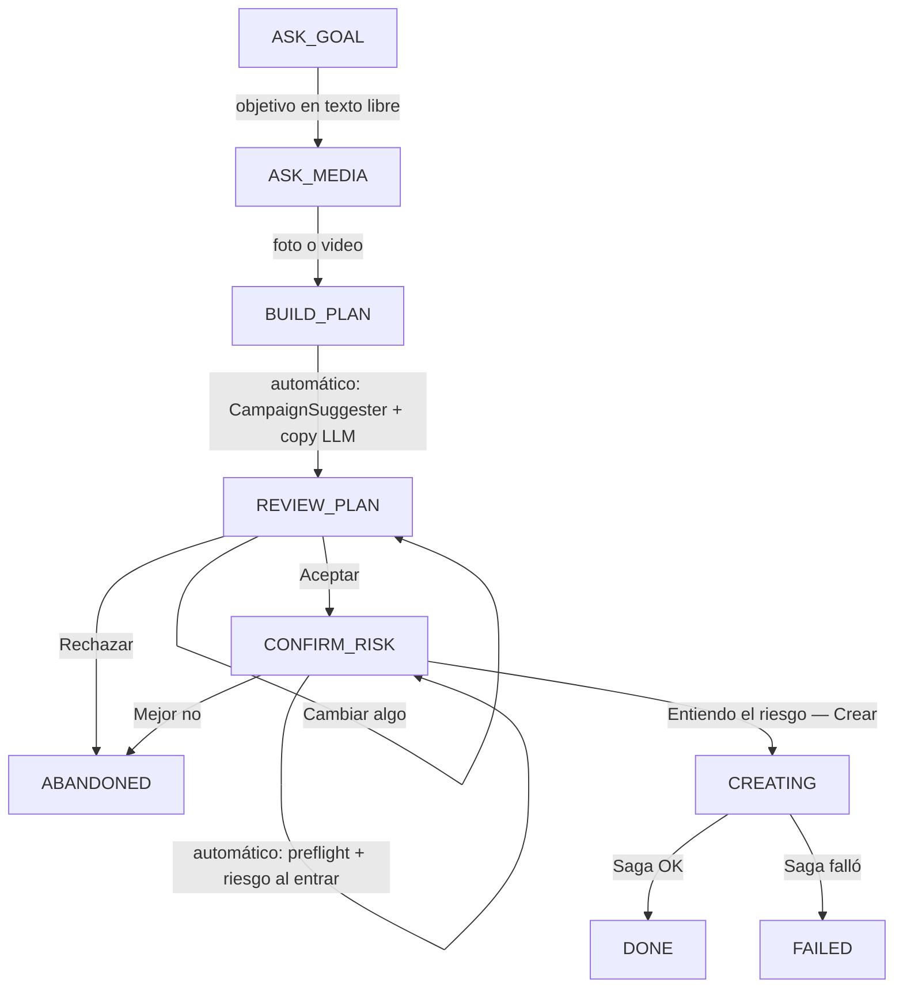

# 23 · Chat de creación de campañas (CH-1)

Segunda puerta de entrada al mismo motor de [20-creacion-campanas](20-creacion-campanas.md): en vez del formulario, un cliente sin experiencia en Meta Ads arma la campaña conversando — sube una foto, dice en criollo qué quiere lograr, y revisa/acepta/rechaza dos tarjetas antes de que se cree nada. No hay un segundo camino de escritura: el chat termina llamando exactamente a `start_campaign_creation`, la misma función que usa `POST /campaigns/`.

## 1. Principio de diseño

Una máquina de estados **determinista** es dueña de los datos y de toda acción irreversible. El LLM se usa **solo** para interpretar texto libre ambiguo — nunca elige una cifra (regla AI-1): si el usuario no escribió un dígito literal, cualquier número que el LLM proponga se descarta (`extraction.strip_numeric_slots_without_digit_evidence`). El chat funciona por completo con `MOCK_SERVICES=true` o sin API key — es lo que corre en CI.

## 2. Máquina de estados (`app/services/campaign_chat/machine.py`)

`next_state(SessionFacts)` es una función PURA del conjunto de slots llenos, no un contador lineal: si el usuario contesta el objetivo y ya venía con la foto en el mismo turno, se salta `BUILD_PLAN` directo. `REVIEW_PLAN`/`CONFIRM_RISK` son compuertas — solo una decisión explícita (botón o "sí"/"no" en texto libre cuando hay una tarjeta pendiente) las mueve.

**Matriz de invalidación** (`invalidation_for_changed_slots`): cambiar `goal_text`/`product_name`/`image_path`/`video_path` obliga a rehacer la propuesta entera (el copy depende de esos datos); cambiar solo `budget`/`days`/`page_id`/`whatsapp_number`/copy mantiene la propuesta pero exige volver a aceptar y re-correr preflight+riesgo. Sin esto, "subí el presupuesto" podría terminar creando con el monto viejo.

## 3. Extracción de slots (`extraction.py` + `OpenRouterClient.extract_campaign_slots`)

1. **Determinista primero** (`extract_message`): regex en español para aceptar/rechazar/cancelar (ancladas al inicio — "no sé si sí" no es un "sí"), presupuesto (`S/.`, `soles`, separadores de miles/decimales es/en), días (número, "una semana", "un mes"), tipo de presupuesto (diario/total), WhatsApp. `sanitize_product_name` (en `slots.py`) transllitera tildes/ñ/emojis y filtra palabras de relleno — es lo que evita que "Cerámicas Piñero 🔥" rompa la regex `^[A-Za-z0-9 _-]+$` de `CampaignValidator` (constante compartida `PRODUCT_NAME_PATTERN`).
2. **LLM solo si el determinista devuelve `unclear`** (`app/services/ai/llm.py::extract_campaign_slots`, prompt versionado `CAMPAIGN_CHAT_PROMPT_VERSION`): `temperature=0`, `response_format: json_object`, modelo más barato del proveedor activo (es clasificación de un mensaje corto, no redacción). El texto del usuario viaja envuelto en `_delimit_untrusted` con `_PROMPT_INJECTION_GUARD` — es la primera superficie donde texto de un usuario final entra directo a un prompt. `UsageContext(feature="campaign_chat")` lo deja medido en `GET /ai-usage`.
3. **Guardas del motor, no del LLM**: `strip_numeric_slots_without_digit_evidence` descarta `budget`/`days` si no hay un dígito literal en el mensaje, sin importar qué haya devuelto el modelo. Tope `MAX_LLM_TURNS_PER_SESSION=12` por sesión.

Sin LLM (CI), solo los cambios numéricos vía texto libre funcionan; cambios de copy/headline en texto libre necesitan el LLM y se degradan a "no entendí" si no hay API key — el chat sigue siendo usable de punta a punta con los botones.

## 3b. Preguntas sobre la marca (CH-6, `questions.py`)

El chat también responde preguntas sobre los datos reales de la cuenta, en cualquier momento de la conversación y sin perder el lugar: el estado y los slots no se tocan, y después de responder se vuelve a plantear lo que estaba pendiente.

**Alcance cerrado a propósito.** Solo datos de la marca y cómo funciona el producto. Temas soportados: gasto, leads/conversaciones, CPL, mejor/peor campaña, listado de campañas, resumen, alertas, recomendaciones, presupuesto sugerido, CTR, público que mejor rinde, página/WhatsApp de destino, cómo funciona el chat y por qué la campaña queda pausada.

**Costo cero en tokens.** La clasificación es por regex sobre el texto sin tildes (son preguntas básicas y repetitivas) y las respuestas se arman con cifras de la base — el LLM no participa. Y lo más importante: una pregunta **fuera de tema también se resuelve acá** (`intent="off_topic"`), en vez de caer en `unclear` y disparar una llamada al modelo para intentar entenderla. Preguntar "¿cuánto está el dólar?" cuesta 0 tokens.

**De dónde salen las cifras — dos fuentes, a propósito.** Las de titular (gasto, conversaciones, costo por conversación y sus Δ%) salen de `get_kpis_with_deltas`, *la misma función que alimenta las tarjetas del Resumen*: si el usuario pregunta "¿cuánto gasté?" mientras mira el dashboard, los dos números tienen que coincidir. `ReportBuilder` se usa solo para lo que no tiene equivalente en KPIs (ranking de campañas, alertas, recomendaciones, segmentación, CTR/alcance).

> ⚠️ **Desfase conocido, previo a este chat:** para la misma etiqueta "7 días", `ReportBuilder` filtra `date >= hoy - 7` **sin límite superior** (incluye hoy → 8 días de datos) mientras que `kpi_period` corta en `date < hoy` (7 días). En la verificación esto daba S/. 1243.56 en el chat contra S/. 1085.47 en el dashboard. Arreglarlo toca Master Brief, PDF y motor de IA, así que quedó fuera de alcance: el chat se alineó con el dashboard eligiendo la fuente correcta para cada cifra.

**Objetivo vs. pregunta en `ASK_GOAL`.** Una frase con forma de pregunta puede ser el objetivo dicho con cortesía ("¿me ayudás a vender zapatillas?"). Lo que las separa es un verbo comercial (`vender|promocionar|anunciar|ofrecer|…`): con él se toma como objetivo, sin él se rechaza por fuera de tema. Sin esta regla, "¿cuánto está el dólar hoy?" terminaba guardado como nombre del producto.

## 4. Persistencia — `CampaignChatSession` (`app/models/campaign_chat_session.py`)

Mismo criterio que `CampaignDraft.payload`: el estado de un proceso multi-turno vive en columnas JSON, no en tablas propias. `messages_json` es la transcripción completa — se lee entera y se reasigna entera en cada turno (nunca `.append()` in-place: SQLAlchemy no detecta la mutación de un `JSON` y el mensaje se perdería en silencio).

`draft_id` es **UNIQUE + nullable**: la garantía dura de que una sesión crea como máximo una campaña. Un doble clic en "Aceptar" en la tarjeta de riesgo pasa por tres capas: `client_turn_id` repetido es un no-op (`process_decision` corta antes de tocar nada), `if session.draft_id:` corta si ya se creó, y el `UNIQUE` de la columna es el backstop de base de datos.

`proposal_json["_accepted"]` guarda si la propuesta ya fue aceptada — se reescribe a `False` cada vez que la matriz de invalidación lo exige, en vez de tener una columna aparte.

## 5. Endpoints — `/api/v1/campaigns/chat` (`app/api/v1/campaign_chat.py`)

| Método | Ruta | Rol | Qué hace |
|---|---|---|---|
| POST | `/sessions` | OPERATOR | Resuelve cuenta + página/WhatsApp (`resolve_destination`) y tope anti-bloqueo ANTES de saludar — si algo falta, error accionable de una vez, sin dejar avanzar el chat para fallar al final |
| GET | `/sessions` | user | Lista sesiones de la organización |
| GET | `/sessions/{id}` | user | Sesión + transcripción; si `state=="CREATING"`, materializa el mensaje de progreso/resultado/error leyendo `CampaignDraft` **sin persistir** |
| POST | `/sessions/{id}/messages` | OPERATOR | Turno de texto libre o de un archivo ya subido (`image_path`/`video_path` de `POST /campaigns/upload-image\|upload-video`, reusados tal cual) |
| POST | `/sessions/{id}/decision` | OPERATOR | La compuerta estilo Claude Code: `{card_id, decision: accept\|reject\|change, text?}` |
| POST | `/sessions/{id}/advance` | OPERATOR | Igual que el GET pero SÍ persiste — lo que el frontend llama cada ~2.5s mientras la Saga corre, cortocircuitado por el evento WS `campaign_creation` |

Montado en `main.py` **antes** que el router de `/campaigns` (prefijo `/campaigns/chat`, para que ninguna ruta con parámetro de `campaigns.py` pueda ensombrecerlo a futuro).

**Fallas de dominio son mensajes de chat, no errores HTTP.** El tope de campañas alcanzado, un preflight rechazado por Meta, o una Saga fallida devuelven `200` con una tarjeta `error` (`code: CAP_REACHED|PREFLIGHT_FAILED|SAGA_FAILED|VALIDATION`) — solo 401/403/404 (auth y aislamiento de tenant) son errores HTTP reales. Un chat que tira un toast en vez de seguir la conversación está roto.

## 6. Contrato — unión discriminada (`app/schemas/response_schemas.py`)

`ChatMessage` es `Union[ChatTextMessage, ChatMediaMessage, ChatReviewCard, ChatRiskCard, ChatProgressMessage, ChatResultMessage, ChatErrorMessage]` con `discriminator="type"` — se renderiza en OpenAPI como `oneOf` + `discriminator.mapping`, así `openapi-typescript` genera una unión TS real que el frontend puede `switch` sin castear. `ChatReviewCard.copy_preview` reusa `SuggestionCopy`; `ChatRiskCard.preflight_checks` reusa `PreflightCheck` — el mismo shape que ya usaba el formulario, no una copia nueva.

## 7. Reutilización — nada se duplica

| Paso | Función reusada |
|---|---|
| Página + WhatsApp de destino | `app/services/campaign_destination.py::resolve_destination` — extraída de `AIExecutor._dispatch_campaign_creation_saga`, ahora la usan los dos |
| Propuesta (números + copy) | `app/services/campaign_proposal.py::build_campaign_proposal` — extraída de `GET /campaigns/suggestion` |
| Crear de verdad | `app/services/campaign_creation.py::start_campaign_creation` — extraída de `POST /campaigns/`; ambos llaman a esto, ninguno construye su propio `CampaignDraft`/`CampaignLearningLog`/chain de Celery |
| Validar contra Meta sin crear | `CampaignPreflight.run()` — antes nadie lo llamaba desde ningún frontend |
| Riesgo | `assess_campaign_risk()` |
| product_name sin tildes | `CampaignValidator.PRODUCT_NAME_PATTERN` (constante compartida) |
| JSON tolerante de un LLM | `_extract_json_object()` en `llm.py`, del que `_parse_copy_json` también tira |

## 8. Frontend — `/campaigns/chat`

`frontend/app/(dashboard)/campaigns/chat/page.tsx` + `frontend/components/campaign-chat/*`. Sin librería de chat ni de estado: `useState`/`useEffect` sobre `ChatSessionResponse`, igual que el resto del dashboard. El botón **💬 Chat** en [campaigns/page.tsx](../frontend/app/(dashboard)/campaigns/page.tsx) es ahora el `btn-primary` resaltado; "+ Crear Campaña" pasó a `btn-secondary` — el chat es la puerta de entrada recomendada, el formulario sigue disponible para quien lo prefiera ("Usar el formulario").

- **Preview de imagen/video**: el backend no sirve los archivos subidos por HTTP (`MEDIA_ROOT` es interno, solo la Saga lo lee del disco). La preview vive en un `blob:` local (`URL.createObjectURL`) mientras dura la pestaña — igual que el formulario. Tras recargar la página se ve un marcador ("📷 Foto adjunta") en vez de una imagen rota.
- **Polling + WS**: mismo patrón que `campaigns/new/page.tsx` — `POST /advance` cada 2.5s (tope 120 intentos ≈ 5 min), cortocircuitado por el evento WS `campaign_creation` con `job_id === draft_id`.
- **`RISK_STYLES`** se extrajo de `campaigns/new/page.tsx` a `lib/badge.ts` para que el formulario y el chat pinten el mismo color por nivel de riesgo sin mantener dos copias.

## 9. Verificado manualmente (2026-08-13)

Flujo completo contra el stack local de Docker Compose con `MOCK_SERVICES=true`: sesión → objetivo en texto libre ("quiero vender más cables eléctricos para constructoras en Lima", producto normalizado a "Cables Electricos Constructoras Lima") → foto subida → tarjeta de revisión con evidencia real del histórico sincronizado (mock) → Aceptar → tarjeta de riesgo BAJO con preflight → Aceptar → Saga dispatchada → `CampaignDraft` creado y polling/advance funcionando en vivo. Ver capturas en la sesión de trabajo.
