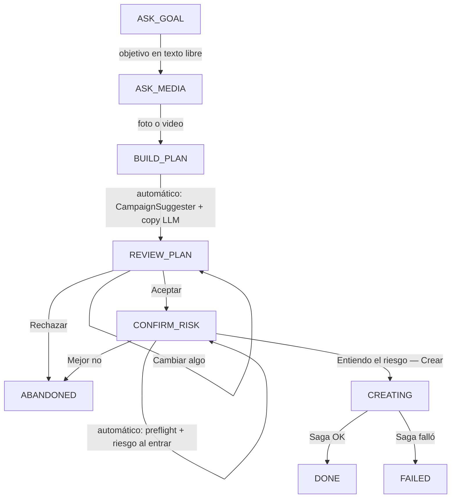

# 23 · Chat de creación de campañas (CH-1)

Segunda puerta de entrada al mismo motor de [20-creacion-campanas](20-creacion-campanas.md): en vez del formulario, un cliente sin experiencia en Meta Ads arma la campaña conversando — sube una foto, dice en criollo qué quiere lograr, y revisa/acepta/rechaza dos tarjetas antes de que se cree nada. No hay un segundo camino de escritura: el chat termina llamando exactamente a `start_campaign_creation`, la misma función que usa `POST /campaigns/`.

## 1. Principio de diseño

Una máquina de estados **determinista** es dueña de los datos y de toda acción irreversible. El LLM se usa **solo** para interpretar texto libre ambiguo — nunca elige una cifra (regla AI-1): si el usuario no escribió un dígito literal, cualquier número que el LLM proponga se descarta (`extraction.strip_numeric_slots_without_digit_evidence`). El chat funciona por completo con `MOCK_SERVICES=true` o sin API key — es lo que corre en CI.

## 2. Máquina de estados (`app/services/campaign_chat/machine.py`)



`next_state(SessionFacts)` es una función PURA del conjunto de slots llenos, no un contador lineal: si el usuario contesta el objetivo y ya venía con la foto en el mismo turno, se salta `BUILD_PLAN` directo. `REVIEW_PLAN`/`CONFIRM_RISK` son compuertas — solo una decisión explícita (botón o "sí"/"no" en texto libre cuando hay una tarjeta pendiente) las mueve.

**Matriz de invalidación** (`invalidation_for_changed_slots`): cambiar `goal_text`/`product_name`/`image_path`/`video_path` obliga a rehacer la propuesta entera (el copy depende de esos datos); cambiar solo `budget`/`days`/`page_id`/`whatsapp_number`/copy mantiene la propuesta pero exige volver a aceptar y re-correr preflight+riesgo. Sin esto, "subí el presupuesto" podría terminar creando con el monto viejo.

## 3. Extracción de slots (`extraction.py` + `OpenRouterClient.extract_campaign_slots`)

1. **Determinista primero** (`extract_message`): regex en español para aceptar/rechazar/cancelar (ancladas al inicio — "no sé si sí" no es un "sí"), presupuesto (`S/.`, `soles`, separadores de miles/decimales es/en), días (número, "una semana", "un mes"), tipo de presupuesto (diario/total), WhatsApp. `sanitize_product_name` (en `slots.py`) transllitera tildes/ñ/emojis y filtra palabras de relleno — es lo que evita que "Cerámicas Piñero 🔥" rompa la regex `^[A-Za-z0-9 _-]+$` de `CampaignValidator` (constante compartida `PRODUCT_NAME_PATTERN`).
2. **LLM solo si el determinista devuelve `unclear`** (`app/services/ai/llm.py::extract_campaign_slots`, prompt versionado `CAMPAIGN_CHAT_PROMPT_VERSION`): `temperature=0`, `response_format: json_object`, modelo más barato del proveedor activo (es clasificación de un mensaje corto, no redacción). El texto del usuario viaja envuelto en `_delimit_untrusted` con `_PROMPT_INJECTION_GUARD` — es la primera superficie donde texto de un usuario final entra directo a un prompt. `UsageContext(feature="campaign_chat")` lo deja medido en `GET /ai-usage`.
3. **Guardas del motor, no del LLM**: `strip_numeric_slots_without_digit_evidence` descarta `budget`/`days` si no hay un dígito literal en el mensaje, sin importar qué haya devuelto el modelo. Tope `MAX_LLM_TURNS_PER_SESSION=12` por sesión.

Sin LLM (CI), solo los cambios numéricos vía texto libre funcionan; cambios de copy/headline en texto libre necesitan el LLM y se degradan a "no entendí" si no hay API key — el chat sigue siendo usable de punta a punta con los botones.

## 3a. Cómo suena: reescritura conversacional (CH-7, `rephrase.py`)

El código decide **qué** se dice; el LLM reescribe **cómo**. El motor arma el texto canónico —con todas las cifras ya calculadas— y `_say()` se lo pasa a `OpenRouterClient.rephrase_chat_message` junto con el último mensaje del cliente, para que la respuesta reaccione a lo que la persona acaba de escribir en vez de repetir una plantilla.

**Al modelo no se le cree.** `rephrase.is_safe_rephrase` compara la reescritura contra el original y exige:

| Control | Por qué |
|---|---|
| **Igualdad** de números (normalizados: `1.085,47` == `1085.47`) | Un número de más es una cifra inventada; uno de menos es la respuesta que perdió el dato por el que preguntaron. |
| Mismos enlaces, sin agregar ni quitar | El link a Ads Manager lleva el `act=` real. |
| Largo entre 0.4× y 1.8× del original (el piso solo para textos ≥120 caracteres) | Detecta que se comió media respuesta o que se puso a agregar cosas. Los textos cortos sí se pueden acortar: es lo que los hace sonar a persona. |

Si algo no cuadra, se descarta la reescritura **entera** y se usa el texto canónico. Eso es lo que mantiene AI-1 en pie con el LLM redactando: no depende de que el prompt funcione.

**Alcance y costo.** Como mucho **un** mensaje reescrito por turno, tope `MAX_REPHRASED_TURNS=30` contra `turn_count` — deliberadamente **no** contra `llm_calls`, porque ese presupuesto es para *entender* al usuario (funcional) y esto es cosmético: quedarse sin comprensión a mitad de la conversación por haber gastado el cupo en redacción sería el peor intercambio posible. No se reescriben: el saludo, `BUILDING_TEXT` (relleno justo antes del paso más lento), las tarjetas estructuradas, ni los textos de error/tope/guarda, donde la precisión importa más que el tono. Sin API key o con `MOCK_SERVICES` no hay reescritura y el chat responde con los textos fijos — es lo que corre en CI.

> Esta rigidez es para el **flujo de creación**, donde cada palabra empuja a una acción irreversible. Para las preguntas sobre el pasado el LLM tiene mucho más margen — ver §3c.

## 3c. Análisis del historial: el LLM redacta (CH-8)

En las preguntas sobre lo que ya pasó, el modelo **compone** en vez de maquillar: `answer_question` devuelve `(texto_plantilla, facts)` y `_analyze()` le pasa las cifras en crudo a `compose_chat_answer`. Puede elegir qué destacar, comparar campañas y explicar qué significa un número — que es lo que hace que se lea como un analista y no como un formulario.

**Lo que lo hace seguro no es el prompt sino `rephrase.numbers_are_grounded`:**

```python
numeric_tokens(respuesta) <= numeric_tokens(facts)
```

**Subconjunto, no igualdad.** Ahí está exactamente la libertad: el modelo omite lo que no viene al caso y ordena el resto a su gusto. Lo que no puede es escribir un número que no esté en los datos — y eso **incluye los que calcule él**. Si le damos gasto y conversaciones y escribe el costo por conversación, esa división es una cifra nueva y tumba la respuesta entera, aunque el resultado sea correcto: no salió de una query. Puede decir "casi el doble" con palabras; no puede decir "2.7".

Cuando algo falla —sin API key, `MOCK_SERVICES`, error HTTP, o la guarda rechaza— se muestra la plantilla del código, que siempre es una respuesta válida por sí sola.

### Ventana de análisis (`period.py`)

Antes toda respuesta hablaba de 7 días fijos. Ahora `parse_period` traduce lo que escribió la persona: "hoy", "esta semana", "el mes pasado", "los últimos 45 días", "desde que empecé".

- **El número sale del texto del usuario** (un dígito literal) o de un catálogo cerrado de frases. El LLM solo puede elegir una **etiqueta** de `PERIOD_ENUM` (`7d`/`30d`/`90d`/`180d`/`all`), nunca proponer un entero — misma disciplina que `strip_numeric_slots_without_digit_evidence`. Si el texto trae un dígito, ese gana sobre la etiqueta del modelo.
- **Techo:** `SNAPSHOT_RETENTION_DAYS` (180). Más atrás los snapshots están en las tablas de archivo, que ni `ReportBuilder` ni `kpi_period` consultan.
- **Piso honesto:** `kpi_period.days_of_history` recorta la ventana a lo que hay sincronizado. Pedir 90 días con 10 de datos responde sobre 10 **y lo dice** (`"los últimos 10 días (es todo lo que tengo sincronizado)"`), en vez de dar por ceros 80 días que nunca se midieron.
- Sin período mencionado se usan 7 días, que es lo que muestra el dashboard.

`report_cache.get_report` ya cachea por `(cuenta, ventana)`, así que varias ventanas conviven sin invalidarse entre sí. Ojo: una primera consulta de 180 días recorre ~25× más snapshots que una de 7.

## 3b. Preguntas sobre la marca (CH-6, `questions.py`)

El chat también responde preguntas sobre los datos reales de la cuenta, en cualquier momento de la conversación y sin perder el lugar: el estado y los slots no se tocan, y después de responder se vuelve a plantear lo que estaba pendiente.

**Alcance cerrado a propósito.** Solo datos de la marca y cómo funciona el producto. Temas soportados: gasto, leads/conversaciones, CPL, mejor/peor campaña, listado de campañas, resumen, alertas, recomendaciones, presupuesto sugerido, CTR, público que mejor rinde, página/WhatsApp de destino, cómo funciona el chat y por qué la campaña queda pausada.

**Clasificación en dos pasos.** Primero regex sobre el texto sin tildes: cubre la forma en que la gente pregunta esto casi siempre y cuesta **0 tokens**. Si ningún regex matchea, el motor le pide al LLM que elija una etiqueta del catálogo cerrado `TOPIC_DESCRIPTIONS` (`classify_chat_question`, prompt `CAMPAIGN_CHAT_QUESTION_PROMPT_VERSION`) — el modelo **no responde ni calcula**: devuelve una etiqueta o `null`, y cualquier etiqueta fuera del catálogo se descarta, así que sigue sin poder inventar una cifra (AI-1). Solo si el LLM también dice que no, se rechaza.

> El diseño original rechazaba en el primer paso, para que una pregunta fuera de tema costara 0 tokens. En producción eso descartaba preguntas que el sistema **sí sabía responder con datos que ya tenía en la base**: "¿cuál es la capana activa ahora?" (con el typo, y en singular) caía en fuera de tema. Ahorrar el token salía más caro que gastarlo. Bajo `MOCK_SERVICES` o sin API key no hay segundo paso y el rechazo vuelve a ser inmediato — es lo que corre en CI.

**De dónde salen las cifras — dos fuentes, a propósito.** Las de titular (gasto, conversaciones, costo por conversación y sus Δ%) salen de `get_kpis_with_deltas`, *la misma función que alimenta las tarjetas del Resumen*: si el usuario pregunta "¿cuánto gasté?" mientras mira el dashboard, los dos números tienen que coincidir. `ReportBuilder` se usa solo para lo que no tiene equivalente en KPIs (ranking de campañas, alertas, recomendaciones, segmentación, CTR/alcance).

> ⚠️ **Desfase conocido, previo a este chat:** para la misma etiqueta "7 días", `ReportBuilder` filtra `date >= hoy - 7` **sin límite superior** (incluye hoy → 8 días de datos) mientras que `kpi_period` corta en `date < hoy` (7 días). En la verificación esto daba S/. 1243.56 en el chat contra S/. 1085.47 en el dashboard. Arreglarlo toca Master Brief, PDF y motor de IA, así que quedó fuera de alcance: el chat se alineó con el dashboard eligiendo la fuente correcta para cada cifra.

**Objetivo vs. pregunta en `ASK_GOAL`.** Una frase con forma de pregunta puede ser el objetivo dicho con cortesía ("¿me ayudás a vender zapatillas?"). Lo que las separa es un verbo comercial (`vender|promocionar|anunciar|ofrecer|…`): con él se toma como objetivo, sin él se rechaza por fuera de tema. Sin esta regla, "¿cuánto está el dólar hoy?" terminaba guardado como nombre del producto.

## 4. Persistencia — `CampaignChatSession` (`app/models/campaign_chat_session.py`)

Mismo criterio que `CampaignDraft.payload`: el estado de un proceso multi-turno vive en columnas JSON, no en tablas propias. `messages_json` es la transcripción completa — se lee entera y se reasigna entera en cada turno (nunca `.append()` in-place: SQLAlchemy no detecta la mutación de un `JSON` y el mensaje se perdería en silencio).

`draft_id` es **UNIQUE + nullable**: la garantía dura de que una sesión crea como máximo una campaña. Un doble clic en "Aceptar" en la tarjeta de riesgo pasa por tres capas: `client_turn_id` repetido es un no-op (`process_decision` corta antes de tocar nada), `if session.draft_id:` corta si ya se creó, y el `UNIQUE` de la columna es el backstop de base de datos.

`proposal_json["_accepted"]` guarda si la propuesta ya fue aceptada — se reescribe a `False` cada vez que la matriz de invalidación lo exige, en vez de tener una columna aparte.

## 5. Endpoints — `/api/v1/campaigns/chat` (`app/api/v1/campaign_chat.py`)

| Método | Ruta | Rol | Qué hace |
|---|---|---|---|
| POST | `/sessions` | OPERATOR | Resuelve cuenta + página/WhatsApp (`resolve_destination`) y tope anti-bloqueo ANTES de saludar — si algo falta, error accionable de una vez, sin dejar avanzar el chat para fallar al final |
| GET | `/sessions` | user | Lista sesiones de la organización |
| GET | `/sessions/{id}` | user | Sesión + transcripción; si `state=="CREATING"`, materializa el mensaje de progreso/resultado/error leyendo `CampaignDraft` **sin persistir** |
| POST | `/sessions/{id}/messages` | OPERATOR | Turno de texto libre o de un archivo ya subido (`image_path`/`video_path` de `POST /campaigns/upload-image\|upload-video`, reusados tal cual) |
| POST | `/sessions/{id}/decision` | OPERATOR | La compuerta estilo Claude Code: `{card_id, decision: accept\|reject\|change, text?}` |
| POST | `/sessions/{id}/advance` | OPERATOR | Igual que el GET pero SÍ persiste — lo que el frontend llama cada ~2.5s mientras la Saga corre, cortocircuitado por el evento WS `campaign_creation` |

Montado en `main.py` **antes** que el router de `/campaigns` (prefijo `/campaigns/chat`, para que ninguna ruta con parámetro de `campaigns.py` pueda ensombrecerlo a futuro).

**Fallas de dominio son mensajes de chat, no errores HTTP.** El tope de campañas alcanzado, un preflight rechazado por Meta, o una Saga fallida devuelven `200` con una tarjeta `error` (`code: CAP_REACHED|PREFLIGHT_FAILED|SAGA_FAILED|VALIDATION`) — solo 401/403/404 (auth y aislamiento de tenant) son errores HTTP reales. Un chat que tira un toast en vez de seguir la conversación está roto.

## 6. Contrato — unión discriminada (`app/schemas/response_schemas.py`)

`ChatMessage` es `Union[ChatTextMessage, ChatMediaMessage, ChatReviewCard, ChatRiskCard, ChatProgressMessage, ChatResultMessage, ChatErrorMessage]` con `discriminator="type"` — se renderiza en OpenAPI como `oneOf` + `discriminator.mapping`, así `openapi-typescript` genera una unión TS real que el frontend puede `switch` sin castear. `ChatReviewCard.copy_preview` reusa `SuggestionCopy`; `ChatRiskCard.preflight_checks` reusa `PreflightCheck` — el mismo shape que ya usaba el formulario, no una copia nueva.

## 7. Reutilización — nada se duplica

| Paso | Función reusada |
|---|---|
| Página + WhatsApp de destino | `app/services/campaign_destination.py::resolve_destination` — extraída de `AIExecutor._dispatch_campaign_creation_saga`, ahora la usan los dos |
| Propuesta (números + copy) | `app/services/campaign_proposal.py::build_campaign_proposal` — extraída de `GET /campaigns/suggestion` |
| Crear de verdad | `app/services/campaign_creation.py::start_campaign_creation` — extraída de `POST /campaigns/`; ambos llaman a esto, ninguno construye su propio `CampaignDraft`/`CampaignLearningLog`/chain de Celery |
| Validar contra Meta sin crear | `CampaignPreflight.run()` — antes nadie lo llamaba desde ningún frontend |
| Riesgo | `assess_campaign_risk()` |
| product_name sin tildes | `CampaignValidator.PRODUCT_NAME_PATTERN` (constante compartida) |
| JSON tolerante de un LLM | `_extract_json_object()` en `llm.py`, del que `_parse_copy_json` también tira |

## 8. Frontend — `/campaigns/chat`

`frontend/app/(dashboard)/campaigns/chat/page.tsx` + `frontend/components/campaign-chat/*`. Sin librería de chat ni de estado: `useState`/`useEffect` sobre `ChatSessionResponse`, igual que el resto del dashboard. El botón **💬 Chat** en [campaigns/page.tsx](../frontend/app/(dashboard)/campaigns/page.tsx) es ahora el `btn-primary` resaltado; "+ Crear Campaña" pasó a `btn-secondary` — el chat es la puerta de entrada recomendada, el formulario sigue disponible para quien lo prefiera ("Usar el formulario").

- **Preview de imagen/video**: el backend no sirve los archivos subidos por HTTP (`MEDIA_ROOT` es interno, solo la Saga lo lee del disco). La preview vive en un `blob:` local (`URL.createObjectURL`) mientras dura la pestaña — igual que el formulario. Tras recargar la página se ve un marcador ("📷 Foto adjunta") en vez de una imagen rota.
- **Polling + WS**: mismo patrón que `campaigns/new/page.tsx` — `POST /advance` cada 2.5s (tope 120 intentos ≈ 5 min), cortocircuitado por el evento WS `campaign_creation` con `job_id === draft_id`.
- **`RISK_STYLES`** se extrajo de `campaigns/new/page.tsx` a `lib/badge.ts` para que el formulario y el chat pinten el mismo color por nivel de riesgo sin mantener dos copias.

## 9. Remediación Post-Auditoría (2026-08)

Tras la auditoría exhaustiva del sistema conversacional y de sincronización, se incorporaron las siguientes garantías y mejoras:

1. **Aislamiento y Allowlist de Writeback (H1)**: Protección en `lejovista.compose.yml`, `config.py` y `main.py` impidiendo que `ENABLE_META_WRITEBACK=True` opere de forma irrestricta contra cuentas reales de clientes sin un allowlist explícito (`WRITEBACK_ACCOUNT_ALLOWLIST`), alertando con `CRITICAL` en el log de inicio.
2. **Grounding Jerárquico de Porcentajes y Números Negativos (H5)**: `GroundingSet._classify_path_unit` inspecciona la ruta de ancestros (`deltas_pct`, `_pct`, `variacion`) priorizando `PERCENT` sobre `MONEY`, y `GroundingSet.add` admite valores absolutos de deltas negativos para validar expresiones de caída ("bajó 5.3%").
3. **Invariante Facts-Grounding y Límite Predictivo (H7)**: Ensamblado atómico ordenado por `BLOCK_PRIORITY` (`_safe_add_block`) garantizando que los datos pasados al LLM y los registrados en `GroundingSet` provienen de la misma estructura pre-computada sin truncamientos silenciosos.
4. **Conexión Unificada de Facts (H2)**: Integración directa de `facts.py:resolve_facts` en el motor conversacional (`engine._answer_and_resume`), centralizando la aritmética determinista y sincronizando explicaciones estáticas.
5. **Desacople de Métricas y Bloque Reach (H4)**: Creación del bloque `reach` (alcance, impresiones, frecuencia, CPM), desacople del `spend_cap` de la consulta general de `SPEND` (solo se incluye en `SPEND_CAP` o presupuestos), y desambiguación de regex para preguntas de alcance ("a cuánta gente le llegué").
6. **Planificador Analítico Abierto (H3)**: Conexión de `OpenRouterClient.plan_chat_request` (`ChatPlan`) en `_try_llm_plan` para consultas multi-bloque o compuestas sin depender de un catálogo cerrado, preservando AI-1 (cero cifras del modelo).
7. **Presupuestos de LLM Diferenciados por Modo (H6)**:
   - `MAX_UNDERSTANDING_CALLS`: `BUILD = 12`, `ASK = 40`.
   - `MAX_ANALYSIS_TURNS`: `BUILD = 30`, `ASK = 60`.
   - Persistencia de historial acotada a `MAX_MESSAGES_PERSISTED = 200` para proteger rendimiento de PostgreSQL.
8. **Respaldo de Sincronización en Frontend (H8)**: Polling de respaldo cada 2.5s vía `api.getSyncStatus()` en el dashboard si el WebSocket se desconecta o no emite, con timeout de seguridad a los 3 minutos.

## 10. Verificado manualmente (2026-08-13)

Flujo completo contra el stack local de Docker Compose con `MOCK_SERVICES=true`: sesión → objetivo en texto libre ("quiero vender más cables eléctricos para constructoras en Lima", producto normalizado a "Cables Electricos Constructoras Lima") → foto subida → tarjeta de revisión con evidencia real del histórico sincronizado (mock) → Aceptar → tarjeta de riesgo BAJO con preflight → Aceptar → Saga dispatchada → `CampaignDraft` creado y polling/advance funcionando en vivo. Ver capturas en la sesión de trabajo.

---

## El chat de consultas en 2026-08 (`execution/04`)

- **`resultados = leads + conversaciones de WhatsApp`.** El producto colapsaba
  las dos métricas con `conversations or conversions` — ELEGÍA una en vez de
  sumar —, así que en una cuenta que corre los dos tipos el total no era
  "resultados", era "lo que haya". No se puede sumar las dos columnas viejas:
  `conversations` trae los leads como proxy cuando no hay mensajería. Por eso
  hay una columna `results` que el sync llena desde los `actions` crudos, y el
  WhatsApp real sale de `results - conversions`.
  El chat nombra cada cosa por lo que es: *"35 resultados: 10 por formulario y
  25 conversaciones de WhatsApp"*.
- **Bloque `cobertura`.** La cobertura se calculaba en cada turno para acotar la
  ventana y se **tiraba**: nunca entraba a los facts. Por eso, preguntado *"¿hasta
  qué día tenés acceso?"*, el modelo contestaba con la ventana de la pregunta —7
  días— y el grounding lo aprobaba, porque ese 7 sí estaba en los facts.
  Ahora hay `app/services/data_coverage.py`, la clave se llama
  `ventana_analizada`, un `cobertura_resumen` va en todos los turnos, y
  `cobertura` es el primero de `BLOCK_PRIORITY`.
- **`COVERAGE` va antes que `SCHEDULE`** en el catálogo de regex: los dos
  matchean *"desde cuándo"* y `SCHEDULE` se los quedaba, así que la pregunta
  devolvía la fecha de fin de una campaña. Hay test en las dos direcciones.
- **Dos temas de honestidad.** `NOT_MEASURED` (ventas, ROAS, matrículas: el
  píxel mide contactos, no ventas, y el CRM no está conectado) y
  `OUT_OF_ACCOUNT` (otra cuenta, la competencia, promedios del mercado).
  *"¿cuánto vendí?"* caía en `SPEND` y contestaba con la **inversión**.
- **`effective_status`.** Se sincroniza en los tres niveles. `status` dice cómo
  quedó configurada la campaña; `effective_status` dice si está entregando.
