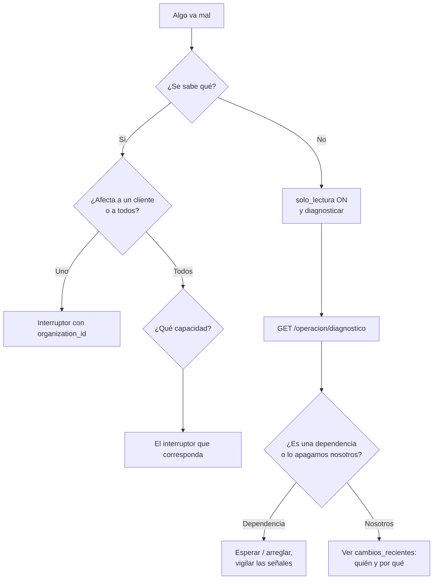

# Operación: qué apagar, en qué orden, y cómo se ve desde fuera

Runbook de la spec 13. Escrito para leerse **durante** un incidente: lo urgente
va arriba y las explicaciones abajo.

## Contención inmediata

Si no se sabe qué está pasando, **modo de solo lectura**. Se activa de una vez y
bloquea toda escritura conservando la consulta del histórico.

```bash
curl -X PUT "$API/api/v1/operacion/interruptores/solo_lectura" \
  -H "Authorization: Bearer $TOKEN" -H 'Content-Type: application/json' \
  -d '{"encendido": true, "motivo": "Incidente en curso, causa desconocida"}'
```

Efecto inmediato, sin desplegar. Ir apagando capacidades de a una mientras se
investiga deja huecos; esto no.

## Los cinco interruptores

| Capacidad | Apaga | Cuándo usarlo |
|---|---|---|
| `creacion` | Crear campañas nuevas | La Saga falla, o el preflight deja pasar algo que no debería |
| `write_back` | Pausar, ajustar presupuesto, cualquier escritura a Meta | Meta devuelve errores de escritura, o se sospecha de un bucle |
| `sync` | Traer datos de Meta | Las credenciales fallan en masa, o el sync satura la cuota |
| `ia` | Respuestas y textos del modelo | El proveedor está caído, o el gasto se disparó |
| `medios` | Subir fotos y videos | El disco se llena |

```bash
curl -X PUT "$API/api/v1/operacion/interruptores/write_back" \
  -H "Authorization: Bearer $TOKEN" -H 'Content-Type: application/json' \
  -d '{"encendido": false, "motivo": "Meta devolviendo 500 en /campaigns"}'
```

**Para una sola Organización**, añadir `"organization_id": "..."`. Lo específico
gana sobre lo global, así que también sirve para EXCLUIR a la cuenta piloto de
una contención global: apagar global y encender esa organización.

### Qué NO apagan

La consulta del histórico. No es que su interruptor esté encendido: es que no
tiene. Un cliente que mira lo que ya ocurrió no puede romper nada, y quitarle esa
consulta durante un incidente lo deja sin saber qué pasa con su dinero.

### Dónde se aplican

En el punto de **ejecución**, no en la API:

- `creacion` → `start_campaign_creation`, el único camino que comparten el
  formulario y el chat.
- `write_back` → el limitador de Meta, por donde pasan todas las escrituras,
  **incluidas las de las tareas ya encoladas**.
- `sync` → dentro de la tarea, junto a la comprobación de suspensión.
- `ia` → el borde de la llamada al modelo.
- `medios` → el servicio de carga, por donde pasan los tres endpoints.

Cortar solo la puerta de entrada deja la cola vaciándose sobre el problema que
se acaba de intentar contener.

## Árbol de decisión



## Diagnóstico

```bash
curl "$API/api/v1/operacion/diagnostico" -H "Authorization: Bearer $TOKEN"
```

Trae las señales funcionales, el estado de los interruptores y **quién movió qué
en los últimos diez cambios**. La primera pregunta de un incidente es «¿esto se
cayó o lo apagamos nosotros?», y responderla exige mirar las dos cosas a la vez.

El cliente ve otra cosa: `GET /operacion/aviso`, sin nombres de infraestructura,
que dice qué puede y qué no puede hacer ahora.

## Las señales y sus umbrales

Publicadas en `GET /operacion/senales`, **sin autenticación**, para que las lea
el vigilante externo.

| Señal | Alerta cuando |
|---|---|
| Antigüedad del último sync | > 26 h |
| Trabajos en cola | > 200 |
| Espera del más antiguo | > 30 min |
| Errores de Meta | > 20 % de las llamadas del día |
| Descartes de la guarda | > 25 % de las llamadas al modelo |
| Consumo de IA sobre el techo | > 90 % en alguna organización |
| Escrituras sin confirmar | ≥ 1 |
| Antigüedad del respaldo | > 30 h |
| Disco | > 90 % |
| Memoria | > 90 % |
| Dependencias | falta alguna |

Los umbrales viven en `app/services/senales.py`, junto a lo que miden. Ponerlos
en el sistema de alertas los separaría de su medición: quien lee el código no
sabría cuándo es demasiado, y quien configura la alerta no sabría qué mide.

**`desconocido` no es `ok`.** Una señal que no se pudo medir se declara así en
vez de darse por sana.

## El vigilante externo

`scripts/vigilante/vigilar.sh`, en **otra máquina**. Comprueba tres cosas:

1. Que el endpoint responda.
2. Que `generado_en` esté fresco.
3. Que no haya señales en alerta.

La segunda es la que se olvida y la que atrapa el caso peor: el servicio arriba
y el trabajo parado. Un endpoint que contesta con una marca de hace dos horas es
un proceso zombi.

```bash
LEJOVISTA_SENALES_URL=https://app.ejemplo.com/api/v1/operacion/senales \
LEJOVISTA_ALERTA_WEBHOOK=https://... \
./vigilar.sh
```

Con el VPS apagado no hay respuesta que leer, y esa ausencia es la alerta.

## Feature flags

Distintos de los interruptores, y no se mezclan: un interruptor se apaga en
mitad de un incidente y un flag se enciende para un rollout. Fusionarlos llenaría
la lista de «qué está apagado ahora» de flags de despliegue, y esa lista se lee
con prisa.

```bash
# Encender una capacidad solo para la cuenta piloto
curl -X PUT "$API/api/v1/operacion/flags/meta_version_candidata" \
  -H "Authorization: Bearer $TOKEN" -H 'Content-Type: application/json' \
  -d '{"activo": true, "ad_account_id": "..."}'
```

Resolución: cuenta → organización → global → valor predeterminado. El valor
predeterminado vive en `app/services/feature_flags.py`, junto al flag, para que
uno sin configurar tenga un valor conocido.

## Política de fallo

| Mecanismo | Si su almacén no responde |
|---|---|
| Interruptores | **Escrituras apagadas**, lectura del histórico sigue |
| Feature flags | Valor **predeterminado** |

La diferencia es deliberada. Un interruptor apagado contiene un incidente; un
flag apagado por accidente apaga una capacidad que llevaba meses funcionando
bien. El default de un flag es lo que el sistema hacía ayer.

## Métricas de producto

```bash
curl "$API/api/v1/operacion/metricas?dias=30" -H "Authorization: Bearer $TOKEN"
```

Tiempo hasta borrador, tiempo de revisión, aprobación sin cambios, errores
bloqueados antes de Meta, diferencia frente al baseline y uso del chat. Son las
que responden si el producto cumple su promesa.

Sin recorrido devuelven `null`, no cero: «sin datos» no es «cero minutos».

## Lo demás de este directorio

Estos documentos son de la spec 14 y no se leen durante un incidente, sino antes
de tocar producción:

- [`migraciones.md`](migraciones.md) — expandir ahora y contraer después, y qué
  hacer con los cambios que no admiten esa escalera: ventana de mantenimiento,
  modo de solo lectura y respaldo externo comprobado antes.
- [`dimensionado.md`](dimensionado.md) — el reparto de los 4 GB y 2 vCPU entre
  los ocho contenedores, y de dónde salen los números.
- [`preproduccion.md`](preproduccion.md) — por qué no hay staging permanente y
  qué se hace en su lugar para una actualización mayor de proveedor.
- [`despliegues/`](despliegues/) — evidencia fechada de smoke tests y ensayos.

El flujo de despliegue y el rollback están en
[`../deploy-runbook.md`](../deploy-runbook.md).
