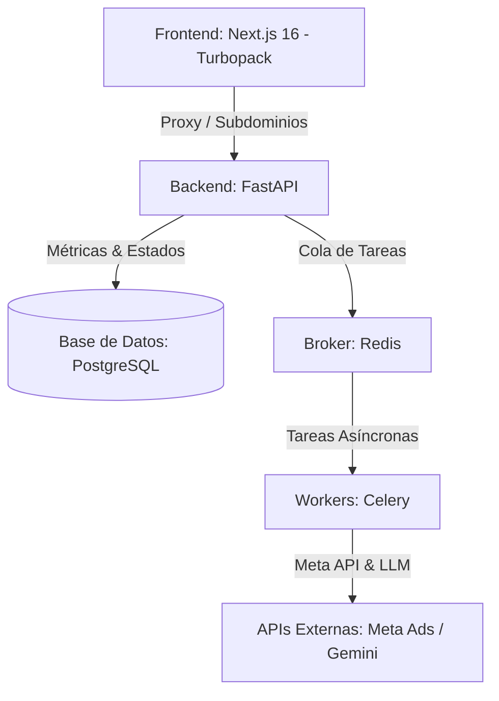

# Estado del Proyecto: LejoVista (SaaS Meta Ads Automation)

Este documento detalla el estado actual, el funcionamiento, el alcance y el roadmap de **LejoVista**, una plataforma SaaS multitenant diseñada para automatizar la recopilación, el análisis por Inteligencia Artificial y la ejecución segura de cambios en cuentas publicitarias de Meta Ads.

---

## 1. El Origen: Del Trabajo Manual a la Automatización

El diseño de LejoVista nace de la necesidad de automatizar y profesionalizar dos procesos críticos y propensos a errores humanos que anteriormente se ejecutaban de forma manual:

### A. La Fase de Diagnóstico y Análisis
* **Flujo Manual (`paso1DescargarInfoApi.md`)**: El analista debía ejecutar manualmente hasta 15 consultas `GET` de manera secuencial mediante scripts de consola. Para imitar el comportamiento humano y evitar que Meta bloqueara el token por comportamiento automatizado (patrón de bot), el analista tenía que programar pausas aleatorias variables de entre 12 y 75 segundos. Los datos crudos se usaban para generar de forma artesanal un archivo HTML estático denominado *Master Brief Ejecutivo*.
* **Automatización en LejoVista**: La plataforma cuenta con un servicio asíncrono (`MetaAdsSyncService`) orquestado por **Celery y Redis** que ejecuta de manera silenciosa y programada la descarga de métricas. Inyecta pausas variables automáticamente en segundo plano. Los datos se normalizan e introducen en una base de datos relacional para poder consumirse en tiempo real desde un panel interactivo.

### B. La Fase de Creación y Optimización de Campañas
* **Flujo Manual (`paso0crearCampañas.md`)**: Crear una campaña requería un protocolo de escritura estricto de 6 pasos (verificación de fondos, subida de imágenes, creación de campaña en estado pausado, adsets segmentados a Lima key:2771 excluyendo Instagram por alto coste, copy en formato gancho-bullets, y finalmente la creación del anuncio). Entre cada paso se requería una pausa obligatoria de 30-50 segundos, con un límite estricto de 3 campañas por sesión para proteger la cuenta.
* **Automatización en LejoVista**: Las sugerencias de optimización son analizadas y redactadas por la IA. El cliente revisa una **Cola de Acciones Sugeridas** directamente en su navegador. Al presionar "Aprobar", un ejecutor en el backend realiza las peticiones `POST` a la API de Meta Ads de forma asíncrona, aplicando automáticamente los retardos de seguridad anti-detección sin que el usuario tenga que esperar o hacerlo manualmente.

---

## 2. Arquitectura y Funcionamiento del Sistema

LejoVista se divide en tres capas tecnológicas integradas:

### 1. Frontend (Next.js 16 + TypeScript)
* **Diseño Premium**: Interfaz oscura con estética moderna de *glassmorphism* utilizando variables CSS nativas y tipografía premium (`Outfit` para encabezados y `Plus Jakarta Sans` para textos).
* **Multi-tenant Dinámico**: El frontend detecta el subdominio del cliente (ej. `cliente1.localhost` o `cliente1.lrojas.dev`) mediante un archivo `proxy.ts` (conforme a las convenciones de Next.js 16). Inyecta la cabecera `x-tenant-slug` en cada petición API para garantizar el aislamiento de datos por organización.

### 2. Backend (FastAPI + SQLAlchemy + PostgreSQL)
* **Modelos Relacionales**: Estructura robusta para el almacenamiento de Usuarios, Organizaciones (tenants), Cuentas Publicitarias conectadas (cuyos tokens de Meta se guardan cifrados con AES-256), Campañas de Anuncios, Historiales de métricas diarias e Historial de Acciones de la IA.
* **Seguridad en Iframe**: El backend soporta autorización a través de tokens en parámetros de consulta (`?token=...`), lo que permite que el reporte Master Brief en HTML cargue directamente dentro de un `iframe` seguro en la UI sin exponer errores de credenciales.

### 3. Motor de Inteligencia Artificial (AI Engine Pipeline)
La IA corre de manera asíncrona un proceso de análisis en **3 capas**:
* **Capa 1 (Reglas de Negocio)**: Filtra campañas con CPL (Costo por Lead) elevado (ej. mayor a S/.7.00) o que no registren conversiones.
* **Capa 2 (Estadísticas)**: Alertas sobre anomalías en el CTR (tasa de clics) o incrementos peligrosos en la frecuencia de anuncios (anuncios quemados).
* **Capa 3 (LLM - Gemini 2.5)**: Toma los hallazgos anteriores, los unifica y redacta un **Master Brief Narrativo** detallado que explica la situación y redacta copys optimizados. Paralelamente, genera propuestas de acciones estructuradas (ej. pausar campaña, disminuir presupuesto, o alertar sobre spend cap).

---

## 3. Alcance Actual del Producto (Entregable al Cliente)

El producto desarrollado cuenta con las siguientes capacidades listas para su despliegue:

* [x] **Aislamiento Multi-tenant**: Registro y Login de usuarios que crea automáticamente una organización aislada bajo un subdominio específico.
* [x] **Conexión de Cuentas**: Formulario seguro para ingresar credenciales de Meta Ads API (identificador de cuenta publicitaria y token de acceso de larga duración).
* [x] **Panel Ejecutivo (Dashboard)**: Tarjetas KPI consolidadas (Inversión acumulada, Leads captados, CPL histórico promedio, conteo de campañas activas) y tabla interactiva de campañas clasificadas por rendimiento (Ganadoras, Alertas, Fallidas).
* [x] **Reportes Narrativos Master Brief**: Visualización interactiva del brief del cliente de forma fluida directamente en la interfaz.
* [x] **Gestión de Alertas IA**: Listado de diagnósticos críticos o de advertencia con opción de descarte.
* [x] **Cola de Acciones (Aprobación Humana)**: Interfaz para aprobar/rechazar cambios en Meta Ads propuestos por la IA. El backend ejecuta de forma autónoma y asíncrona las llamadas a la API correspondientes.
* [x] **SEO Técnico y Accesibilidad**: Cumple con la jerarquía semántica de títulos (H1 para logo/SaaS, H2 para secciones), etiquetas `aria-label`, imágenes/iframes titulados y archivo `robots.txt` público.

---

## 4. Oportunidades de Mejora (Roadmap del Producto)

Para evolucionar el software de un MVP a una plataforma SaaS comercial escalable, se proponen las siguientes mejoras:

### Corto Plazo (Mejoras de UX y Feedback)
1. **Gráficos de Tendencias**: Implementación de gráficos interactivos (ej. Recharts) para visualizar desgloses de placements (Facebook vs Instagram), demográficos (edad/género) e históricos de CPL directamente en el dashboard, reduciendo la dependencia del iframe del reporte breve.
2. **WebSockets para Estado en Tiempo Real**: Añadir WebSockets o Server-Sent Events (SSE) para notificar al usuario de forma instantánea cuando una sincronización en segundo plano de Meta Ads o una tarea de ejecución de campaña de Celery haya culminado con éxito.

### Mediano Plazo (IA y Funcionalidad Adicional)
3. **Editor Interactivo de Copys Ganadores**: Una sección dentro de la cola de acciones que permita al cliente modificar/corregir el copy sugerido por la IA en un cuadro de texto antes de aprobar y subir el anuncio a Meta.
4. **Historial Comparativo de Versiones de Brief**: Mantener un control de cambios de los briefs narrativos generados por la IA en base a los periodos anteriores (ej. Brief de Junio vs Julio) para realizar análisis de atribución a largo plazo.

### Largo Plazo (SaaS Comercial)
5. **Pasarela de Pagos (Stripe)**: Integración de suscripciones y control de accesos basados en planes (ej. Plan Básico: 1 cuenta publicitaria, Plan Pro: análisis ilimitado e integraciones de WhatsApp).
